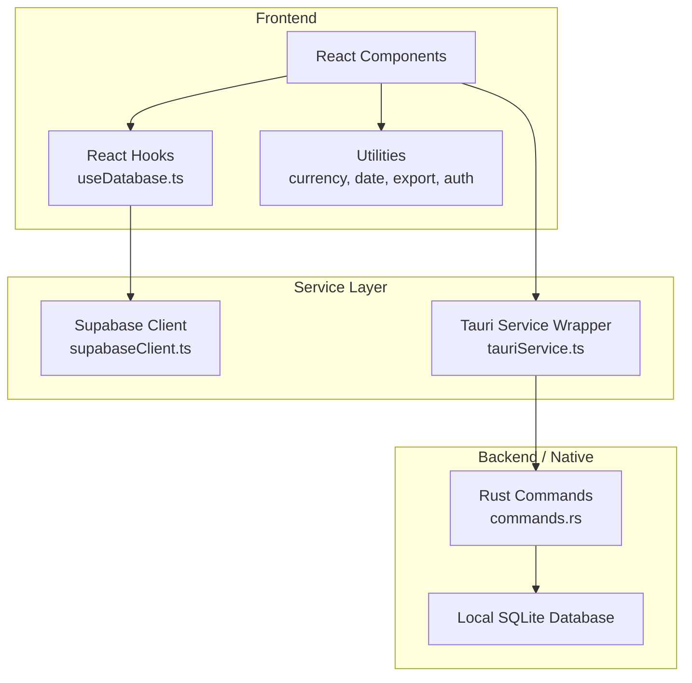
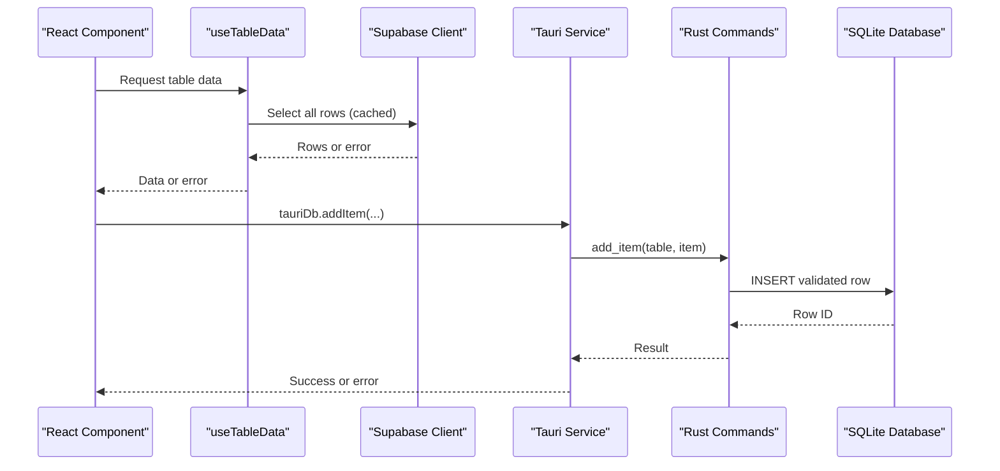
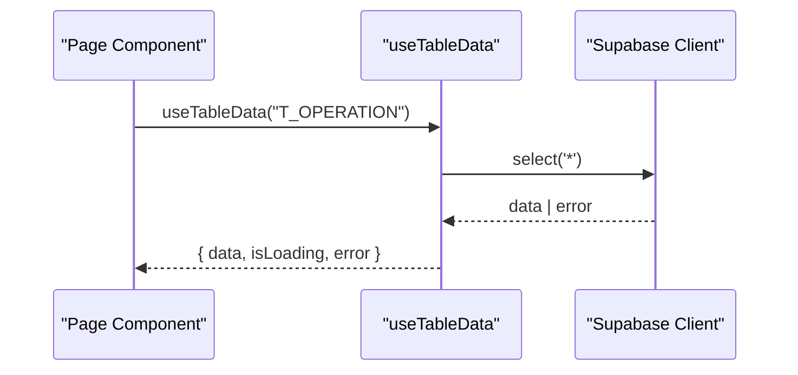
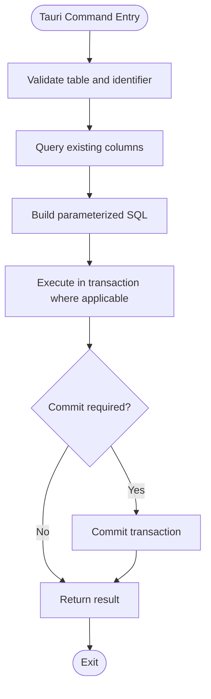
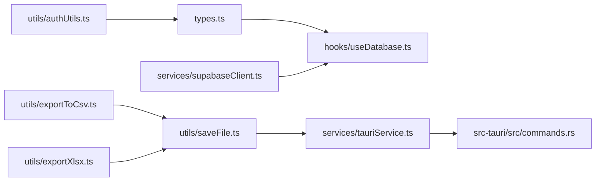

# API Reference

<cite>
**Referenced Files in This Document**
- [supabaseClient.ts](file://services/supabaseClient.ts)
- [database.ts](file://services/database.ts)
- [tauriService.ts](file://services/tauriService.ts)
- [commands.rs](file://src-tauri/src/commands.rs)
- [authUtils.ts](file://utils/authUtils.ts)
- [currencyUtils.ts](file://utils/currencyUtils.ts)
- [dateUtils.ts](file://utils/dateUtils.ts)
- [exportToCsv.ts](file://utils/exportToCsv.ts)
- [exportXlsx.ts](file://utils/exportXlsx.ts)
- [saveFile.ts](file://utils/saveFile.ts)
- [errorMessage.ts](file://utils/errorMessage.ts)
- [useDatabase.ts](file://hooks/useDatabase.ts)
- [types.ts](file://types.ts)
</cite>

## Table of Contents
1. [Introduction](#introduction)
2. [Project Structure](#project-structure)
3. [Core Components](#core-components)
4. [Architecture Overview](#architecture-overview)
5. [Detailed Component Analysis](#detailed-component-analysis)
6. [Dependency Analysis](#dependency-analysis)
7. [Performance Considerations](#performance-considerations)
8. [Troubleshooting Guide](#troubleshooting-guide)
9. [Conclusion](#conclusion)
10. [Appendices](#appendices)

## Introduction
This document describes GOFT3’s service-layer APIs that connect the React frontend to backend and native capabilities. It covers:
- Supabase client configuration, data access patterns, and query usage through React hooks.
- Tauri command APIs for local SQLite database operations, file system interactions, backup import/export, and window management.
- Utility APIs for currency formatting, date normalization, export helpers, and authentication utilities.
- Protocol-specific integration examples from React components, error handling strategies, performance tips, security considerations, and debugging guidance.

The goal is to help frontend developers extend the API surface safely while maintaining consistent behavior across browser and desktop environments.

## Project Structure
GOFT3 organizes its service layer into three main areas:
- Services: Supabase client setup and Tauri command wrappers.
- Utilities: Formatting, export, and authentication helpers.
- Hooks: React Query-based data fetching over Supabase.

**Diagram sources**
- [supabaseClient.ts:1-37](file://services/supabaseClient.ts#L1-L37)
- [tauriService.ts:1-102](file://services/tauriService.ts#L1-L102)
- [commands.rs:1-791](file://src-tauri/src/commands.rs#L1-L791)
- [useDatabase.ts:1-59](file://hooks/useDatabase.ts#L1-L59)

**Section sources**
- [supabaseClient.ts:1-37](file://services/supabaseClient.ts#L1-L37)
- [tauriService.ts:1-102](file://services/tauriService.ts#L1-L102)
- [commands.rs:1-791](file://src-tauri/src/commands.rs#L1-L791)
- [useDatabase.ts:1-59](file://hooks/useDatabase.ts#L1-L59)

## Core Components
This section summarizes the primary API surfaces exposed to React components.

### Supabase Client Configuration and Data Access
- The Supabase client is created only when a valid URL and key are stored in localStorage; otherwise it is null to avoid initialization errors.
- Configuration can be saved or reset via helper functions that update localStorage and reload the app.
- React hooks use this client to fetch table data and summaries with caching and selective column projection.

Key responsibilities:
- Validate and store Supabase credentials.
- Provide a safe supabase instance.
- Expose configuration persistence helpers.

**Section sources**
- [supabaseClient.ts:1-37](file://services/supabaseClient.ts#L1-L37)
- [useDatabase.ts:1-59](file://hooks/useDatabase.ts#L1-L59)

### Tauri Command Wrappers
- The Tauri service detects whether the app runs inside Tauri and wraps native commands using a safe invoke helper.
- It exposes methods for database CRUD, cascade delete, reset, import/export, backup save/read, SQLite export, Supabase-to-SQLite export, and local DB path retrieval.
- All commands validate tables and identifiers on the Rust side before executing SQL.

Key responsibilities:
- Environment detection.
- Safe invocation of Rust commands.
- Strongly typed wrappers for database operations.

**Section sources**
- [tauriService.ts:1-102](file://services/tauriService.ts#L1-L102)
- [commands.rs:1-791](file://src-tauri/src/commands.rs#L1-L791)

### Utility APIs
- Currency utilities format amounts, parse inputs, and convert numbers to Arabic words.
- Date utilities normalize various input formats, parse dates, compare them, compute elapsed days, and format durations.
- Export utilities generate Excel-compatible files and save blobs either via Tauri dialog or browser anchor fallback.
- Authentication utilities provide password hashing, verification with migration support, and default admin hash checks.

**Section sources**
- [currencyUtils.ts:1-168](file://utils/currencyUtils.ts#L1-L168)
- [dateUtils.ts:1-147](file://utils/dateUtils.ts#L1-L147)
- [exportToCsv.ts:1-46](file://utils/exportToCsv.ts#L1-L46)
- [exportXlsx.ts:1-15](file://utils/exportXlsx.ts#L1-L15)
- [saveFile.ts:1-42](file://utils/saveFile.ts#L1-L42)
- [authUtils.ts:1-71](file://utils/authUtils.ts#L1-L71)

## Architecture Overview
The application uses a layered architecture:
- Frontend React components call hooks and utility functions.
- Hooks interact with the Supabase client for cloud data.
- Tauri service wrappers call Rust commands for local data and native features.
- Rust commands operate on a local SQLite database and enforce schema constraints.

**Diagram sources**
- [useDatabase.ts:5-16](file://hooks/useDatabase.ts#L5-L16)
- [supabaseClient.ts:22-24](file://services/supabaseClient.ts#L22-L24)
- [tauriService.ts:24-36](file://services/tauriService.ts#L24-L36)
- [commands.rs:445-492](file://src-tauri/src/commands.rs#L445-L492)

## Detailed Component Analysis

### Supabase Client API
Configuration and state:
- `isConfigured`: boolean indicating whether Supabase URL and key are present and valid.
- `supabase`: client instance or null if not configured.
- `saveConfiguration(url, key)`: stores credentials and reloads the page.
- `resetConfiguration()`: clears credentials and reloads the page.

Usage patterns:
- Always check `supabase` before querying.
- Use hooks for automatic caching and refetching.

Error handling:
- If `supabase` is null, throw a clear error message.
- Propagate Supabase errors to UI via toast or error boundary.

Security considerations:
- Store credentials in localStorage only in trusted environments.
- Avoid logging secrets.

**Section sources**
- [supabaseClient.ts:1-37](file://services/supabaseClient.ts#L1-L37)

#### React Hook: useTableData
Purpose:
- Fetches all rows for a given table name with React Query caching.

Parameters:
- `tableName`: one of the keys in the `Database` type.

Returns:
- Query result containing data typed as the corresponding table array.

Example flow:

**Diagram sources**
- [useDatabase.ts:5-16](file://hooks/useDatabase.ts#L5-L16)
- [supabaseClient.ts:22-24](file://services/supabaseClient.ts#L22-L24)

**Section sources**
- [useDatabase.ts:1-59](file://hooks/useDatabase.ts#L1-L59)

### Tauri Command API
Environment detection:
- `isTauri()`: returns true if running in Tauri by checking global objects.

Safe invoke wrapper:
- `invokeTauri<T>(cmd, args)`: dynamically imports Tauri core and invokes commands with error logging.

Database operations:
- `getDatabase()`: exports the full local database as JSON.
- `addItem(table, item)`: inserts a row, skipping auto-increment PK and unknown columns.
- `upsertItem(table, item)`: inserts or replaces a row preserving explicit primary keys.
- `updateItem(table, idField, id, item)`: updates fields excluding the PK and unknown columns.
- `deleteItem(table, idField, id)`: deletes a row by validated ID field.
- `deleteOperationCascade(operationId)`: deletes an operation row within a transaction.
- `resetDatabase()`: clears all data and seeds a default admin user.
- `importDatabase(dbJson)`: bulk imports dataset, skipping invalid rows and unknown columns.
- `exportDatabase()`: alias for `getDatabase`.
- `saveBackup(content, path, passphrase)`: writes AES-256-GCM encrypted backup with PBKDF2-derived key.
- `readBackup(path, passphrase?)`: reads encrypted or legacy plain backups.
- `exportSqliteDb(path)`: creates a clean SQLite snapshot using VACUUM INTO.
- `exportSupabaseSqlite(path, dbJson)`: builds a new SQLite file with official schema and inserts Supabase rows.
- `getLocalDbPath()`: returns the active SQLite database path.

Window management:
- `set_window_close_enabled(enabled)`: enables/disables native close button.
- `close_window()`: closes the main window programmatically.

File system operations:
- `save_binary_file(path, contents)`: writes binary content to disk, creating directories as needed.

Validation and safety:
- Allowed tables list restricts operations to known entities.
- Identifier validation prevents SQL injection via unsafe names.
- Column filtering ensures only existing schema fields are used.

**Diagram sources**
- [commands.rs:52-81](file://src-tauri/src/commands.rs#L52-L81)
- [commands.rs:168-178](file://src-tauri/src/commands.rs#L168-L178)
- [commands.rs:445-492](file://src-tauri/src/commands.rs#L445-L492)
- [commands.rs:494-548](file://src-tauri/src/commands.rs#L494-L548)
- [commands.rs:550-572](file://src-tauri/src/commands.rs#L550-L572)
- [commands.rs:594-638](file://src-tauri/src/commands.rs#L594-L638)
- [commands.rs:644-790](file://src-tauri/src/commands.rs#L644-L790)

**Section sources**
- [tauriService.ts:1-102](file://services/tauriService.ts#L1-L102)
- [commands.rs:1-791](file://src-tauri/src/commands.rs#L1-L791)

### Utility APIs

#### Currency Utilities
Functions:
- `formatCurrency(amount)`: formats number to localized decimal string.
- `formatCurrencyForInput(amount)`: formats without grouping for editing.
- `parseCurrency(input)`: parses formatted or raw numeric strings.
- `formatAmountInput(value)`: normalizes decimal separators during input.
- `numberToArabicWords(number)`: converts amount to Arabic text with Algerian Dinars and Centimes.

Complexity:
- Parsing and formatting are O(n) relative to input length.
- Arabic conversion processes integer and decimal parts with constant-time arithmetic per digit group.

Use cases:
- Displaying financial values consistently.
- Handling user input robustly across locales.

**Section sources**
- [currencyUtils.ts:1-168](file://utils/currencyUtils.ts#L1-L168)

#### Date Utilities
Functions:
- `normalizeDate(dateStr)`: handles Excel serials, ISO dates, and DD-MM-YYYY formats.
- `parseDate(dateStr)`: converts normalized strings to Date objects.
- `compareDates(d1, d2)`: compares two date strings.
- `getCurrentDate()`: returns current date in DD/MM/YYYY.
- `formatDate(date)`: formats Date to DD/MM/YYYY.
- `isFinancialDuration(durationStr)`: detects month-based durations.
- `getEffectiveDurationDays(durationStr)`: computes effective days using financial rules.
- `calculateElapsedDays(start, end, useFinancialRule)`: calculates calendar or 30/360 elapsed days.
- `formatDurationArabic(durationStr)`: formats duration in Arabic.

Algorithm highlights:
- Financial rule applies 30 days per month for duration calculations.
- Robust parsing supports multiple input formats.

**Section sources**
- [dateUtils.ts:1-147](file://utils/dateUtils.ts#L1-L147)

#### Export Utilities
Functions:
- `exportToFormattedExcel(htmlContent, filename)`: generates an HTML-based Excel file with UTF-8 BOM and right-to-left worksheet options.
- `saveWorkbook(workbook, filename)`: serializes an ExcelJS workbook to .xlsx and saves via shared mechanism.
- `saveBlobToFile(blob, suggestedName)`: uses Tauri save dialog and native write in desktop; falls back to Blob anchor download in browsers.

Integration notes:
- In Tauri, downloads are blocked by WebView; native dialog + Rust command is required.
- Ensure filenames have correct extensions for Excel compatibility.

**Section sources**
- [exportToCsv.ts:1-46](file://utils/exportToCsv.ts#L1-L46)
- [exportXlsx.ts:1-15](file://utils/exportXlsx.ts#L1-L15)
- [saveFile.ts:1-42](file://utils/saveFile.ts#L1-L42)

#### Authentication Utilities
Functions:
- `DEFAULT_ADMIN_PASSWORD_HASH`: predefined bcrypt hash for seeded default admin password.
- `isDefaultPasswordHash(storedHash)`: checks if stored hash matches default.
- `legacySha256(password)`: computes SHA-256 for backward compatibility.
- `hashPassword(password)`: modern bcrypt hashing in browser environment.
- `verifyPassword(password, storedHash)`: verifies passwords against bcrypt or legacy hashes and indicates rehash needs.

Migration strategy:
- Supports seamless migration from legacy SHA-256 or plaintext to bcrypt.
- Returns `needsRehash` flag to trigger secure storage updates.

Security considerations:
- Prefer bcrypt for new passwords.
- Avoid storing plaintext or weak hashes.
- Enforce minimum passphrase requirements for backups.

**Section sources**
- [authUtils.ts:1-71](file://utils/authUtils.ts#L1-L71)

### Error Handling Utilities
Function:
- `errorMessage(err, fallback)`: extracts human-readable messages from errors, including Tauri strings, Supabase objects, and nested structures.

Usage:
- Centralize error display logic to show meaningful causes instead of generic messages.

**Section sources**
- [errorMessage.ts:1-29](file://utils/errorMessage.ts#L1-L29)

## Dependency Analysis
The following diagram shows how modules depend on each other:

**Diagram sources**
- [useDatabase.ts:1-59](file://hooks/useDatabase.ts#L1-L59)
- [supabaseClient.ts:1-37](file://services/supabaseClient.ts#L1-L37)
- [tauriService.ts:1-102](file://services/tauriService.ts#L1-L102)
- [commands.rs:1-791](file://src-tauri/src/commands.rs#L1-L791)
- [saveFile.ts:1-42](file://utils/saveFile.ts#L1-L42)
- [exportToCsv.ts:1-46](file://utils/exportToCsv.ts#L1-L46)
- [exportXlsx.ts:1-15](file://utils/exportXlsx.ts#L1-L15)
- [authUtils.ts:1-71](file://utils/authUtils.ts#L1-L71)
- [types.ts:1-269](file://types.ts#L1-L269)

**Section sources**
- [useDatabase.ts:1-59](file://hooks/useDatabase.ts#L1-L59)
- [supabaseClient.ts:1-37](file://services/supabaseClient.ts#L1-L37)
- [tauriService.ts:1-102](file://services/tauriService.ts#L1-L102)
- [commands.rs:1-791](file://src-tauri/src/commands.rs#L1-L791)
- [saveFile.ts:1-42](file://utils/saveFile.ts#L1-L42)
- [exportToCsv.ts:1-46](file://utils/exportToCsv.ts#L1-L46)
- [exportXlsx.ts:1-15](file://utils/exportXlsx.ts#L1-L15)
- [authUtils.ts:1-71](file://utils/authUtils.ts#L1-L71)
- [types.ts:1-269](file://types.ts#L1-L269)

## Performance Considerations
- Caching: React Query caches table data for five minutes; adjust staleTime based on update frequency.
- Selective columns: Summary queries select only necessary columns to reduce payload size.
- Bulk operations: Import and export commands use transactions and schema-aware column filtering to minimize failures and improve throughput.
- File I/O: Use Tauri native dialogs and Rust file writes to avoid WebView download restrictions and ensure reliable saving.
- Validation overhead: Table and identifier validation prevent expensive SQL errors; keep allowed tables minimal and precise.

[No sources needed since this section provides general guidance]

## Troubleshooting Guide
Common issues and resolutions:
- Supabase not configured:
  - Symptom: Queries fail because `supabase` is null.
  - Resolution: Call `saveConfiguration(url, key)` and reload the app.
- Tauri invoke failed:
  - Symptom: Errors logged when calling native commands.
  - Resolution: Verify command names and argument shapes; check Rust logs for validation errors.
- Backup passphrase errors:
  - Symptom: Read backup fails with passphrase requirement or decryption failure.
  - Resolution: Ensure passphrase meets minimum length and matches the encryption used during save.
- Export failures:
  - Symptom: Excel files not opening or corrupted.
  - Resolution: Ensure correct MIME types and extensions; verify UTF-8 BOM for Arabic content.
- Error message clarity:
  - Use `errorMessage` to extract readable causes from diverse error shapes.

**Section sources**
- [supabaseClient.ts:26-36](file://services/supabaseClient.ts#L26-L36)
- [tauriService.ts:14-22](file://services/tauriService.ts#L14-L22)
- [commands.rs:228-254](file://src-tauri/src/commands.rs#L228-L254)
- [exportToCsv.ts:6-45](file://utils/exportToCsv.ts#L6-L45)
- [errorMessage.ts:1-29](file://utils/errorMessage.ts#L1-L29)

## Conclusion
GOFT3’s service layer provides a robust bridge between React components and both cloud and native backends. The Supabase client offers configurable data access, while Tauri commands deliver secure, schema-aware local operations and file system integration. Utility APIs standardize formatting, exports, and authentication flows. By following the documented patterns, developers can extend the API surface safely, handle errors gracefully, and optimize performance across environments.

[No sources needed since this section summarizes without analyzing specific files]

## Appendices

### API Surface Summary

#### Supabase Client
- `isConfigured`: boolean
- `supabase`: client or null
- `saveConfiguration(url, key)`: void
- `resetConfiguration()`: void

#### Tauri Service
- `isTauri()`: boolean
- `tauriDb.getDatabase()`: Promise<Database>
- `tauriDb.addItem(table, item)`: Promise<number>
- `tauriDb.upsertItem(table, item)`: Promise<number>
- `tauriDb.updateItem(table, idField, id, item)`: Promise<boolean>
- `tauriDb.deleteItem(table, idField, id)`: Promise<boolean>
- `tauriDb.deleteOperationCascade(operationId)`: Promise<boolean>
- `tauriDb.resetDatabase()`: Promise<boolean>
- `tauriDb.importDatabase(dbJson)`: Promise<number>
- `tauriDb.exportDatabase()`: Promise<Database>
- `tauriDb.saveBackup(content, path, passphrase)`: Promise<void>
- `tauriDb.readBackup(path, passphrase?)`: Promise<string>
- `tauriDb.exportSqliteDb(path)`: Promise<void>
- `tauriDb.exportSupabaseSqlite(path, dbJson)`: Promise<number>
- `tauriDb.getLocalDbPath()`: Promise<string>

#### Utilities
- Currency: `formatCurrency`, `formatCurrencyForInput`, `parseCurrency`, `formatAmountInput`, `numberToArabicWords`
- Date: `normalizeDate`, `parseDate`, `compareDates`, `getCurrentDate`, `formatDate`, `isFinancialDuration`, `getEffectiveDurationDays`, `calculateElapsedDays`, `formatDurationArabic`
- Export: `exportToFormattedExcel`, `saveWorkbook`, `saveBlobToFile`
- Auth: `DEFAULT_ADMIN_PASSWORD_HASH`, `isDefaultPasswordHash`, `legacySha256`, `hashPassword`, `verifyPassword`

**Section sources**
- [supabaseClient.ts:1-37](file://services/supabaseClient.ts#L1-L37)
- [tauriService.ts:1-102](file://services/tauriService.ts#L1-L102)
- [currencyUtils.ts:1-168](file://utils/currencyUtils.ts#L1-L168)
- [dateUtils.ts:1-147](file://utils/dateUtils.ts#L1-L147)
- [exportToCsv.ts:1-46](file://utils/exportToCsv.ts#L1-L46)
- [exportXlsx.ts:1-15](file://utils/exportXlsx.ts#L1-L15)
- [saveFile.ts:1-42](file://utils/saveFile.ts#L1-L42)
- [authUtils.ts:1-71](file://utils/authUtils.ts#L1-L71)