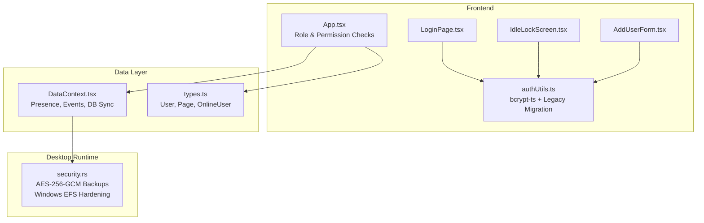
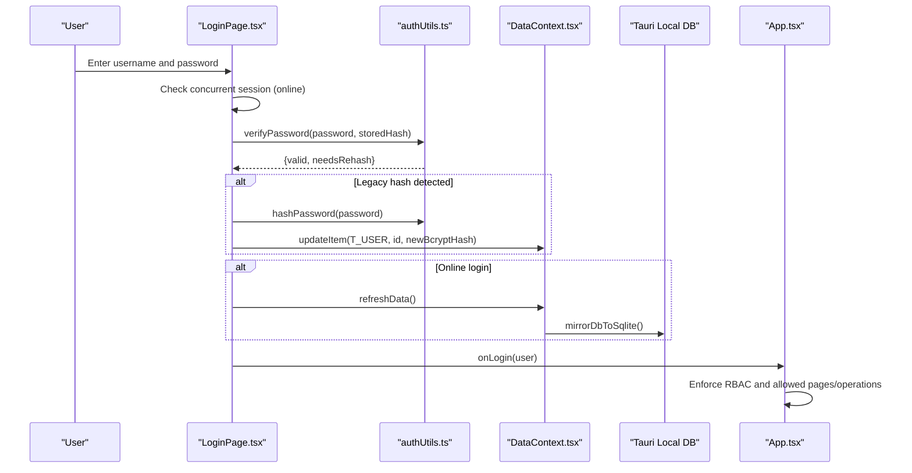
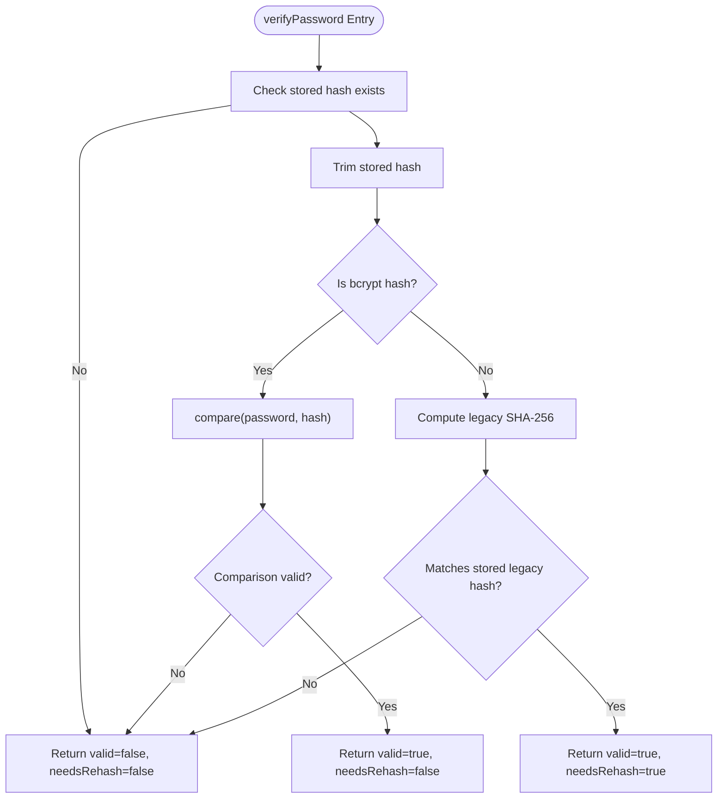
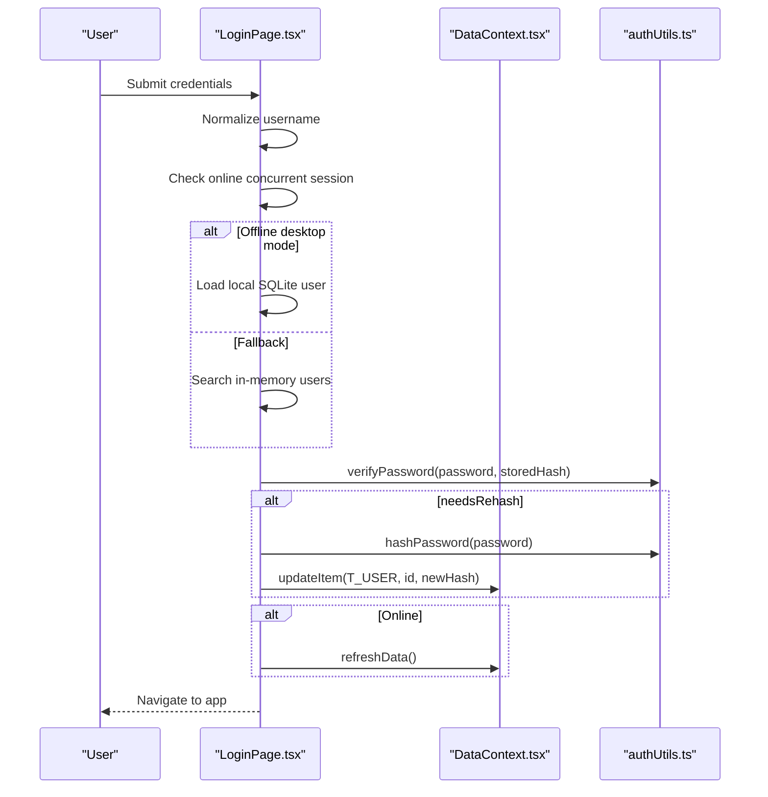
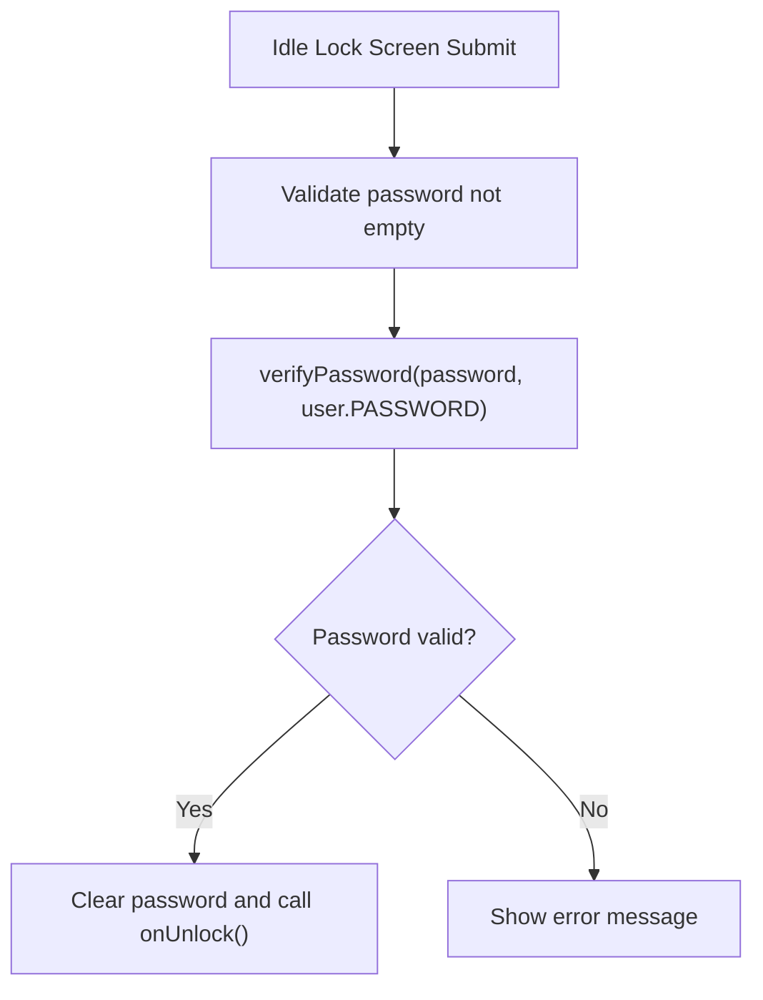
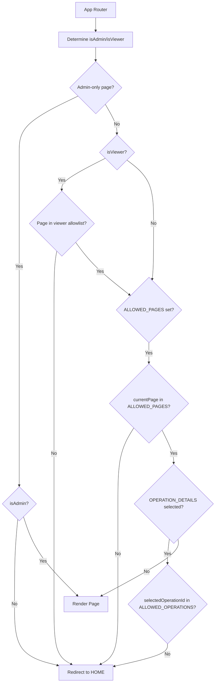
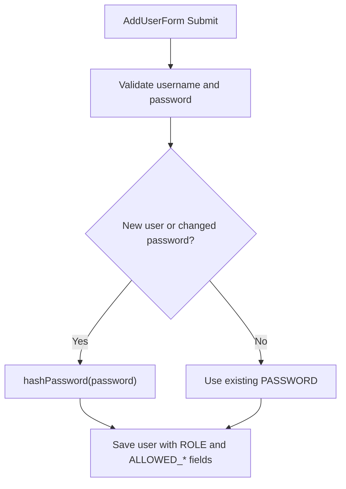
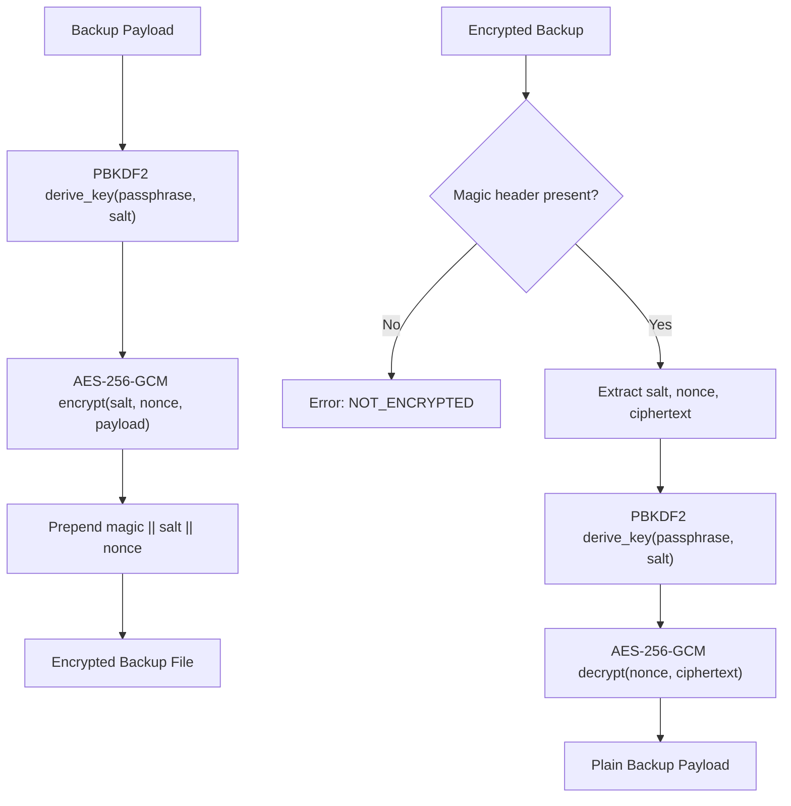
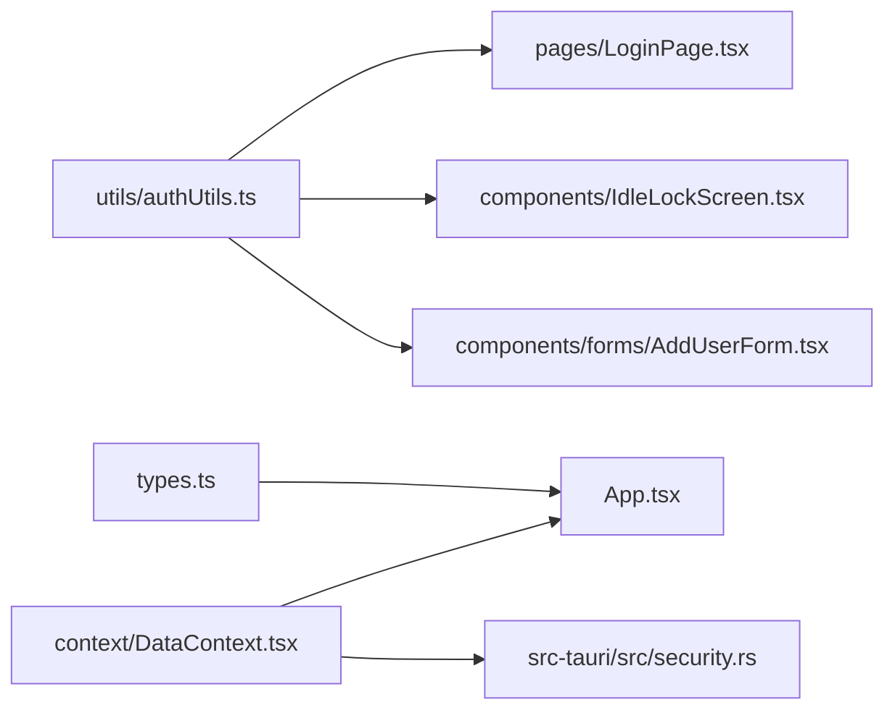

# Authentication & Security

<cite>
**Referenced Files in This Document**   
- [authUtils.ts](file://utils/authUtils.ts)
- [LoginPage.tsx](file://pages/LoginPage.tsx)
- [IdleLockScreen.tsx](file://components/IdleLockScreen.tsx)
- [types.ts](file://types.ts)
- [App.tsx](file://App.tsx)
- [DataContext.tsx](file://context/DataContext.tsx)
- [AddUserForm.tsx](file://components/forms/AddUserForm.tsx)
- [security.rs](file://src-tauri/src/security.rs)
</cite>

## Table of Contents
1. [Introduction](#introduction)
2. [Project Structure](#project-structure)
3. [Core Components](#core-components)
4. [Architecture Overview](#architecture-overview)
5. [Detailed Component Analysis](#detailed-component-analysis)
6. [Dependency Analysis](#dependency-analysis)
7. [Performance Considerations](#performance-considerations)
8. [Troubleshooting Guide](#troubleshooting-guide)
9. [Conclusion](#conclusion)

## Introduction
This document explains GOFT3’s authentication and security model for protecting sensitive financial data. It covers the user login and logout flow, password hashing with bcrypt-ts, session management including idle timeout protection, role-based access control, permission checking, user administration, and local data protection. The content combines conceptual overviews with technical implementation details so both security practitioners and developers can understand and extend the system safely.

## Project Structure
GOFT3 implements authentication and authorization across frontend React components, shared utilities, application routing logic, and a Tauri-backed local security layer:

- Frontend authentication UI and flows:
  - Login page handles credential verification, concurrent session checks, and automatic migration to bcrypt hashes.
  - Idle lock screen re-authenticates users after inactivity.
- Shared security utilities:
  - Password hashing and verification utilities using bcrypt-ts with legacy SHA-256 migration support.
- Role-based access control:
  - Application router enforces admin-only pages, viewer restrictions, and per-user allowed pages and operations.
- User administration:
  - User creation form hashes passwords and assigns roles and granular permissions.
- Local data protection:
  - Tauri Rust module provides AES-256-GCM encrypted backups and Windows EFS hardening for local SQLite files.

**Diagram sources**
- [LoginPage.tsx:31-146](file://pages/LoginPage.tsx#L31-L146)
- [IdleLockScreen.tsx:21-39](file://components/IdleLockScreen.tsx#L21-L39)
- [AuthUtils.ts:1-70](file://utils/authUtils.ts#L1-L70)
- [App.tsx:238-320](file://App.tsx#L238-L320)
- [DataContext.tsx:1098-1134](file://context/DataContext.tsx#L1098-L1134)
- [security.rs:1-131](file://src-tauri/src/security.rs#L1-L131)

**Section sources**
- [LoginPage.tsx:31-146](file://pages/LoginPage.tsx#L31-L146)
- [IdleLockScreen.tsx:21-39](file://components/IdleLockScreen.tsx#L21-L39)
- [authUtils.ts:1-70](file://utils/authUtils.ts#L1-L70)
- [App.tsx:238-320](file://App.tsx#L238-L320)
- [DataContext.tsx:1098-1134](file://context/DataContext.tsx#L1098-L1134)
- [security.rs:1-131](file://src-tauri/src/security.rs#L1-L131)

## Core Components
- Password hashing and verification:
  - bcrypt-ts is used for secure hashing and comparison.
  - Legacy SHA-256 hashes are supported for backward compatibility; successful legacy logins trigger automatic migration to bcrypt.
- Login flow:
  - Prevents concurrent sessions for the same username when online.
  - Verifies credentials against stored hashes (bcrypt or legacy).
  - Auto-migrates legacy hashes to bcrypt on successful login.
  - Mirrors cloud data into local SQLite after successful online login.
- Session and idle protection:
  - Idle lock screen requires password re-entry after inactivity to protect financial data.
- Role-based access control:
  - Admin-only pages and viewer page allowlists are enforced at the router level.
  - Per-user allowed pages and operations restrict navigation and record-level access.
- User administration:
  - New users are created with hashed passwords and assigned roles and optional fine-grained permissions.
- Local data protection:
  - Encrypted backups using AES-256-GCM with PBKDF2 key derivation.
  - Windows EFS encryption for local SQLite database files.

**Section sources**
- [authUtils.ts:1-70](file://utils/authUtils.ts#L1-L70)
- [LoginPage.tsx:31-146](file://pages/LoginPage.tsx#L31-L146)
- [IdleLockScreen.tsx:21-39](file://components/IdleLockScreen.tsx#L21-L39)
- [App.tsx:238-320](file://App.tsx#L238-L320)
- [AddUserForm.tsx:69-99](file://components/forms/AddUserForm.tsx#L69-L99)
- [security.rs:1-131](file://src-tauri/src/security.rs#L1-L131)

## Architecture Overview
The authentication architecture integrates browser-side React components with a Tauri runtime for local data protection. The login process validates credentials against stored hashes, manages presence and events via Supabase channels, and enforces RBAC at the application router. Idle sessions are locked and require re-authentication.

**Diagram sources**
- [LoginPage.tsx:31-146](file://pages/LoginPage.tsx#L31-L146)
- [authUtils.ts:28-70](file://utils/authUtils.ts#L28-L70)
- [DataContext.tsx:357-369](file://context/DataContext.tsx#L357-L369)
- [App.tsx:238-320](file://App.tsx#L238-L320)

## Detailed Component Analysis

### Password Hashing and Verification
GOFT3 uses bcrypt-ts for modern password hashing and supports seamless migration from legacy SHA-256 hashes. The verification function detects bcrypt hashes and compares them securely; if a legacy hash matches, it returns a flag indicating that the password should be migrated to bcrypt.

Key behaviors:
- bcrypt-ts hashing with configurable salt rounds.
- Legacy SHA-256 compatibility for existing accounts.
- Automatic migration triggered during login when legacy hashes are detected.

**Diagram sources**
- [authUtils.ts:36-70](file://utils/authUtils.ts#L36-L70)

**Section sources**
- [authUtils.ts:1-70](file://utils/authUtils.ts#L1-L70)

### Login Flow and Concurrent Session Protection
The login page performs several security checks before granting access:
- Blocks concurrent sessions for the same username when online.
- Prefers local SQLite credentials in offline desktop mode.
- Falls back to in-memory users and triggers a full refresh if needed.
- Verifies passwords using the utility functions.
- Migrates legacy hashes to bcrypt automatically.
- Mirrors cloud data into local SQLite after successful online login.

**Diagram sources**
- [LoginPage.tsx:31-146](file://pages/LoginPage.tsx#L31-L146)
- [authUtils.ts:36-70](file://utils/authUtils.ts#L36-L70)
- [DataContext.tsx:357-369](file://context/DataContext.tsx#L357-L369)

**Section sources**
- [LoginPage.tsx:31-146](file://pages/LoginPage.tsx#L31-L146)

### Idle Lock Screen and Session Timeout Protection
The idle lock screen protects sensitive financial data by requiring password re-entry after inactivity. It verifies the current user’s password using the same hashing utilities and prevents unauthorized access until unlocked.

Key behaviors:
- Focuses input automatically.
- Disables submit while verifying.
- Uses verifyPassword to validate the unlock attempt.
- Displays localized error messages.

**Diagram sources**
- [IdleLockScreen.tsx:21-39](file://components/IdleLockScreen.tsx#L21-L39)
- [authUtils.ts:36-70](file://utils/authUtils.ts#L36-L70)

**Section sources**
- [IdleLockScreen.tsx:1-81](file://components/IdleLockScreen.tsx#L1-L81)

### Role-Based Access Control and Permission Checking
GOFT3 enforces RBAC at the application router:
- Admin-only pages are restricted to users with ROLE 'admin'.
- Viewer users have a predefined allowlist of pages.
- Non-admin users can have custom ALLOWED_PAGES restricting navigation.
- Record-level access control checks ALLOWED_OPERATIONS for operation-specific pages.

**Diagram sources**
- [App.tsx:238-320](file://App.tsx#L238-L320)

**Section sources**
- [App.tsx:238-320](file://App.tsx#L238-L320)

### User Administration and Role Assignment
The user creation form supports:
- Creating users with hashed passwords.
- Assigning roles ('admin', 'user', 'viewer').
- Setting per-user allowed pages and operations for non-admin users.
- Preserving existing passwords when editing without changes.

**Diagram sources**
- [AddUserForm.tsx:69-99](file://components/forms/AddUserForm.tsx#L69-L99)
- [authUtils.ts:28-30](file://utils/authUtils.ts#L28-L30)

**Section sources**
- [AddUserForm.tsx:35-99](file://components/forms/AddUserForm.tsx#L35-L99)

### Local Data Protection and Backup Encryption
GOFT3’s Tauri security module provides:
- AES-256-GCM encryption for backups with PBKDF2-HMAC-SHA256 key derivation.
- Detection of encrypted vs. plain backups.
- Windows EFS encryption for local SQLite database files.

**Diagram sources**
- [security.rs:23-64](file://src-tauri/src/security.rs#L23-L64)

**Section sources**
- [security.rs:1-131](file://src-tauri/src/security.rs#L1-L131)

## Dependency Analysis
Authentication and security dependencies span frontend utilities, React components, application context, and Tauri runtime:

**Diagram sources**
- [authUtils.ts:1-70](file://utils/authUtils.ts#L1-L70)
- [LoginPage.tsx:31-146](file://pages/LoginPage.tsx#L31-L146)
- [IdleLockScreen.tsx:21-39](file://components/IdleLockScreen.tsx#L21-L39)
- [AddUserForm.tsx:69-99](file://components/forms/AddUserForm.tsx#L69-L99)
- [types.ts:9-16](file://types.ts#L9-L16)
- [App.tsx:238-320](file://App.tsx#L238-L320)
- [DataContext.tsx:1098-1134](file://context/DataContext.tsx#L1098-L1134)
- [security.rs:1-131](file://src-tauri/src/security.rs#L1-L131)

**Section sources**
- [authUtils.ts:1-70](file://utils/authUtils.ts#L1-L70)
- [LoginPage.tsx:31-146](file://pages/LoginPage.tsx#L31-L146)
- [IdleLockScreen.tsx:21-39](file://components/IdleLockScreen.tsx#L21-L39)
- [AddUserForm.tsx:69-99](file://components/forms/AddUserForm.tsx#L69-L99)
- [types.ts:9-16](file://types.ts#L9-L16)
- [App.tsx:238-320](file://App.tsx#L238-L320)
- [DataContext.tsx:1098-1134](file://context/DataContext.tsx#L1098-L1134)
- [security.rs:1-131](file://src-tauri/src/security.rs#L1-L131)

## Performance Considerations
- Password hashing:
  - bcrypt-ts hashing cost is controlled by salt rounds; ensure environment performance allows timely login UX.
- Legacy migration:
  - Automatic bcrypt migration occurs on login; consider background processing to avoid blocking UI.
- Presence and events:
  - Presence tracking and event broadcasting use Supabase channels; network latency may affect real-time features.
- Local SQLite mirroring:
  - Post-login mirroring runs in background; failures are logged but do not block login.

[No sources needed since this section provides general guidance]

## Troubleshooting Guide
Common issues and mitigations:
- Concurrent session blocked:
  - If a username is already online, login is refused; instruct the user to log out from the other device.
- Legacy password mismatch:
  - Ensure legacy SHA-256 hashes exist only for migrated accounts; otherwise, reset or migrate passwords.
- Idle lock errors:
  - Verify that the stored hash is accessible and that verifyPassword handles errors gracefully.
- RBAC redirections:
  - Confirm that ALLOWED_PAGES and ALLOWED_OPERATIONS are correctly set for non-admin users.
- Local backup decryption:
  - Ensure passphrase correctness; wrong passphrases return specific errors.

**Section sources**
- [LoginPage.tsx:51-57](file://pages/LoginPage.tsx#L51-L57)
- [authUtils.ts:36-70](file://utils/authUtils.ts#L36-L70)
- [IdleLockScreen.tsx:21-39](file://components/IdleLockScreen.tsx#L21-L39)
- [App.tsx:277-320](file://App.tsx#L277-L320)
- [security.rs:51-64](file://src-tauri/src/security.rs#L51-L64)

## Conclusion
GOFT3 implements a robust authentication and security model tailored for financial data protection. It combines modern password hashing with legacy migration, concurrent session controls, idle session locking, comprehensive RBAC, and strong local data encryption. Administrators can create users, assign roles, and enforce granular permissions, while the system maintains auditability through presence and event channels. Following the documented best practices ensures secure deployment and ongoing compliance.

[No sources needed since this section summarizes without analyzing specific files]