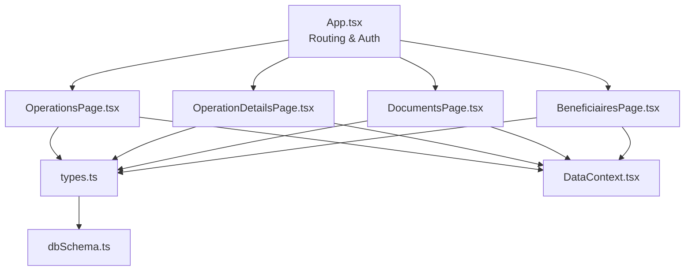
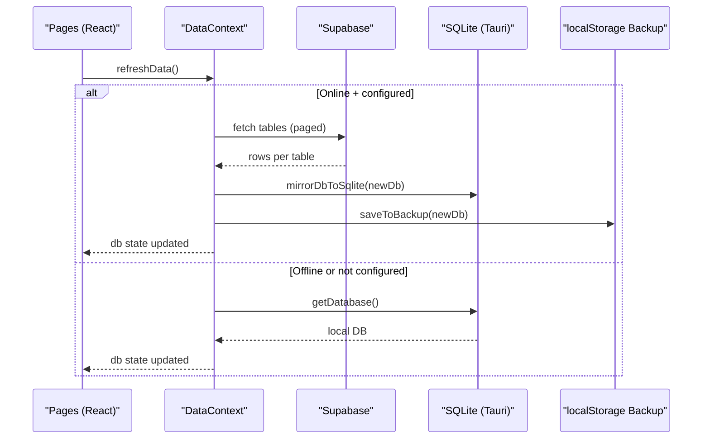
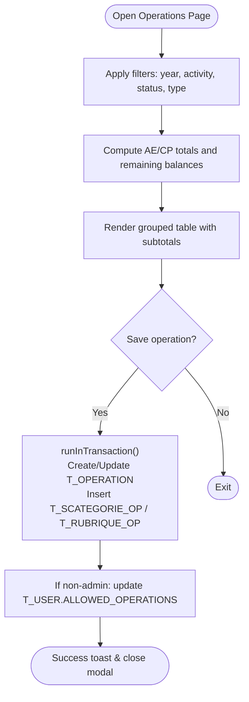
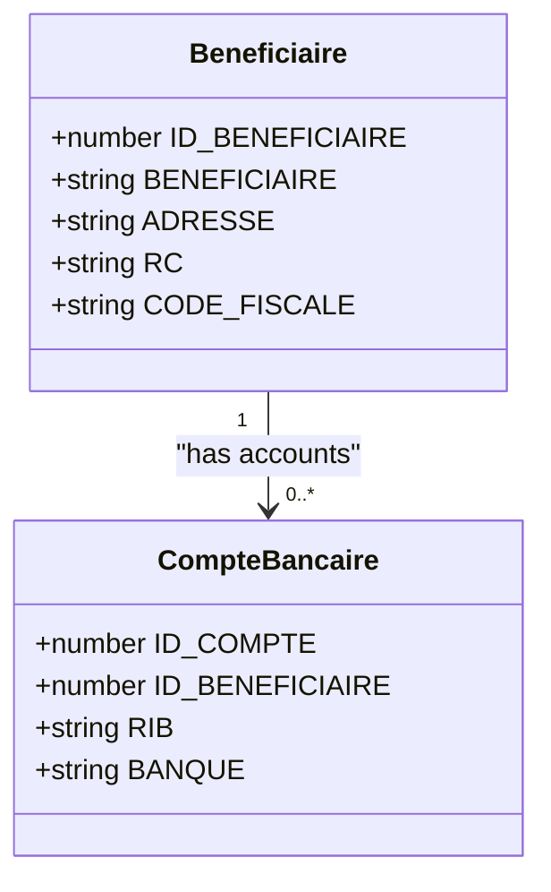
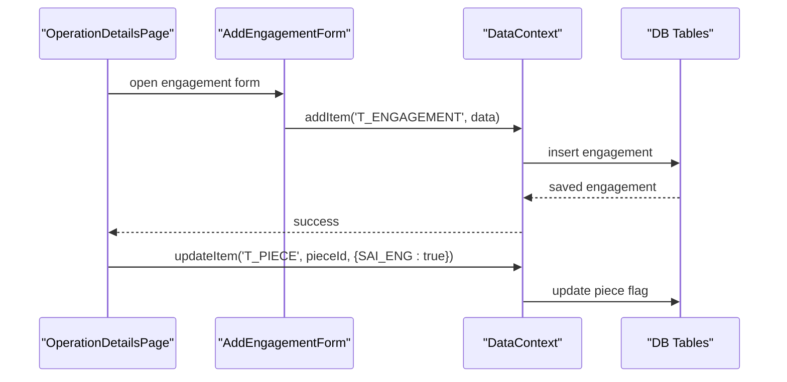
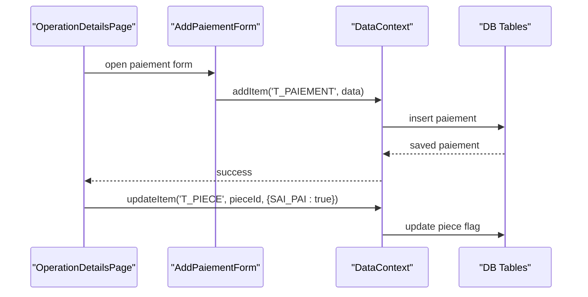
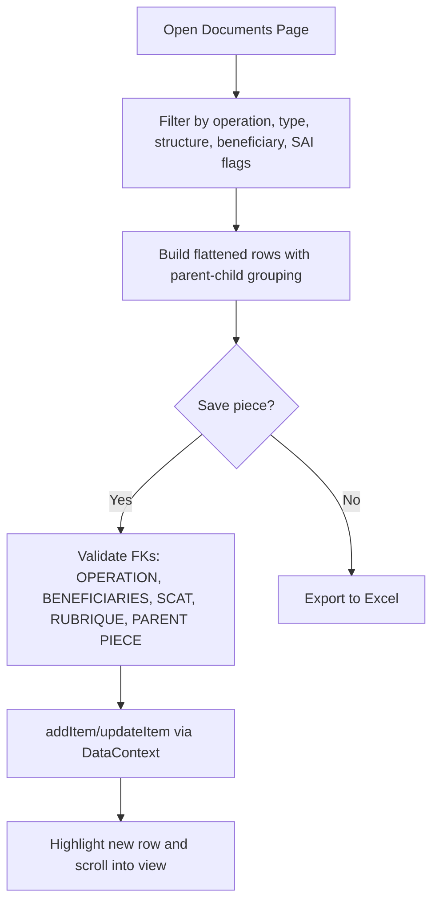
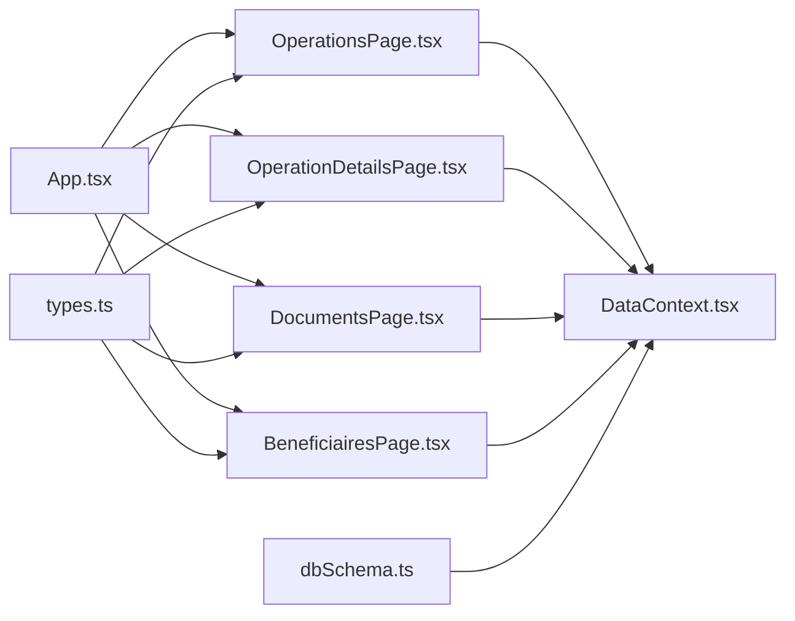

# Core Features

<cite>
**Referenced Files in This Document**
- [App.tsx](file://App.tsx)
- [types.ts](file://types.ts)
- [dbSchema.ts](file://services/dbSchema.ts)
- [database.ts](file://services/database.ts)
- [DataContext.tsx](file://context/DataContext.tsx)
- [OperationsPage.tsx](file://pages/OperationsPage.tsx)
- [OperationDetailsPage.tsx](file://pages/OperationDetailsPage.tsx)
- [DocumentsPage.tsx](file://pages/DocumentsPage.tsx)
- [BeneficiairesPage.tsx](file://pages/BeneficiairesPage.tsx)
</cite>

## Table of Contents
1. [Introduction](#introduction)
2. [Project Structure](#project-structure)
3. [Core Components](#core-components)
4. [Architecture Overview](#architecture-overview)
5. [Detailed Component Analysis](#detailed-component-analysis)
6. [Dependency Analysis](#dependency-analysis)
7. [Performance Considerations](#performance-considerations)
8. [Troubleshooting Guide](#troubleshooting-guide)
9. [Conclusion](#conclusion)

## Introduction
This document explains GOFT3’s core financial operations management workflow, focusing on:
- Operations lifecycle management (engagements and payments)
- Beneficiary tracking
- Engagement processing
- Payment handling
- Document management (pieces)

It provides conceptual overviews for understanding government-style workflows using the terms engagements (commitments), paiements (payments), and pieces (documents), and includes technical details for extending functionality, including form validation, data persistence, and user interaction patterns.

## Project Structure
GOFT3 is a React-based application with:
- Pages for each major feature area
- Shared forms under components/forms
- A centralized data context that manages cloud/local synchronization and integrity checks
- TypeScript types defining all domain models
- Database schema definitions for Supabase

**Diagram sources**
- [App.tsx:1-783](file://App.tsx#L1-L783)
- [OperationsPage.tsx:1-800](file://pages/OperationsPage.tsx#L1-L800)
- [OperationDetailsPage.tsx:1-800](file://pages/OperationDetailsPage.tsx#L1-L800)
- [DocumentsPage.tsx:1-800](file://pages/DocumentsPage.tsx#L1-L800)
- [BeneficiairesPage.tsx:1-446](file://pages/BeneficiairesPage.tsx#L1-L446)
- [types.ts:1-269](file://types.ts#L1-L269)
- [dbSchema.ts:1-260](file://services/dbSchema.ts#L1-L260)
- [DataContext.tsx:1-800](file://context/DataContext.tsx#L1-L800)

**Section sources**
- [App.tsx:1-783](file://App.tsx#L1-L783)
- [types.ts:1-269](file://types.ts#L1-L269)
- [dbSchema.ts:1-260](file://services/dbSchema.ts#L1-L260)

## Core Components
- Operations lifecycle: Create, update, filter, export/import operations; compute AE/CP balances; manage sub-allocations (rubriques/scategories).
- Beneficiaries: CRUD for beneficiaries and bank accounts; import/export; detail modal.
- Documents (pieces): Central registry of documents with engagement/payment linkage flags; filtering by operation, type, structure, beneficiary; bulk import/export.
- Engagements and Paiements: Creation flows from documents; status updates on pieces; print/reporting pages driven by IDs.
- Data layer: DataContext provides add/update/delete, transactions, presence/events, offline/online sync, integrity checks, and SQLite mirroring.

Key public interfaces exposed to UI:
- Forms: Add*Form components for Operation, Beneficiary, Piece, Engagement, Paiement, Bordereau, etc.
- Data models: All entities defined in types.ts (Operation, Piece, Engagement, Paiement, Beneficiaire, etc.)
- Business logic functions: useData() methods addItem, updateItem, deleteItem, deleteOperation, runInTransaction, refreshData, broadcastEvent.

**Section sources**
- [types.ts:9-269](file://types.ts#L9-L269)
- [DataContext.tsx:28-57](file://context/DataContext.tsx#L28-L57)
- [OperationsPage.tsx:394-474](file://pages/OperationsPage.tsx#L394-L474)
- [DocumentsPage.tsx:539-652](file://pages/DocumentsPage.tsx#L539-L652)
- [BeneficiairesPage.tsx:72-111](file://pages/BeneficiairesPage.tsx#L72-L111)

## Architecture Overview
The system follows a layered architecture:
- Presentation layer: Pages and reusable components
- State/data layer: DataContext orchestrates data access, caching, and sync
- Persistence layer: Supabase (cloud) and local SQLite via Tauri, with localStorage backup
- Domain models: TypeScript interfaces aligned with database schema

**Diagram sources**
- [DataContext.tsx:490-690](file://context/DataContext.tsx#L490-L690)

**Section sources**
- [DataContext.tsx:133-800](file://context/DataContext.tsx#L133-L800)

## Detailed Component Analysis

### Operations Lifecycle Management
Purpose:
- Create and edit operations with category/subcategory allocations
- Compute and display AE (engagement authority) and CP (payment appropriation) balances
- Manage rubriques and scategories per operation
- Import/export operations and auto-assign permissions for non-admin users

Implementation highlights:
- Filtering and grouping by category/subcategory/program/sub-program
- Computed totals for AE/CP and remaining balances
- Transactional creation of operation plus related allocations
- Auto-update of user ALLOWED_OPERATIONS when non-admin creates an operation

**Diagram sources**
- [OperationsPage.tsx:180-280](file://pages/OperationsPage.tsx#L180-L280)
- [OperationsPage.tsx:394-474](file://pages/OperationsPage.tsx#L394-L474)

**Section sources**
- [OperationsPage.tsx:180-280](file://pages/OperationsPage.tsx#L180-L280)
- [OperationsPage.tsx:394-474](file://pages/OperationsPage.tsx#L394-L474)

### Beneficiary Tracking
Purpose:
- Maintain beneficiaries and their bank accounts
- Support import/export and detail view

Implementation highlights:
- Transactional create/update of beneficiary and associated bank accounts
- Deletion cascades to linked accounts
- Import validates required fields and ensures at least one bank account per beneficiary

**Diagram sources**
- [types.ts:26-40](file://types.ts#L26-L40)
- [BeneficiairesPage.tsx:72-111](file://pages/BeneficiairesPage.tsx#L72-L111)

**Section sources**
- [BeneficiairesPage.tsx:72-111](file://pages/BeneficiairesPage.tsx#L72-L111)
- [BeneficiairesPage.tsx:203-335](file://pages/BeneficiairesPage.tsx#L203-L335)

### Engagement Processing
Purpose:
- Register engagements (commitments) against documents (pieces) and operations
- Update piece registration flags (SAI_ENG) automatically
- Provide filtering by object, year, and beneficiary

Implementation highlights:
- Form-driven creation via AddEngagementForm
- After save, mark piece.SAI_ENG = true if not already set
- Aggregation of engagement amounts considering nature (e.g., withdrawal reduces total)

**Diagram sources**
- [OperationDetailsPage.tsx:568-623](file://pages/OperationDetailsPage.tsx#L568-L623)

**Section sources**
- [OperationDetailsPage.tsx:310-335](file://pages/OperationDetailsPage.tsx#L310-L335)
- [OperationDetailsPage.tsx:568-623](file://pages/OperationDetailsPage.tsx#L568-L623)

### Payment Handling
Purpose:
- Record paiements (payments) linked to engagements and documents
- Update piece registration flags (SAI_PAI) automatically
- Provide filtering by object, year, and beneficiary

Implementation highlights:
- Form-driven creation via AddPaiementForm
- After save, mark piece.SAI_PAI = true if not already set
- Summation of payment amounts per operation/year

**Diagram sources**
- [OperationDetailsPage.tsx:568-623](file://pages/OperationDetailsPage.tsx#L568-L623)

**Section sources**
- [OperationDetailsPage.tsx:337-352](file://pages/OperationDetailsPage.tsx#L337-L352)
- [OperationDetailsPage.tsx:568-623](file://pages/OperationDetailsPage.tsx#L568-L623)

### Document Management (Pieces)
Purpose:
- Central registry of documents (pieces) with links to operations, beneficiaries, categories, and rubrics
- Track engagement/payment linkage via SAI_ENG/SAI_PAI flags
- Support complex filtering and hierarchy (parent-child contracts)

Implementation highlights:
- Proactive foreign key integrity checks before saving
- Grouped rendering of main contracts and child documents
- Bulk import/export with Excel templates

**Diagram sources**
- [DocumentsPage.tsx:147-275](file://pages/DocumentsPage.tsx#L147-L275)
- [DocumentsPage.tsx:539-652](file://pages/DocumentsPage.tsx#L539-L652)

**Section sources**
- [DocumentsPage.tsx:147-275](file://pages/DocumentsPage.tsx#L147-L275)
- [DocumentsPage.tsx:539-652](file://pages/DocumentsPage.tsx#L539-L652)

### Public Interfaces Summary
- Forms: AddOperationForm, AddBeneficiaryForm, AddDocumentForm, AddEngagementForm, AddPaiementForm, AddBordereauForm
- Data models: Operation, Beneficiaire, CompteBancaire, Piece, Engagement, Paiement, Rubrique, Scategorie, Direction, Programme, Sprogramme, Cp, RubriqueOp, ScategorieOp, LotOperation, LotPiece, Ods, Bordereau
- Business logic functions: addItem, updateItem, deleteItem, deleteOperation, runInTransaction, refreshData, broadcastEvent

**Section sources**
- [types.ts:9-269](file://types.ts#L9-L269)
- [DataContext.tsx:28-57](file://context/DataContext.tsx#L28-L57)

## Dependency Analysis
High-level dependencies between modules:
- App.tsx routes to pages and passes navigation/context props
- Pages consume DataContext for data operations
- Types define shared contracts used across layers
- Schema defines persistent structures mirrored by DataContext

**Diagram sources**
- [App.tsx:1-783](file://App.tsx#L1-L783)
- [OperationsPage.tsx:1-800](file://pages/OperationsPage.tsx#L1-L800)
- [OperationDetailsPage.tsx:1-800](file://pages/OperationDetailsPage.tsx#L1-L800)
- [DocumentsPage.tsx:1-800](file://pages/DocumentsPage.tsx#L1-L800)
- [BeneficiairesPage.tsx:1-446](file://pages/BeneficiairesPage.tsx#L1-L446)
- [types.ts:1-269](file://types.ts#L1-L269)
- [dbSchema.ts:1-260](file://services/dbSchema.ts#L1-L260)
- [DataContext.tsx:1-800](file://context/DataContext.tsx#L1-L800)

**Section sources**
- [App.tsx:1-783](file://App.tsx#L1-L783)
- [types.ts:1-269](file://types.ts#L1-L269)
- [dbSchema.ts:1-260](file://services/dbSchema.ts#L1-L260)
- [DataContext.tsx:1-800](file://context/DataContext.tsx#L1-L800)

## Performance Considerations
- Lazy page loading via React.lazy to reduce initial bundle size
- Memoized computations (useMemo) for filtered/sorted lists and aggregates
- Paged fetching from Supabase with column projections to minimize payload
- Splitting heavy tables (operations, engagements, paiements) into separate state slices
- Debounced search inputs to limit re-renders
- Batched imports within transactions to avoid UI freezes

[No sources needed since this section provides general guidance]

## Troubleshooting Guide
Common issues and resolutions:
- Connection errors during refresh: DataContext sets connectionError and falls back to local SQLite or localStorage backup
- Integrity issues: DataContext detects broken foreign keys and exposes integrityIssues for cleanup
- Permission denied on edits/deletes: Pages check currentUser roles and CREATED_BY ownership before allowing actions
- Default password enforcement: App prompts mandatory password change for default admin credentials

Actionable steps:
- Use retry flow in DocumentsPage to reconnect to Supabase
- Clean orphaned items via provided confirm dialogs
- Ensure foreign keys are valid before saving (validation alerts shown in DocumentsPage)

**Section sources**
- [DataContext.tsx:490-690](file://context/DataContext.tsx#L490-L690)
- [DocumentsPage.tsx:539-652](file://pages/DocumentsPage.tsx#L539-L652)
- [App.tsx:99-140](file://App.tsx#L99-L140)

## Conclusion
GOFT3 implements a robust financial operations workflow centered around operations, documents (pieces), engagements, and paiements, with strong support for beneficiary management and reporting. The data layer ensures resilience through offline capabilities, integrity checks, and transactional operations. Extending functionality involves adding new forms, updating types/schema, and leveraging DataContext APIs for persistence and synchronization.

[No sources needed since this section summarizes without analyzing specific files]