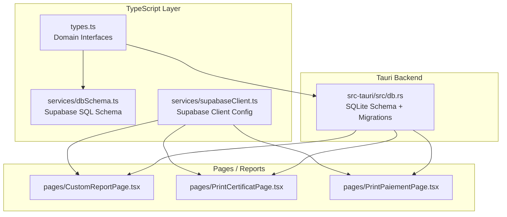
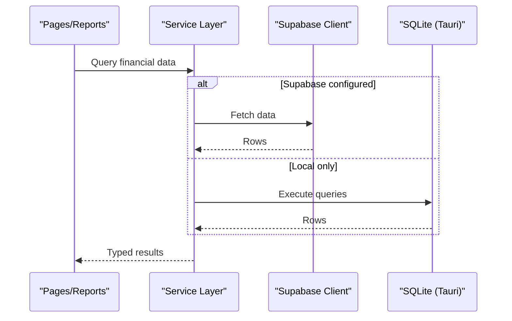
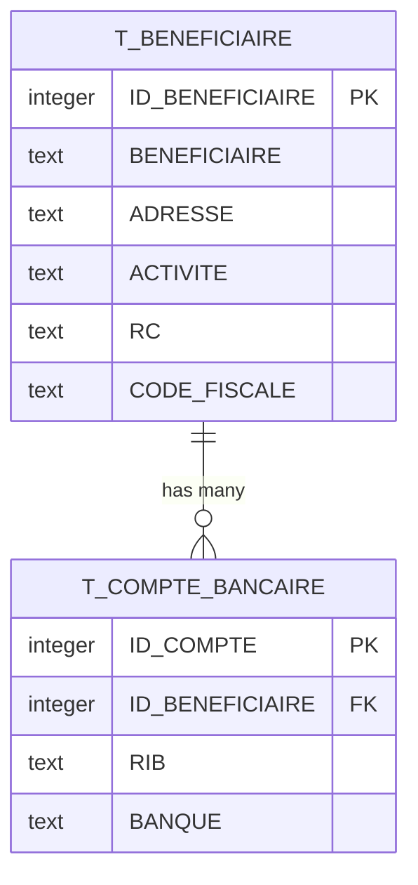
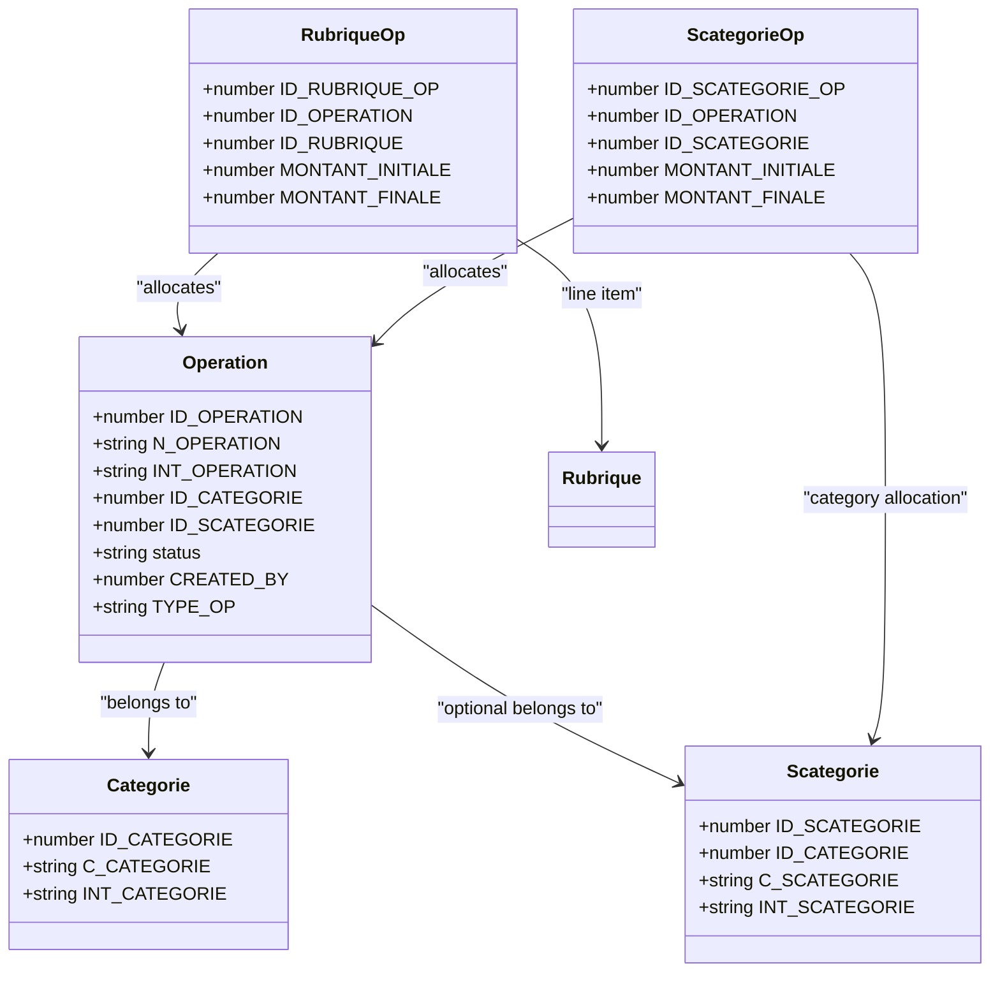
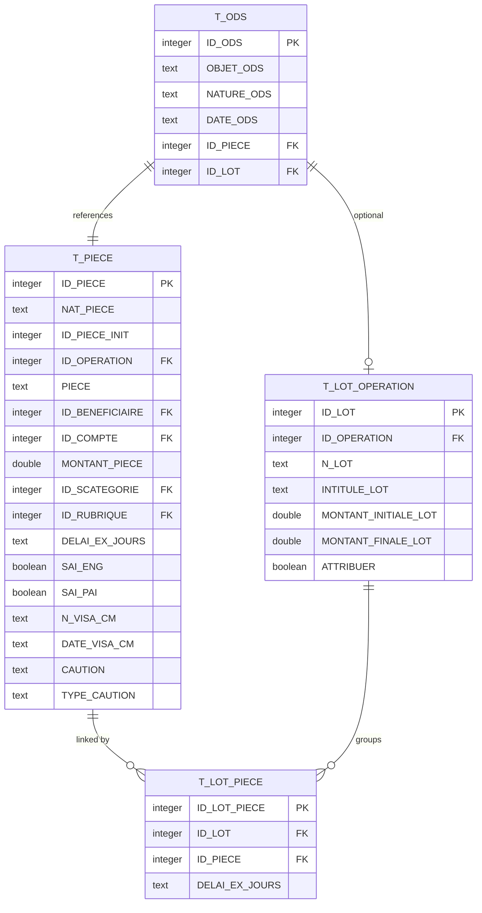
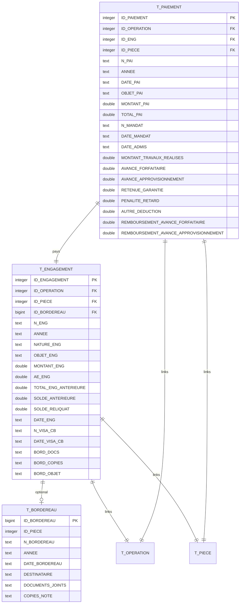
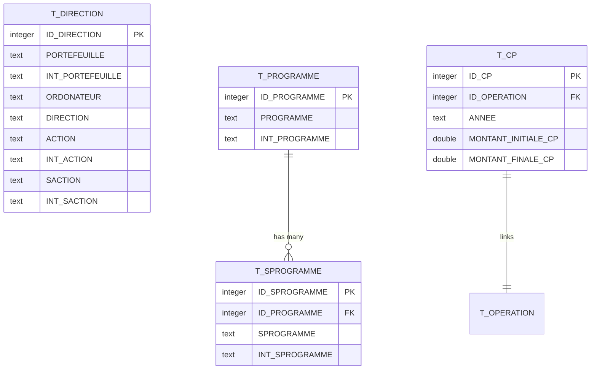
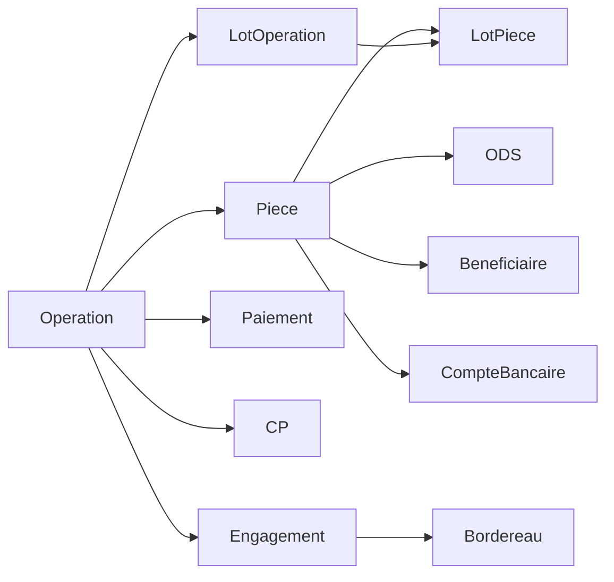
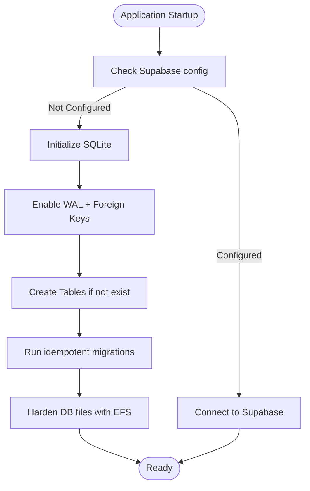

# Data Models & Database Schema

<cite>
**Referenced Files in This Document**   
- [types.ts](file://types.ts)
- [dbSchema.ts](file://services/dbSchema.ts)
- [supabaseClient.ts](file://services/supabaseClient.ts)
- [db.rs](file://src-tauri/src/db.rs)
- [CustomReportPage.tsx](file://pages/CustomReportPage.tsx)
- [PrintCertificatPage.tsx](file://pages/PrintCertificatPage.tsx)
- [PrintPaiementPage.tsx](file://pages/PrintPaiementPage.tsx)
</cite>

## Table of Contents
1. [Introduction](#introduction)
2. [Project Structure](#project-structure)
3. [Core Components](#core-components)
4. [Architecture Overview](#architecture-overview)
5. [Detailed Component Analysis](#detailed-component-analysis)
6. [Dependency Analysis](#dependency-analysis)
7. [Performance Considerations](#performance-considerations)
8. [Data Lifecycle, Retention, and Archival](#data-lifecycle-retention-and-archival)
9. [Security and Privacy](#security-and-privacy)
10. [Troubleshooting Guide](#troubleshooting-guide)
11. [Conclusion](#conclusion)

## Introduction
This document describes GOFT3’s financial data model and database schema. It focuses on core financial entities such as operations, engagements, payments, beneficiaries, documents (pieces), lots, categories, rubriques, programmes, bordereaux, and related accounting structures. The documentation covers:
- Entity relationships and primary/foreign key constraints
- Field definitions with TypeScript types, data types, validation rules, and business constraints
- Indexing strategy and performance considerations
- Data access patterns through the service layer
- Caching strategies for offline functionality
- Data lifecycle from creation to archiving and retention policies
- Migration paths for schema evolution
- Security and privacy controls for sensitive financial data

## Project Structure
GOFT3 defines its financial domain model in TypeScript interfaces and synchronizes it with two storage backends:
- Supabase (PostgreSQL) via a SQL schema script
- Local SQLite via Tauri/Rust initialization

**Diagram sources**
- [types.ts:9-268](file://types.ts#L9-L268)
- [dbSchema.ts:4-259](file://services/dbSchema.ts#L4-L259)
- [supabaseClient.ts:1-37](file://services/supabaseClient.ts#L1-L37)
- [db.rs:20-299](file://src-tauri/src/db.rs#L20-L299)
- [CustomReportPage.tsx:74-87](file://pages/CustomReportPage.tsx#L74-L87)
- [PrintCertificatPage.tsx:24-49](file://pages/PrintCertificatPage.tsx#L24-L49)
- [PrintPaiementPage.tsx:38-63](file://pages/PrintPaiementPage.tsx#L38-L63)

**Section sources**
- [types.ts:9-268](file://types.ts#L9-L268)
- [dbSchema.ts:4-259](file://services/dbSchema.ts#L4-L259)
- [supabaseClient.ts:1-37](file://services/supabaseClient.ts#L1-L37)
- [db.rs:20-299](file://src-tauri/src/db.rs#L20-L299)

## Core Components
The financial domain is modeled by these core entities:
- Beneficiary and Bank Account
- Operation (financial operation/project)
- Category and Subcategory
- Rubrique (budget line)
- Piece (document/contract piece)
- Lot and Lot-Piece mapping
- ODS (service order)
- Engagement (commitment)
- Bordereau (transmittal/batch)
- Payment
- CP (credit provision)
- Direction, Programme, Subprogramme (organizational and budget structure)

Each entity has a corresponding TypeScript interface and a matching table definition in both Supabase SQL and local SQLite.

**Section sources**
- [types.ts:26-268](file://types.ts#L26-L268)
- [dbSchema.ts:15-257](file://services/dbSchema.ts#L15-L257)
- [db.rs:37-262](file://src-tauri/src/db.rs#L37-L262)

## Architecture Overview
GOFT3 supports dual storage modes:
- Cloud mode using Supabase (PostgreSQL)
- Offline/local mode using SQLite via Tauri

The application reads/writes against an in-memory representation of the database that mirrors either Supabase or SQLite depending on configuration. Pages and reports query this unified data model.

**Diagram sources**
- [supabaseClient.ts:1-37](file://services/supabaseClient.ts#L1-L37)
- [db.rs:20-299](file://src-tauri/src/db.rs#L20-L299)

## Detailed Component Analysis

### Beneficiary and Bank Account
- Beneficiaire: identifies contractors/vendors with contact and tax identifiers
- CompteBancaire: stores bank account details linked to a beneficiary

Key fields and constraints:
- Beneficiaire: ID_BENEFICIAIRE (PK), BENEFICIAIRE (not null), ADRESSE (not null), ACTIVITE (nullable), RC (nullable), CODE_FISCALE (nullable)
- CompteBancaire: ID_COMPTE (PK), ID_BENEFICIAIRE (FK to Beneficiaire), RIB (not null), BANQUE (not null)

Validation and business rules:
- Beneficiary name and address are mandatory
- Bank account must reference an existing beneficiary

**Diagram sources**
- [types.ts:26-40](file://types.ts#L26-L40)
- [dbSchema.ts:15-32](file://services/dbSchema.ts#L15-L32)
- [db.rs:37-52](file://src-tauri/src/db.rs#L37-L52)

**Section sources**
- [types.ts:26-40](file://types.ts#L26-L40)
- [dbSchema.ts:15-32](file://services/dbSchema.ts#L15-L32)
- [db.rs:37-52](file://src-tauri/src/db.rs#L37-L52)

### Operation, Categories, and Budget Lines
- Operation: represents a financial operation/project with category/subcategory linkage and status
- Categorie/Scategorie: hierarchical classification
- RubriqueOp/ScategorieOp: per-operation budget allocations
- Rubrique: budget line items

Key fields and constraints:
- Operation: ID_OPERATION (PK), N_OPERATION (not null), INT_OPERATION (not null), ID_CATEGORIE (FK), ID_SCATEGORIE (nullable FK), status (enum-like check), CREATED_BY (nullable), TYPE_OP (nullable)
- Categorie: ID_CATEGORIE (PK), C_CATEGORIE (not null), INT_CATEGORIE (not null)
- Scategorie: ID_SCATEGORIE (PK), ID_CATEGORIE (FK), C_SCATEGORIE (not null), INT_SCATEGORIE (not null)
- RubriqueOp: ID_RUBRIQUE_OP (PK), ID_OPERATION (FK), ID_RUBRIQUE (FK), MONTANT_INITIALE (not null), MONTANT_FINALE (nullable)
- ScategorieOp: ID_SCATEGORIE_OP (PK), ID_OPERATION (FK), ID_SCATEGORIE (FK), MONTANT_INITIALE (not null), MONTANT_FINALE (nullable)

Validation and business rules:
- Operation status is constrained to active/closed values
- Category/subcategory hierarchy enforced via foreign keys
- Initial/final amounts track budget changes

**Diagram sources**
- [types.ts:42-119](file://types.ts#L42-L119)
- [dbSchema.ts:34-63](file://services/dbSchema.ts#L34-L63)
- [db.rs:54-80](file://src-tauri/src/db.rs#L54-L80)

**Section sources**
- [types.ts:42-119](file://types.ts#L42-L119)
- [dbSchema.ts:34-63](file://services/dbSchema.ts#L34-L63)
- [db.rs:54-80](file://src-tauri/src/db.rs#L54-L80)

### Documents (Pieces), Lots, and ODS
- Piece: central document/contract record with financial amount, category/rubrique linkage, and optional references to beneficiary and bank account
- LotOperation/LotPiece: grouping pieces into lots
- ODS: service orders associated with pieces and optionally lots

Key fields and constraints:
- Piece: ID_PIECE (PK), NAT_PIECE (not null), ID_PIECE_INIT (nullable self-reference), ID_OPERATION (FK), PIECE (not null), ID_BENEFICIAIRE (nullable FK), ID_COMPTE (nullable FK), MONTANT_PIECE (not null), ID_SCATEGORIE (FK), ID_RUBRIQUE (nullable FK), DELAI_EX_JOURS (nullable), SAI_ENG/SAI_PAI flags, visa info, caution fields
- LotOperation: ID_LOT (PK), ID_OPERATION (FK), N_LOT (not null), INTITULE_LOT (not null), MONTANT_INITIALE_LOT/MONTANT_FINALE_LOT (not null), ATTRIBUER (boolean)
- LotPiece: ID_LOT_PIECE (PK), ID_LOT (FK), ID_PIECE (FK), DELAI_EX_JOURS (nullable)
- ODS: ID_ODS (PK), OBJET_ODS/NATURE_ODS/DATE_ODS (not null), ID_PIECE (FK), ID_LOT (nullable FK)

Validation and business rules:
- Pieces must belong to an operation and a subcategory
- Optional links to beneficiary/bank account for payment routing
- Lots group pieces; ODS can be tied to a lot or directly to a piece

**Diagram sources**
- [types.ts:121-169](file://types.ts#L121-L169)
- [dbSchema.ts:71-96](file://services/dbSchema.ts#L71-L96)
- [db.rs:97-124](file://src-tauri/src/db.rs#L97-L124)
- [dbSchema.ts:174-228](file://services/dbSchema.ts#L174-L228)
- [db.rs:187-236](file://src-tauri/src/db.rs#L187-L236)

**Section sources**
- [types.ts:121-169](file://types.ts#L121-L169)
- [dbSchema.ts:71-96](file://services/dbSchema.ts#L71-L96)
- [db.rs:97-124](file://src-tauri/src/db.rs#L97-L124)
- [dbSchema.ts:174-228](file://services/dbSchema.ts#L174-L228)
- [db.rs:187-236](file://src-tauri/src/db.rs#L187-L236)

### Engagements and Payments
- Engagement: commitment record linked to an operation and piece, with balances and visa information
- Bordereau: batch/transmittal document optionally linked to engagement
- Paiement: payment record linked to operation, engagement, and piece, with detailed deduction fields

Key fields and constraints:
- Engagement: ID_ENGAGEMENT (PK), ID_OPERATION (FK), ID_PIECE (FK), ID_BORDEREAU (nullable FK), N_ENG/ANNEE/NATURE_ENG/OBJET_ENG (not null), MONTANT_ENG/AE_ENG/TOTAL_ENG_ANTERIEURE/SOLDE_ANTERIEURE/SOLDE_RELIQUAT (not null numeric), DATE_ENG/N_VISA_CB/DATE_VISA_CB (text), BORD_* fields (nullable)
- Bordereau: ID_BORDEREAU (PK), ID_PIECE (nullable), N_BORDEREAU (nullable), ANNEE (default 'NULL'), DATE_BORDEREAU/DESTINATAIRE/DOCUMENTS_JOINTS/COPIES_NOTE (nullable)
- Paiement: ID_PAIEMENT (PK), ID_OPERATION (FK), ID_ENG (FK), ID_PIECE (FK), N_PAI/ANNEE/DATE_PAI/OBJET_PAI (not null), MONTANT_PAI/TOTAL_PAI (not null), N_MANDAT/DATE_MANDAT/DATE_ADMIS (nullable), various deduction/advance fields (nullable)

Validation and business rules:
- Engagements must reference valid operation and piece
- Payments must reference valid engagement and piece
- Bordereau may link to engagement and/or piece

**Diagram sources**
- [types.ts:171-226](file://types.ts#L171-L226)
- [dbSchema.ts:98-162](file://services/dbSchema.ts#L98-L162)
- [db.rs:126-176](file://src-tauri/src/db.rs#L126-L176)

**Section sources**
- [types.ts:171-226](file://types.ts#L171-L226)
- [dbSchema.ts:98-162](file://services/dbSchema.ts#L98-L162)
- [db.rs:126-176](file://src-tauri/src/db.rs#L126-L176)

### Organizational and Budget Structures
- Direction: organizational unit and action codes
- Programme/Sprogramme: programmatic budget structure
- CP: credit provision per operation/year

Key fields and constraints:
- Direction: ID_DIRECTION (PK), PORTEFEUILLE/INT_PORTEFEUILLE/ORDONATEUR/DIRECTION/ACTION/INT_ACTION (not null), SACTION/INT_SACTION (nullable)
- Programme: ID_PROGRAMME (PK), PROGRAMME/INT_PROGRAMME (not null)
- Sprogramme: ID_SPROGRAMME (PK), ID_PROGRAMME (FK), SPROGRAMME/INT_SPROGRAMME (not null)
- CP: ID_CP (PK), ID_OPERATION (FK), ANNEE (not null), MONTANT_INITIALE_CP/MONTANT_FINALE_CP (not null)

Validation and business rules:
- Hierarchical relationship between Programme and Sprogramme
- CP records track yearly credit provisions per operation

**Diagram sources**
- [types.ts:72-103](file://types.ts#L72-L103)
- [dbSchema.ts:164-257](file://services/dbSchema.ts#L164-L257)
- [db.rs:178-262](file://src-tauri/src/db.rs#L178-L262)

**Section sources**
- [types.ts:72-103](file://types.ts#L72-L103)
- [dbSchema.ts:164-257](file://services/dbSchema.ts#L164-L257)
- [db.rs:178-262](file://src-tauri/src/db.rs#L178-L262)

## Dependency Analysis
Primary relationships across financial entities:
- Operation anchors most financial activity (engagements, payments, CP, lots)
- Piece ties documents to operations, categories, rubriques, and beneficiaries
- Engagement bridges documents to commitments and balances
- Payment finalizes financial flows against engagements and pieces
- Bordereau groups or transmits documents and engagements

**Diagram sources**
- [dbSchema.ts:50-162](file://services/dbSchema.ts#L50-L162)
- [db.rs:68-176](file://src-tauri/src/db.rs#L68-L176)

**Section sources**
- [dbSchema.ts:50-162](file://services/dbSchema.ts#L50-L162)
- [db.rs:68-176](file://src-tauri/src/db.rs#L68-L176)

## Performance Considerations
- WAL mode and foreign key enforcement are enabled for SQLite to improve concurrency and integrity.
- Financial tables use numeric fields for monetary amounts; ensure consistent precision at the application layer.
- Queries joining multiple financial entities (e.g., custom reports) should filter early by operation/year to reduce dataset size.
- For large datasets:
  - Use indexed lookups on frequently filtered columns (e.g., ID_OPERATION, ANNEE).
  - Avoid full-table scans by applying WHERE clauses on IDs and dates.
  - Cache derived aggregates (totals, balances) when appropriate.

[No sources needed since this section provides general guidance]

## Data Lifecycle, Retention, and Archival
Lifecycle stages:
- Creation: Beneficiaries, categories, rubriques, operations, pieces, engagements, payments
- Processing: Lots grouping, ODS issuance, bordereau transmission
- Reporting: Custom reports and print views aggregate across entities
- Archival: Not explicitly implemented in schema; consider adding archival flags and separate archive tables for compliance

Retention and archival recommendations:
- Add explicit retention metadata (e.g., ARCHIVED_AT, RETENTION_UNTIL) to financial tables
- Implement periodic jobs to move old records to archive tables while preserving referential integrity
- Ensure audit trails for all modifications to financial records

[No sources needed since this section provides general guidance]

## Security and Privacy
- Local SQLite database files are hardened using Windows EFS encryption at rest.
- User roles are enforced via CHECK constraints and application-level checks.
- Sensitive fields (passwords, bank accounts, tax IDs) should be treated as confidential; avoid logging or exporting without masking.
- Access control:
  - Role-based page permissions stored in user records
  - Application enforces allowed pages and operations

**Diagram sources**
- [supabaseClient.ts:1-37](file://services/supabaseClient.ts#L1-L37)
- [db.rs:20-299](file://src-tauri/src/db.rs#L20-L299)

**Section sources**
- [supabaseClient.ts:1-37](file://services/supabaseClient.ts#L1-L37)
- [db.rs:20-299](file://src-tauri/src/db.rs#L20-L299)

## Troubleshooting Guide
Common issues and resolutions:
- Missing foreign key violations: Ensure referenced entities exist before creating dependent records (e.g., create Beneficiary before linking to Piece).
- Constraint errors on status fields: Verify enum-like values match allowed sets (e.g., Operation status).
- Data inconsistencies after updates: Re-run migrations to ensure schema parity between Supabase and SQLite.
- Offline vs cloud sync: Validate Supabase URL/key configuration; reset configuration if invalid.

Operational tips:
- When generating reports, filter by ID_OPERATION and ANNEE to limit result sets.
- For print views, verify parent-child relationships (e.g., root contract piece traversal).

**Section sources**
- [CustomReportPage.tsx:74-87](file://pages/CustomReportPage.tsx#L74-L87)
- [PrintCertificatPage.tsx:24-49](file://pages/PrintCertificatPage.tsx#L24-L49)
- [PrintPaiementPage.tsx:38-63](file://pages/PrintPaiementPage.tsx#L38-L63)

## Conclusion
GOFT3’s financial data model centers around Operations, Pieces, Engagements, and Payments, with supporting structures for categorization, budget lines, lots, and organizational units. The schema is defined consistently in TypeScript, Supabase SQL, and SQLite, enabling robust dual-mode operation. Adhering to the documented constraints, indexing strategies, and security measures will ensure data integrity, performance, and compliance for financial records.

[No sources needed since this section summarizes without analyzing specific files]