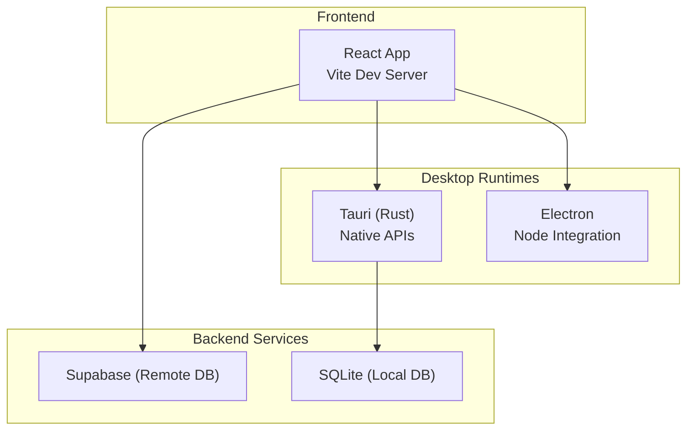
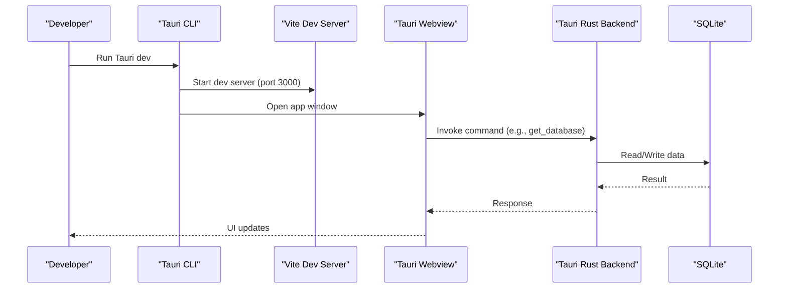
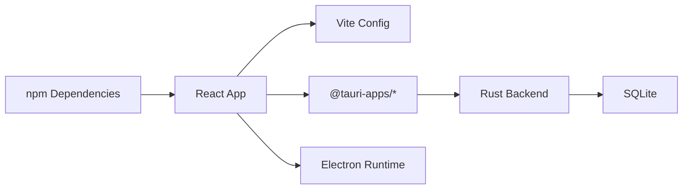

# Getting Started

<cite>
**Referenced Files in This Document**
- [package.json](file://package.json)
- [vite.config.ts](file://vite.config.ts)
- [electron.js](file://electron.js)
- [preload.js](file://preload.js)
- [tauri.conf.json](file://src-tauri/tauri.conf.json)
- [Cargo.toml](file://src-tauri/Cargo.toml)
- [build.rs](file://src-tauri/build.rs)
- [tauriService.ts](file://services/tauriService.ts)
</cite>

## Table of Contents
1. [Introduction](#introduction)
2. [Project Structure](#project-structure)
3. [Core Components](#core-components)
4. [Architecture Overview](#architecture-overview)
5. [Detailed Component Analysis](#detailed-component-analysis)
6. [Dependency Analysis](#dependency-analysis)
7. [Performance Considerations](#performance-considerations)
8. [Troubleshooting Guide](#troubleshooting-guide)
9. [Conclusion](#conclusion)

## Introduction
GOFT3 is a desktop application for financial operations management with dual runtime support: Tauri and Electron. It uses React and Vite for the frontend, Rust/Tauri for native capabilities, and can also run under Electron. The app requires Node.js >=20.0.0 and npm >=10.0.0.

This guide helps you quickly set up GOFT3 for development or production, explains environment requirements, and provides step-by-step instructions to clone, install dependencies, run in development mode, and build for distribution on Windows, Linux, and macOS.

## Project Structure
At a high level:
- Frontend: React + TypeScript + Vite
- Desktop runtimes: Tauri (Rust) and Electron
- Native features: SQLite database, file I/O, updater via Tauri plugins
- Build tooling: Vite for bundling; Tauri CLI and Electron Builder for packaging

**Diagram sources**
- [vite.config.ts:16-25](file://vite.config.ts#L16-L25)
- [electron.js:11-36](file://electron.js#L11-L36)
- [tauri.conf.json:6-11](file://src-tauri/tauri.conf.json#L6-L11)
- [Cargo.toml:15-23](file://src-tauri/Cargo.toml#L15-L23)

**Section sources**
- [package.json:1-32](file://package.json#L1-L32)
- [vite.config.ts:1-61](file://vite.config.ts#L1-L61)
- [electron.js:1-73](file://electron.js#L1-L73)
- [tauri.conf.json:1-56](file://src-tauri/tauri.conf.json#L1-L56)
- [Cargo.toml:1-34](file://src-tauri/Cargo.toml#L1-L34)

## Core Components
- Environment requirements: Node.js >=20.0.0, npm >=10.0.0
- Development server: Vite runs at port 3000
- Dual runtime:
  - Tauri: Uses Tauri CLI for dev and build; integrates with Rust backend
  - Electron: Uses Electron main process to load the app
- Database: Local SQLite via Tauri; remote Supabase integration available

Key configuration highlights:
- Engines and scripts are defined in package.json
- Vite config sets dev server, polyfills, and chunking
- Tauri config defines dev URL, window settings, CSP, and updater endpoints
- Electron main script loads dev server in development and built assets in production

**Section sources**
- [package.json:15-32](file://package.json#L15-L32)
- [vite.config.ts:16-25](file://vite.config.ts#L16-L25)
- [tauri.conf.json:6-27](file://src-tauri/tauri.conf.json#L6-L27)
- [electron.js:26-36](file://electron.js#L26-L36)

## Architecture Overview
The app supports two desktop runtimes:

- Tauri path:
  - Tauri CLI starts the Vite dev server and opens the webview
  - Frontend calls Tauri commands through @tauri-apps/api
  - Rust backend exposes commands for local SQLite and file operations

- Electron path:
  - Electron main process loads either the Vite dev server or the built dist/index.html
  - Preload script is present but not required for local DB access

**Diagram sources**
- [tauri.conf.json:6-11](file://src-tauri/tauri.conf.json#L6-L11)
- [tauriService.ts:13-22](file://services/tauriService.ts#L13-L22)
- [Cargo.toml:15-23](file://src-tauri/Cargo.toml#L15-L23)

## Detailed Component Analysis

### Installation and Setup
- Prerequisites:
  - Node.js >=20.0.0
  - npm >=10.0.0
- Clone the repository
- Install dependencies using npm
- Verify installation by running the development server

Notes:
- The project’s engines field enforces Node.js and npm versions
- Vite dev server defaults to port 3000

**Section sources**
- [package.json:15-18](file://package.json#L15-L18)
- [package.json:19-32](file://package.json#L19-L32)
- [vite.config.ts:16-20](file://vite.config.ts#L16-L20)

### Running in Development Mode

#### Tauri Development
- Use the Tauri CLI to start the app in development mode
- The Tauri config specifies the dev URL and before-dev command to launch Vite

Steps:
- Ensure dependencies are installed
- Run the Tauri dev command from the project root

Expected behavior:
- Vite dev server starts on port 3000
- Tauri opens a window pointing to the dev server

**Section sources**
- [package.json:24-27](file://package.json#L24-L27)
- [tauri.conf.json:6-11](file://src-tauri/tauri.conf.json#L6-L11)

#### Electron Development
- The Electron main script loads the Vite dev server in development mode
- You can start Electron directly to test the Electron runtime

Steps:
- Ensure dependencies are installed
- Run the Electron start script from the project root

Expected behavior:
- Electron opens a window connected to the Vite dev server on port 3000

**Section sources**
- [package.json:28-31](file://package.json#L28-L31)
- [electron.js:26-36](file://electron.js#L26-L36)

### Building for Distribution

#### Tauri Build
- The Tauri build command compiles the frontend and bundles the Rust backend
- Tauri config defines the frontend distribution directory and build steps

Steps:
- Ensure dependencies are installed
- Run the Tauri build command from the project root

Outputs:
- Platform-specific installers and artifacts based on Tauri bundle targets

**Section sources**
- [package.json:27](file://package.json#L27)
- [tauri.conf.json:6-11](file://src-tauri/tauri.conf.json#L6-L11)
- [tauri.conf.json:29-44](file://src-tauri/tauri.conf.json#L29-L44)

#### Electron Build
- The Electron build script first builds the frontend with Vite, then packages with electron-builder
- Package configuration defines output directory and platform targets

Steps:
- Ensure dependencies are installed
- Run the Electron build script from the project root

Outputs:
- Platform-specific installers and archives in the release directory

**Section sources**
- [package.json:29-31](file://package.json#L29-L31)
- [package.json:100-135](file://package.json#L100-L135)

### First-Time Configuration
- No additional configuration is required to run the app locally
- If using Supabase, configure your Supabase credentials in your environment variables as needed by the application code
- For Tauri updater, ensure the latest.json endpoint is reachable and the public key matches the configured value

**Section sources**
- [tauri.conf.json:46-52](file://src-tauri/tauri.conf.json#L46-L52)

## Dependency Analysis
The project depends on:
- Frontend: React, Vite, TailwindCSS, Supabase client, ExcelJS, jsPDF, html2canvas
- Tauri: Tauri core and plugins (opener, dialog, updater, process), SQLite via rusqlite
- Electron: Electron runtime and builder

**Diagram sources**
- [package.json:33-99](file://package.json#L33-L99)
- [vite.config.ts:1-61](file://vite.config.ts#L1-L61)
- [Cargo.toml:15-23](file://src-tauri/Cargo.toml#L15-L23)

**Section sources**
- [package.json:33-99](file://package.json#L33-L99)
- [Cargo.toml:15-23](file://src-tauri/Cargo.toml#L15-L23)

## Performance Considerations
- Vite chunking splits large libraries into separate chunks to improve loading performance
- ExcelJS browser bundle is used to avoid Node-only dependencies inside the Tauri webview
- Keep dev server on port 3000 to match Tauri and Electron configurations

Recommendations:
- Monitor bundle size during development
- Avoid unnecessary imports in heavy pages
- Use lazy loading where appropriate

**Section sources**
- [vite.config.ts:35-59](file://vite.config.ts#L35-L59)
- [vite.config.ts:26-34](file://vite.config.ts#L26-L34)

## Troubleshooting Guide

Common issues and resolutions:
- Node.js or npm version mismatch:
  - Ensure Node.js >=20.0.0 and npm >=10.0.0
  - The engines field enforces these versions
- Port conflicts:
  - Vite dev server uses port 3000; ensure it is free
- Tauri build failures:
  - Ensure Rust toolchain and Tauri CLI are installed
  - Check Cargo.toml dependencies and platform-specific crates
- Electron build issues:
  - Ensure electron-builder is installed and platform tools are available
  - Verify icon files exist for Windows and Linux targets
- Tauri invoke errors:
  - Confirm that the app is running in Tauri context; otherwise, Tauri API calls will fail
  - Check console logs for invoke error messages

Platform-specific notes:
- Windows:
  - NSIS installer is configured; ensure icons are present
- Linux:
  - DEB target is configured; ensure category and icons are set
- macOS:
  - Tauri bundle targets include all platforms; ensure signing and notarization steps are followed if distributing

**Section sources**
- [package.json:15-18](file://package.json#L15-L18)
- [vite.config.ts:16-20](file://vite.config.ts#L16-L20)
- [tauri.conf.json:29-44](file://src-tauri/tauri.conf.json#L29-L44)
- [package.json:100-135](file://package.json#L100-L135)
- [tauriService.ts:13-22](file://services/tauriService.ts#L13-L22)

## Conclusion
You now have the essentials to set up GOFT3 for both Tauri and Electron environments. Use the provided scripts to run in development and build for distribution. If you encounter issues, consult the troubleshooting section and verify your environment meets the specified requirements.