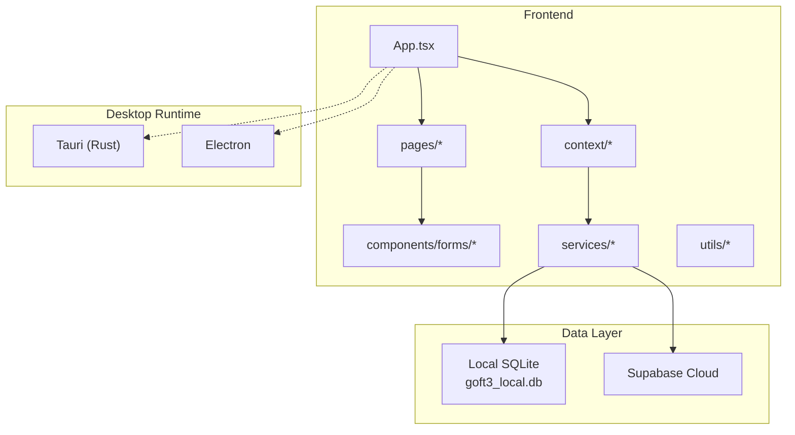
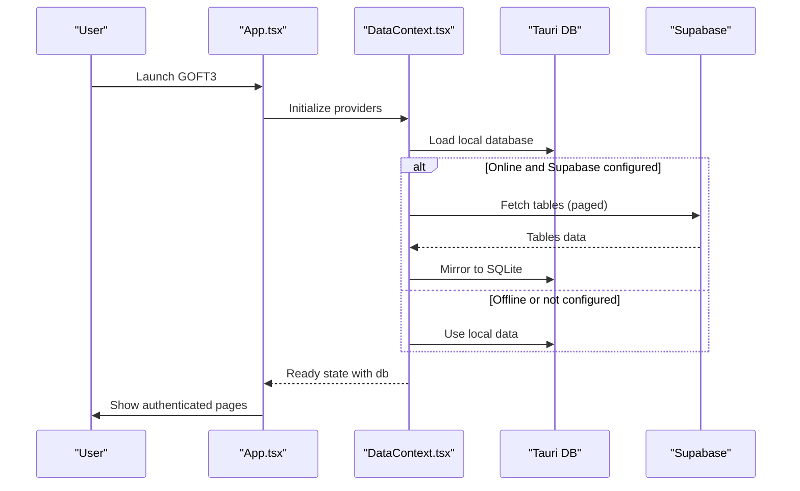
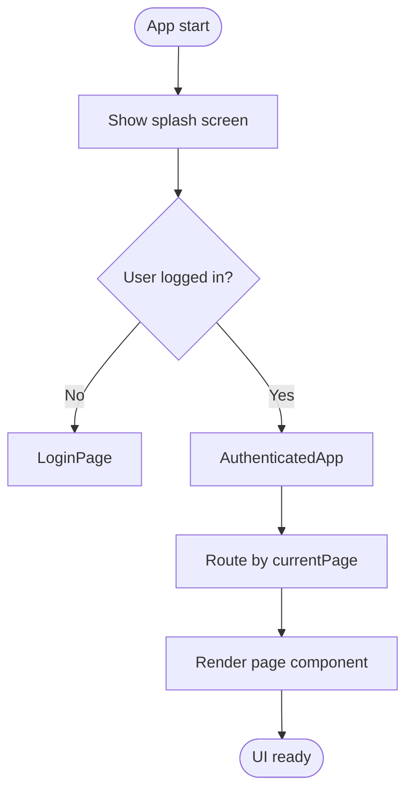
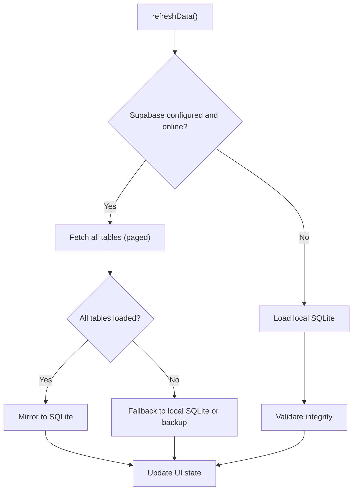
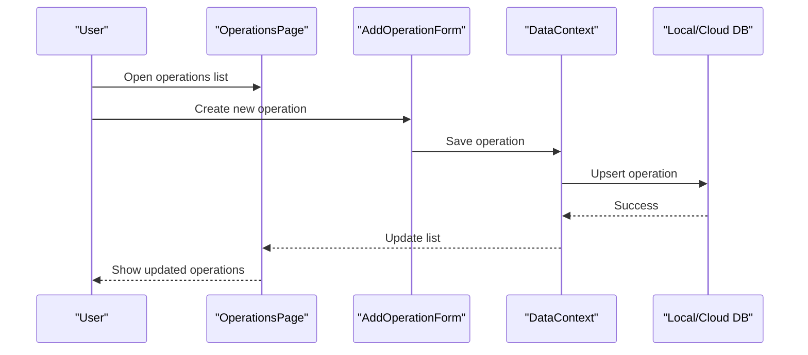
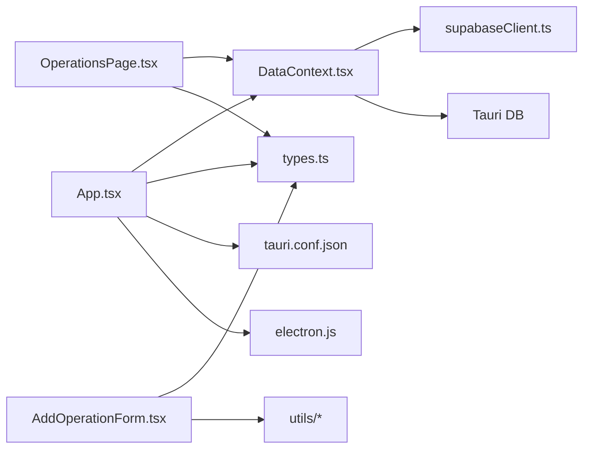

# Project Overview

<cite>
**Referenced Files in This Document**   
- [package.json](file://package.json)
- [App.tsx](file://App.tsx)
- [types.ts](file://types.ts)
- [tauri.conf.json](file://src-tauri/tauri.conf.json)
- [electron.js](file://electron.js)
- [supabaseClient.ts](file://services/supabaseClient.ts)
- [DataContext.tsx](file://context/DataContext.tsx)
- [OperationsPage.tsx](file://pages/OperationsPage.tsx)
- [AddOperationForm.tsx](file://components/forms/AddOperationForm.tsx)
</cite>

## Table of Contents
1. [Introduction](#introduction)
2. [Project Structure](#project-structure)
3. [Core Components](#core-components)
4. [Architecture Overview](#architecture-overview)
5. [Detailed Component Analysis](#detailed-component-analysis)
6. [Dependency Analysis](#dependency-analysis)
7. [Performance Considerations](#performance-considerations)
8. [Troubleshooting Guide](#troubleshooting-guide)
9. [Conclusion](#conclusion)

## Introduction
GOFT3 is a government/institutional financial operations management desktop application. It helps users manage financial operations, engagements, payments, and beneficiaries while supporting offline-first usage with optional cloud synchronization. The system is built as a React/Tauri/Electron hybrid desktop app: the same frontend can run inside Tauri or Electron, using a local SQLite database for offline operation and Supabase as an optional cloud source for multi-user synchronization.

Key terminology used throughout the codebase:
- Operations: top-level financial records that group documents, commitments, and payments.
- Engagements: commitment records linked to operations and documents.
- Payments: settlement records linked to operations, engagements, and documents.
- Beneficiaries: entities receiving payments, with optional bank account details.

This overview explains both conceptual workflows for beginners and technical implementation details for developers working with desktop applications.

## Project Structure
The project follows a feature-oriented structure:
- `pages/` contains main screens such as operations, documents, beneficiaries, financial status, and print views.
- `components/forms/` contains reusable forms for creating and editing operations, engagements, payments, beneficiaries, categories, programs, directions, rubriques, and related entities.
- `context/` provides global state, data synchronization, language, and toast notifications.
- `services/` contains Supabase client configuration and Tauri database integration.
- `utils/` includes currency formatting, date utilities, export helpers, update service, and authentication utilities.
- `src-tauri/` contains Tauri configuration and native commands.
- `electron.js` configures the Electron runtime.
- `App.tsx` is the main application shell, routing, and session management.
- `types.ts` defines TypeScript interfaces for all core models.

**Diagram sources**
- [App.tsx:547-780](file://App.tsx#L547-L780)
- [tauri.conf.json:1-56](file://src-tauri/tauri.conf.json#L1-L56)
- [electron.js:1-73](file://electron.js#L1-L73)
- [supabaseClient.ts:1-37](file://services/supabaseClient.ts#L1-L37)
- [DataContext.tsx:490-690](file://context/DataContext.tsx#L490-L690)

**Section sources**
- [package.json:1-137](file://package.json#L1-L137)
- [App.tsx:1-783](file://App.tsx#L1-L783)

## Core Components
- Main Application Shell (`App.tsx`)
  - Manages user session, navigation history, idle lock, splash screen, and page routing.
  - Integrates providers for query caching, data synchronization, language, and toast notifications.
  - Enforces role-based access control and per-operation visibility restrictions.
- Data Provider (`context/DataContext.tsx`)
  - Centralizes database state, offline/online sync, pending action queue, presence, events, integrity checks, and backup/restore.
  - Implements offline-first loading from local SQLite, then background refresh from Supabase when available.
- Type Definitions (`types.ts`)
  - Defines core models: User, Operation, Engagement, Paiement, Beneficiaire, Piece, Bordereau, Direction, Programme, Rubrique, and more.
  - Includes Page enum-like union type for routing and APP_VERSION constant.
- Desktop Runtimes
  - Tauri configuration (`src-tauri/tauri.conf.json`) sets window size, security policy, updater endpoints, and build settings.
  - Electron entry (`electron.js`) creates a secure BrowserWindow, loads Vite dev server in development, and serves built assets in production.

**Section sources**
- [App.tsx:547-780](file://App.tsx#L547-L780)
- [DataContext.tsx:133-800](file://context/DataContext.tsx#L133-L800)
- [types.ts:1-269](file://types.ts#L1-L269)
- [tauri.conf.json:1-56](file://src-tauri/tauri.conf.json#L1-L56)
- [electron.js:1-73](file://electron.js#L1-L73)

## Architecture Overview
GOFT3 uses a hybrid desktop architecture:
- Frontend: React + TypeScript with Vite.
- Desktop shells: Tauri (preferred for native performance and updater plugin) and Electron (alternative).
- Data layer:
  - Offline-first: local SQLite via Tauri commands.
  - Optional cloud sync: Supabase for multi-user collaboration.
  - Backup: localStorage JSON backup for web-only environments.

**Diagram sources**
- [App.tsx:547-780](file://App.tsx#L547-L780)
- [DataContext.tsx:490-690](file://context/DataContext.tsx#L490-L690)
- [supabaseClient.ts:1-37](file://services/supabaseClient.ts#L1-L37)

## Detailed Component Analysis

### Main App Component Structure
The main `App` component:
- Initializes splash screen, user session, current page, selected IDs for operations/engagements/payments, and navigation history.
- Wraps the UI with providers: QueryClientProvider, LanguageProvider, DataProvider, ToastProvider.
- Routes to login or authenticated pages based on session and roles.
- Handles idle auto-lock, global search shortcuts, and update prompts.

**Diagram sources**
- [App.tsx:547-780](file://App.tsx#L547-L780)

**Section sources**
- [App.tsx:547-780](file://App.tsx#L547-L780)

### TypeScript Type Definitions and Core Data Models
Core types define the domain model:
- User: identity, role, allowed pages/operations.
- Operation: financial operation header with category, subtype, status.
- Engagement: commitment record tied to operation and document.
- Paiement: payment record tied to operation, engagement, and document.
- Beneficiaire: beneficiary entity with optional bank account.
- Piece: document attached to an operation.
- Bordereau: dispatch list associated with documents.
- Direction, Programme, Rubrique, Categorie, Scategorie: administrative and budgetary structures.
- Database: aggregate interface combining all tables.

These types are consumed across pages, forms, and services to ensure consistent data handling.

**Section sources**
- [types.ts:1-269](file://types.ts#L1-L269)

### Offline-First Data Flow and Cloud Synchronization
The data provider implements:
- Priority 1: Supabase fetch when online and configured; mirrors results to local SQLite.
- Priority 2: Local SQLite load when offline or Supabase unavailable.
- Priority 3: localStorage backup fallback for web-only environments.
- Pending actions queue for add/update/delete operations when offline, synced later.
- Integrity validation for foreign keys among operations, pieces, engagements, and payments.

**Diagram sources**
- [DataContext.tsx:490-690](file://context/DataContext.tsx#L490-L690)

**Section sources**
- [DataContext.tsx:490-690](file://context/DataContext.tsx#L490-L690)
- [supabaseClient.ts:1-37](file://services/supabaseClient.ts#L1-L37)

### Configuration Options for Tauri and Electron
- Tauri (`src-tauri/tauri.conf.json`)
  - Window dimensions, minimum sizes, resizable flag, fullscreen disabled, centered.
  - CSP security policy allowing self-hosted scripts/styles/images/fonts and connecting to Supabase over HTTPS/WSS.
  - Updater plugin configured with GitHub release endpoint and public key for signed updates.
  - Build targets and icons defined for bundling.
- Electron (`electron.js`)
  - Creates a BrowserWindow with context isolation and no Node integration.
  - Loads Vite dev server in development mode and built index.html in production.
  - Disables menu in production and handles external links safely.

**Section sources**
- [tauri.conf.json:1-56](file://src-tauri/tauri.conf.json#L1-L56)
- [electron.js:1-73](file://electron.js#L1-L73)

### Usage Patterns for Financial Operations Management
Common workflows:
- Operation creation
  - Open the operations list, open the add operation form, fill required fields (operation number, title, category, subcategory), optionally add structure rows (rubriques/scategories), and save.
  - The form validates input length and required fields, formats operation numbers, and persists through the data provider.
- Engagement processing
  - After creating documents and operations, engagements are created and validated against operations and documents.
  - The data provider tracks engagement status flags and ensures referential integrity.
- Payment handling
  - Payments are linked to operations, engagements, and documents.
  - The system supports printing payment-related reports and managing payment claims.

**Diagram sources**
- [OperationsPage.tsx:1-200](file://pages/OperationsPage.tsx#L1-L200)
- [AddOperationForm.tsx:1-200](file://components/forms/AddOperationForm.tsx#L1-L200)
- [DataContext.tsx:391-451](file://context/DataContext.tsx#L391-L451)

**Section sources**
- [OperationsPage.tsx:1-200](file://pages/OperationsPage.tsx#L1-L200)
- [AddOperationForm.tsx:1-200](file://components/forms/AddOperationForm.tsx#L1-L200)

## Dependency Analysis
High-level dependencies:
- App depends on contexts/providers for data, language, and toast.
- Pages depend on types and data provider for CRUD operations.
- Forms depend on utils for currency/date formatting and validation.
- Data provider depends on Supabase client and Tauri DB service.
- Tauri and Electron provide the desktop runtime environment.

**Diagram sources**
- [App.tsx:547-780](file://App.tsx#L547-L780)
- [DataContext.tsx:490-690](file://context/DataContext.tsx#L490-L690)
- [supabaseClient.ts:1-37](file://services/supabaseClient.ts#L1-L37)
- [tauri.conf.json:1-56](file://src-tauri/tauri.conf.json#L1-L56)
- [electron.js:1-73](file://electron.js#L1-L73)

**Section sources**
- [package.json:1-137](file://package.json#L1-L137)

## Performance Considerations
- Code splitting: Pages are lazy-loaded to reduce initial bundle size.
- Query caching: React Query client configured with staleTime and gcTime to minimize refetches.
- Paged fetching: Supabase tables fetched in batches to avoid large payloads.
- Split state: Heavy tables (operations, engagements, paiements) separated from metadata to improve reactivity.
- Column projections: Only necessary columns are requested to reduce network overhead.
- Idle lock: Auto-lock after inactivity protects sensitive financial data.

[No sources needed since this section provides general guidance]

## Troubleshooting Guide
- Connection errors
  - If Supabase fetch fails, the app falls back to local SQLite or localStorage backup and shows a connection error message.
  - Check Supabase URL/key configuration stored in localStorage.
- Local SQLite issues
  - If Tauri DB is unavailable, the app disables local mirror and relies on backup.
  - Verify Tauri commands and permissions if running in packaged mode.
- Integrity issues
  - Broken foreign keys between operations, pieces, engagements, and payments are detected and reported.
  - Resolve missing references by ensuring proper deletion order or restoring from backup.
- Update failures
  - Update prompts may fail due to network or signature verification issues; check updater endpoint and pubkey configuration.

**Section sources**
- [DataContext.tsx:490-690](file://context/DataContext.tsx#L490-L690)
- [App.tsx:500-541](file://App.tsx#L500-L541)

## Conclusion
GOFT3 provides a robust, offline-first financial operations management system tailored for government and institutional use. Its hybrid desktop architecture supports both Tauri and Electron, with optional cloud synchronization via Supabase. The application emphasizes data integrity, security, and usability, offering comprehensive workflows for operations, engagements, payments, and beneficiaries. Developers can extend functionality through well-defined TypeScript types, modular components, and clear separation between frontend, desktop runtime, and data layers.

[No sources needed since this section summarizes without analyzing specific files]