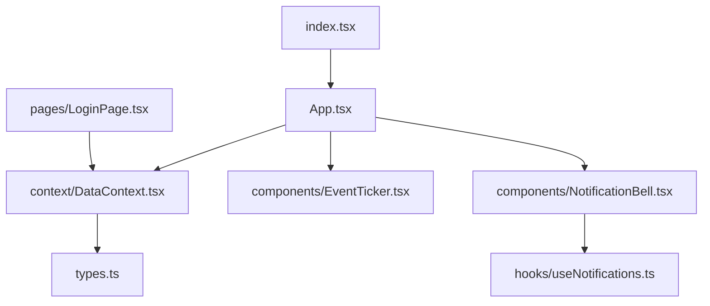
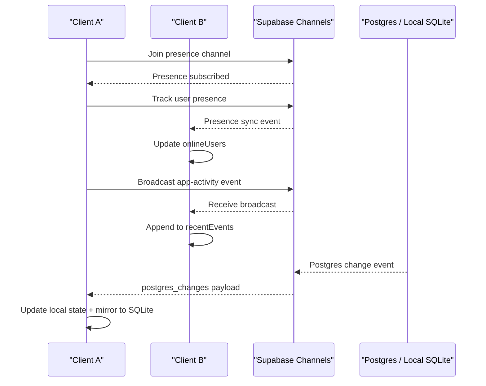
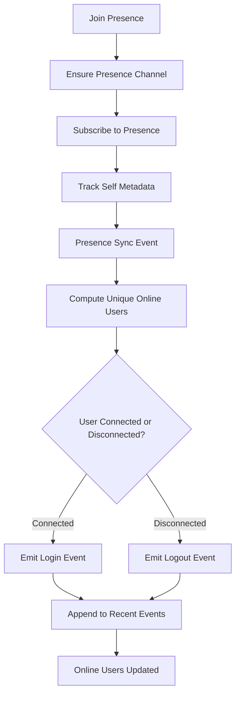
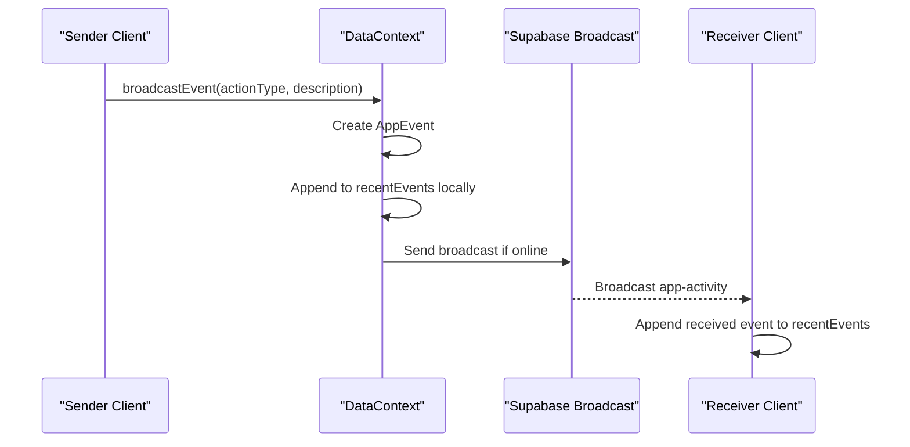
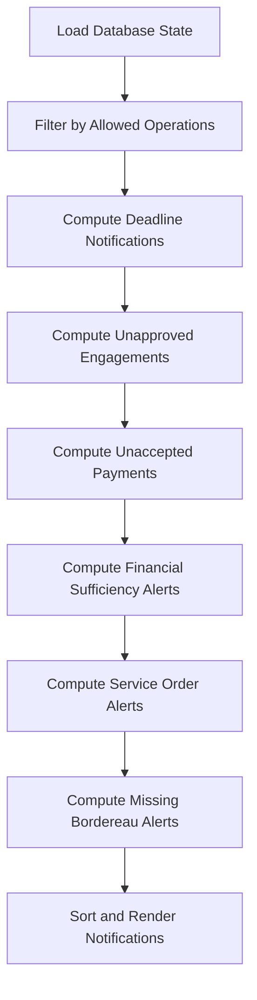
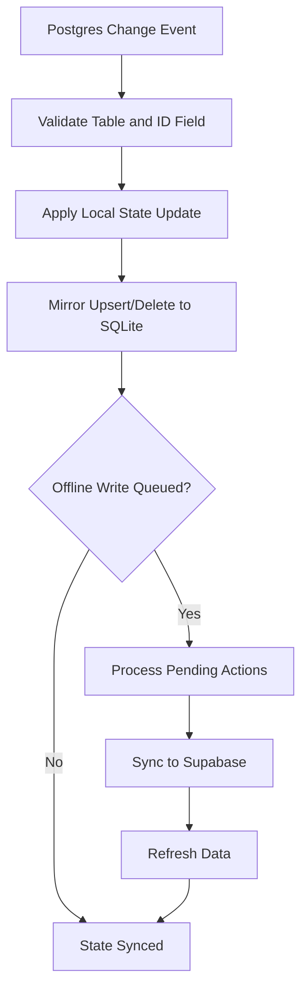
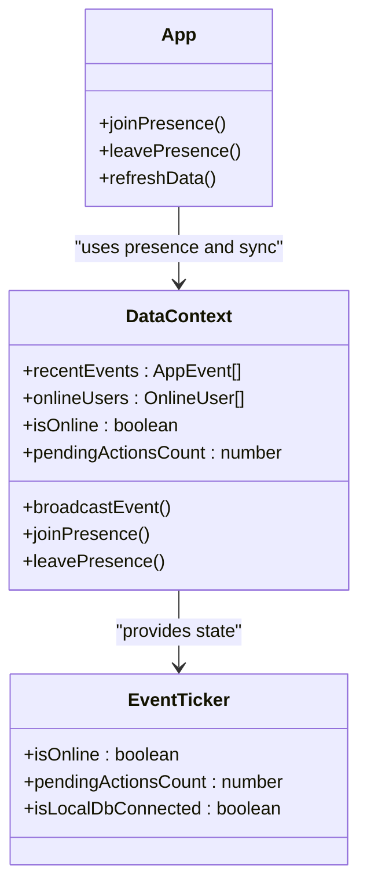
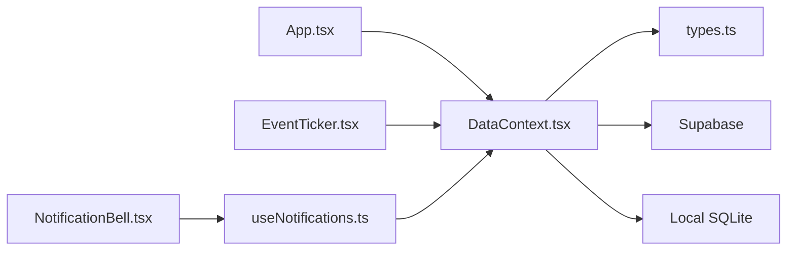

# Real-time Collaboration

<cite>
**Referenced Files in This Document**   
- [App.tsx](file://App.tsx)
- [index.tsx](file://index.tsx)
- [types.ts](file://types.ts)
- [DataContext.tsx](file://context/DataContext.tsx)
- [EventTicker.tsx](file://components/EventTicker.tsx)
- [NotificationBell.tsx](file://components/NotificationBell.tsx)
- [useNotifications.ts](file://hooks/useNotifications.ts)
- [LoginPage.tsx](file://pages/LoginPage.tsx)
</cite>

## Table of Contents
1. [Introduction](#introduction)
2. [Project Structure](#project-structure)
3. [Core Components](#core-components)
4. [Architecture Overview](#architecture-overview)
5. [Detailed Component Analysis](#detailed-component-analysis)
6. [Dependency Analysis](#dependency-analysis)
7. [Performance Considerations](#performance-considerations)
8. [Troubleshooting Guide](#troubleshooting-guide)
9. [Conclusion](#conclusion)

## Introduction
This document explains GOFT3’s real-time collaboration model for multi-user financial operations management. It focuses on presence indicators, event broadcasting, notification systems, and real-time data synchronization. The application uses a hybrid architecture:

- **Real-time layer**: Supabase channels provide presence tracking and event broadcasting.
- **Data synchronization layer**: Postgres changes are listened to for live updates; local SQLite is mirrored for offline-first behavior.
- **User activity tracking**: A recent-events list shows user actions such as add, update, delete, print, reset, import, login, and logout.
- **Notification system**: Business rules generate notifications for deadlines, financial sufficiency, missing documents, and payment claims.

The terminology used here follows real-time systems conventions: presence, events, notifications, and synchronization.

## Project Structure
GOFT3 organizes real-time collaboration features across context, components, hooks, pages, and shared types:

**Diagram sources**
- [App.tsx:51-65](file://App.tsx#L51-L65)
- [DataContext.tsx:1-7](file://context/DataContext.tsx#L1-L7)
- [EventTicker.tsx:1-5](file://components/EventTicker.tsx#L1-L5)
- [NotificationBell.tsx:1-4](file://components/NotificationBell.tsx#L1-L4)
- [useNotifications.ts:1-6](file://hooks/useNotifications.ts#L1-L6)
- [LoginPage.tsx:31-57](file://pages/LoginPage.tsx#L31-L57)
- [types.ts:18-24](file://types.ts#L18-L24)

**Section sources**
- [App.tsx:51-65](file://App.tsx#L51-L65)
- [index.tsx:92-102](file://index.tsx#L92-L102)
- [types.ts:18-24](file://types.ts#L18-L24)

## Core Components
GOFT3’s real-time collaboration relies on these core components:

- **Presence tracking**: Tracks who is online using Supabase presence channels.
- **Event broadcasting**: Broadcasts user actions across clients via Supabase broadcast channels.
- **Real-time data synchronization**: Subscribes to Postgres changes and mirrors updates to local state and SQLite.
- **Notification generation**: Computes business-driven notifications from the current database state.
- **Activity UI**: Displays connection status, pending sync count, and data source hints.

Key responsibilities:

| Component | Responsibility | Real-time Concept |
|---|---|---|
| `DataContext` | Presence, events, realtime subscriptions, sync queue | Presence, events, synchronization |
| `EventTicker` | Status bar with online/offline and sync indicators | Synchronization |
| `NotificationBell` | User-facing notification panel | Notifications |
| `useNotifications` | Derives notifications from DB state | Notifications |
| `LoginPage` | Prevents concurrent sessions by checking presence | Presence |
| `App` | Joins presence, leaves presence, refreshes data | Presence, synchronization |

**Section sources**
- [DataContext.tsx:28-57](file://context/DataContext.tsx#L28-L57)
- [DataContext.tsx:323-343](file://context/DataContext.tsx#L323-L343)
- [EventTicker.tsx:4-62](file://components/EventTicker.tsx#L4-L62)
- [NotificationBell.tsx:6-262](file://components/NotificationBell.tsx#L6-L262)
- [useNotifications.ts:8-393](file://hooks/useNotifications.ts#L8-L393)
- [LoginPage.tsx:31-57](file://pages/LoginPage.tsx#L31-L57)
- [App.tsx:94-95](file://App.tsx#L94-L95)
- [App.tsx:183-236](file://App.tsx#L183-L236)

## Architecture Overview
GOFT3 implements an event-driven real-time architecture with three main flows:

1. **Presence flow**: Users join presence, track themselves, and receive presence sync events that update the online users list.
2. **Event flow**: Clients broadcast app activity events; other clients receive them and append them to a recent-events list.
3. **Synchronization flow**: Postgres changes trigger local state updates and SQLite mirroring; offline writes are queued and synced when online.

**Diagram sources**
- [DataContext.tsx:888-990](file://context/DataContext.tsx#L888-L990)
- [DataContext.tsx:990-1015](file://context/DataContext.tsx#L990-L1015)
- [DataContext.tsx:1017-1090](file://context/DataContext.tsx#L1017-L1090)
- [DataContext.tsx:1098-1134](file://context/DataContext.tsx#L1098-L1134)

## Detailed Component Analysis

### Presence Indicators
Presence indicators show which users are currently active in the application. GOFT3 uses a Supabase presence channel named `online-users`. Each client tracks itself with user metadata such as user ID, username, role, and online timestamp. When presence sync occurs, the component computes unique users and derives login/logout events for other users.

Implementation highlights:

- Presence channel creation and subscription.
- Tracking self on subscribe.
- Computing unique online users.
- Emitting login/logout events into recent events.
- Joining and leaving presence lifecycle.

**Diagram sources**
- [DataContext.tsx:1017-1090](file://context/DataContext.tsx#L1017-L1090)
- [DataContext.tsx:1098-1134](file://context/DataContext.tsx#L1098-L1134)

Practical example:

- When a user logs in, `joinPresence` is called and the user tracks their presence.
- Other clients receive a presence sync event and see the new user in the online users list.
- If a user disconnects, the presence sync detects the removal and emits a logout event.

**Section sources**
- [DataContext.tsx:1017-1090](file://context/DataContext.tsx#L1017-L1090)
- [DataContext.tsx:1098-1134](file://context/DataContext.tsx#L1098-L1134)
- [App.tsx:183-236](file://App.tsx#L183-L236)

### Event Broadcasting
Event broadcasting allows users to share application activity with others. GOFT3 defines an `AppEvent` type with fields like id, username, actionType, description, and timestamp. The `broadcastEvent` function creates an event, updates local recent events immediately, and sends it over Supabase only when online.

Key behaviors:

- Local-first event insertion so the sender sees immediate feedback.
- Conditional broadcast only when online.
- Listener setup for `app-activity` broadcasts.
- Deduplication by event id.

**Diagram sources**
- [DataContext.tsx:990-1015](file://context/DataContext.tsx#L990-L1015)
- [DataContext.tsx:1098-1119](file://context/DataContext.tsx#L1098-L1119)
- [types.ts:18-24](file://types.ts#L18-L24)

Public interface for event handling:

- `broadcastEvent`: Emits an application activity event.
- `recentEvents`: Read-only list of recent events exposed through the data context.
- `AppEvent`: Type defining event structure.

**Section sources**
- [DataContext.tsx:990-1015](file://context/DataContext.tsx#L990-L1015)
- [DataContext.tsx:1098-1119](file://context/DataContext.tsx#L1098-L1119)
- [types.ts:18-24](file://types.ts#L18-L24)

### Notification System
The notification system generates business alerts based on the current database state. It computes overdue deadlines, unapproved engagements, unaccepted payments, financial sufficiency issues, missing bordereaux, and service order delays. The `NotificationBell` component renders these notifications and navigates users to relevant pages.

Important aspects:

- Notification derivation is computed from `db.T_PIECE`, `T_ENGAGEMENT`, `T_PAIEMENT`, `T_ODS`, and related tables.
- Authorization filtering applies when the current user is not admin.
- Notification types include deadline, financial, administrative, and operational alerts.
- Clicking a notification navigates to the appropriate operation or document page.

**Diagram sources**
- [useNotifications.ts:8-393](file://hooks/useNotifications.ts#L8-L393)
- [NotificationBell.tsx:11-262](file://components/NotificationBell.tsx#L11-L262)

Public interfaces for notifications:

- `useNotifications(currentUser)`: Returns a memoized array of notifications derived from the database.
- `NotificationBell`: Renders the notification bell and dropdown.
- `Notification`: Type defining notification shape.

**Section sources**
- [useNotifications.ts:8-393](file://hooks/useNotifications.ts#L8-L393)
- [NotificationBell.tsx:11-262](file://components/NotificationBell.tsx#L11-L262)
- [types.ts:235-245](file://types.ts#L235-L245)

### Real-time Data Synchronization
GOFT3 synchronizes data between Supabase and local SQLite. When online, it subscribes to Postgres changes and updates React state and local storage. Offline writes are queued and later synchronized when connectivity returns.

Core synchronization logic:

- Postgres change listener processes INSERT, UPDATE, DELETE events.
- Immediate local state updates keep the UI responsive.
- SQLite mirroring keeps offline data consistent.
- Pending actions queue ensures offline work is not lost.

**Diagram sources**
- [DataContext.tsx:888-990](file://context/DataContext.tsx#L888-L990)
- [DataContext.tsx:1309-1335](file://context/DataContext.tsx#L1309-L1335)
- [DataContext.tsx:693-783](file://context/DataContext.tsx#L693-L783)

**Section sources**
- [DataContext.tsx:888-990](file://context/DataContext.tsx#L888-L990)
- [DataContext.tsx:693-783](file://context/DataContext.tsx#L693-L783)
- [DataContext.tsx:1309-1335](file://context/DataContext.tsx#L1309-L1335)

### User Activity Tracking
User activity tracking is implemented through the recent-events list and presence-based login/logout events. The `EventTicker` displays connection status, pending sync count, and data source hints. The `App` component joins presence on mount and leaves presence on cleanup.

Key elements:

- `recentEvents` stores up to 10 recent events.
- Presence sync emits login/logout events.
- `EventTicker` shows online/offline status and sync progress.
- Idle lock mechanism protects sensitive financial data.

**Diagram sources**
- [DataContext.tsx:323-343](file://context/DataContext.tsx#L323-L343)
- [DataContext.tsx:990-1015](file://context/DataContext.tsx#L990-L1015)
- [EventTicker.tsx:4-62](file://components/EventTicker.tsx#L4-L62)
- [App.tsx:183-236](file://App.tsx#L183-L236)

**Section sources**
- [DataContext.tsx:323-343](file://context/DataContext.tsx#L323-L343)
- [DataContext.tsx:990-1015](file://context/DataContext.tsx#L990-L1015)
- [EventTicker.tsx:4-62](file://components/EventTicker.tsx#L4-L62)
- [App.tsx:183-236](file://App.tsx#L183-L236)

### Concurrent Session Prevention
GOFT3 prevents concurrent sessions for the same username by checking presence before allowing login. If a username is already online, the login is blocked with a clear error message.

Behavior:

- Check `onlineUsers` for matching username.
- Block login if concurrent session detected.
- Show toast and error message.

**Section sources**
- [LoginPage.tsx:31-57](file://pages/LoginPage.tsx#L31-L57)
- [DataContext.tsx:1017-1090](file://context/DataContext.tsx#L1017-L1090)

## Dependency Analysis
The real-time collaboration features depend on several layers:

- **React components**: `App`, `EventTicker`, `NotificationBell`.
- **Context layer**: `DataContext` provides presence, events, and synchronization.
- **Hooks layer**: `useNotifications` derives notifications from database state.
- **Types layer**: Shared types define `AppEvent`, `OnlineUser`, `Notification`, and database models.
- **External services**: Supabase for presence, broadcast, and Postgres changes; Tauri/local SQLite for offline persistence.

**Diagram sources**
- [App.tsx:51-65](file://App.tsx#L51-L65)
- [DataContext.tsx:1-7](file://context/DataContext.tsx#L1-L7)
- [EventTicker.tsx:1-5](file://components/EventTicker.tsx#L1-L5)
- [NotificationBell.tsx:1-4](file://components/NotificationBell.tsx#L1-L4)
- [useNotifications.ts:1-6](file://hooks/useNotifications.ts#L1-L6)
- [types.ts:18-24](file://types.ts#L18-L24)

**Section sources**
- [App.tsx:51-65](file://App.tsx#L51-L65)
- [DataContext.tsx:1-7](file://context/DataContext.tsx#L1-L7)
- [EventTicker.tsx:1-5](file://components/EventTicker.tsx#L1-L5)
- [NotificationBell.tsx:1-4](file://components/NotificationBell.tsx#L1-L4)
- [useNotifications.ts:1-6](file://hooks/useNotifications.ts#L1-L6)
- [types.ts:18-24](file://types.ts#L18-L24)

## Performance Considerations
Handling concurrent users and real-time communication requires careful performance management:

- **Presence scaling**: Presence channels scale with the number of connected clients. Avoid excessive metadata in presence payloads.
- **Event broadcasting limits**: Keep event payloads small and limit recent events to a fixed size to prevent memory growth.
- **Realtime listeners**: Postgres change listeners should filter by table and avoid unnecessary re-renders.
- **Batch mode**: Use batch mode to suppress intermediate realtime updates during transactions.
- **Offline queue**: Limit pending actions and process them sequentially to avoid overwhelming the network.
- **Conflict resolution**: GOFT3 uses optimistic local updates with server reconciliation. For simultaneous edits, prefer server-side validation and conflict resolution strategies such as last-write-wins or merge strategies.

Recommendations:

- Debounce heavy computations in notification derivation.
- Use memoization for derived notification lists.
- Monitor Supabase channel health and reconnect on failure.
- Implement backpressure for event broadcasting under high concurrency.
- Profile SQLite mirroring performance for large datasets.

[No sources needed since this section provides general guidance]

## Troubleshooting Guide
Common issues and resolutions:

- **Presence not updating**: Verify Supabase connection and ensure `joinPresence` is called after login.
- **Events not broadcasting**: Check `isOnline` flag and ensure broadcast channel is initialized.
- **Notifications not appearing**: Confirm database state is loaded and authorization filters are correct.
- **Sync failures**: Inspect pending actions queue and network errors; retry on reconnection.
- **Concurrent session blocked**: Ensure the conflicting user logs out or closes their session.

Debugging tips:

- Inspect `onlineUsers` to verify presence state.
- Inspect `recentEvents` to verify event broadcasting.
- Inspect `pendingActionsCount` to monitor sync backlog.
- Use browser console to log Supabase channel events.

**Section sources**
- [DataContext.tsx:323-343](file://context/DataContext.tsx#L323-L343)
- [DataContext.tsx:990-1015](file://context/DataContext.tsx#L990-L1015)
- [DataContext.tsx:693-783](file://context/DataContext.tsx#L693-L783)
- [EventTicker.tsx:4-62](file://components/EventTicker.tsx#L4-L62)

## Conclusion
GOFT3’s real-time collaboration model combines presence tracking, event broadcasting, and robust data synchronization to support multi-user financial operations management. The architecture balances real-time responsiveness with offline resilience, while providing clear user feedback through presence indicators, event tickers, and notification panels. For production deployments, focus on scalability limits, conflict resolution strategies, and performance optimization to ensure reliable collaboration under concurrent usage.

[No sources needed since this section summarizes without analyzing specific files]