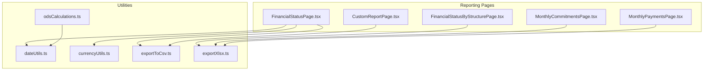
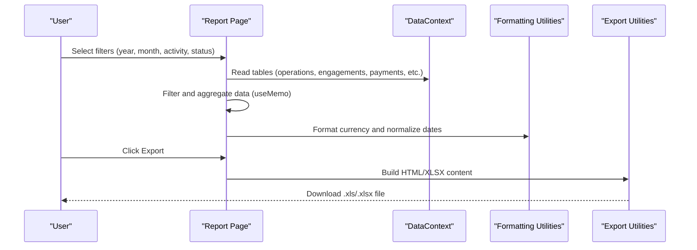
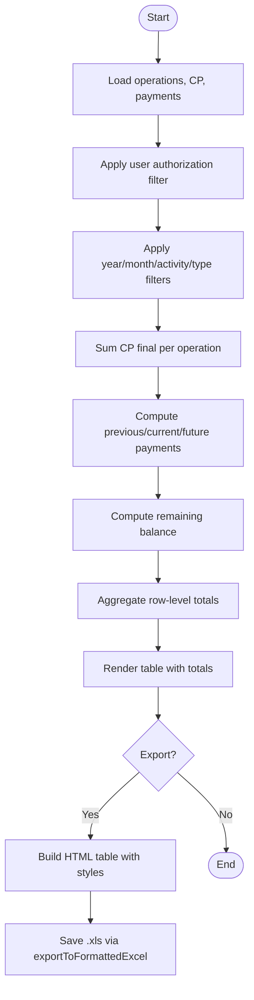
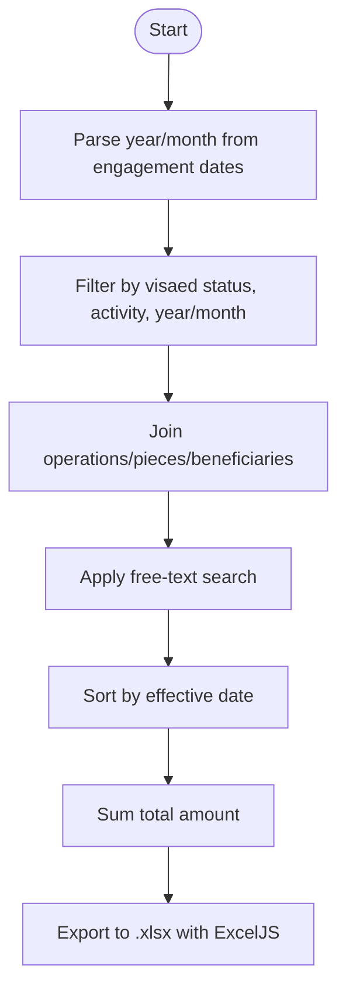
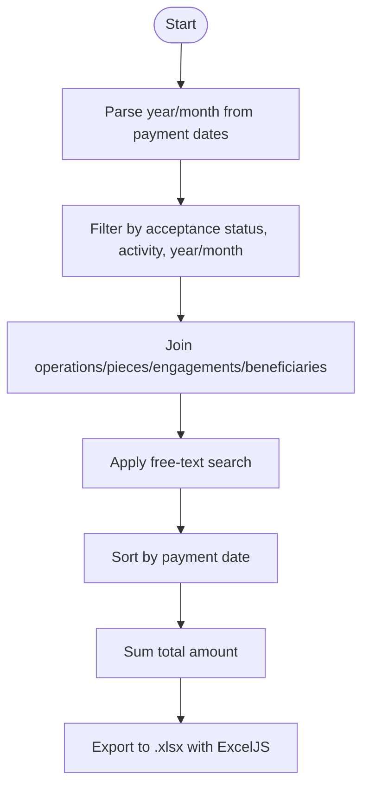
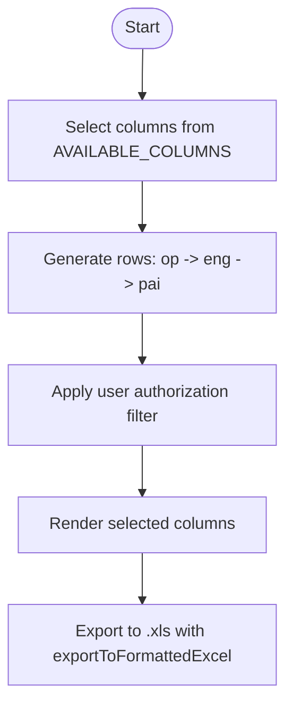
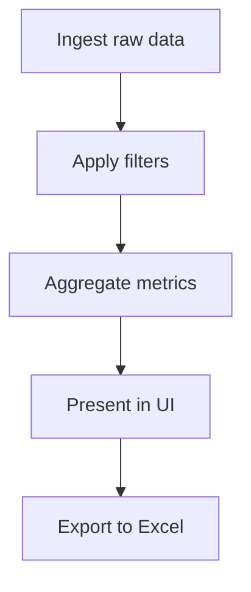
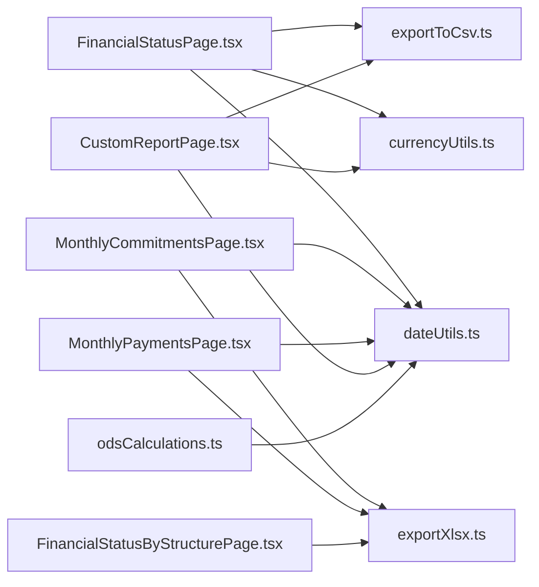

# Reporting & Analytics

<cite>
**Referenced Files in This Document**   
- [FinancialStatusPage.tsx](file://pages/FinancialStatusPage.tsx)
- [MonthlyCommitmentsPage.tsx](file://pages/MonthlyCommitmentsPage.tsx)
- [MonthlyPaymentsPage.tsx](file://pages/MonthlyPaymentsPage.tsx)
- [CustomReportPage.tsx](file://pages/CustomReportPage.tsx)
- [FinancialStatusByStructurePage.tsx](file://pages/FinancialStatusByStructurePage.tsx)
- [odsCalculations.ts](file://utils/odsCalculations.ts)
- [dateUtils.ts](file://utils/dateUtils.ts)
- [currencyUtils.ts](file://utils/currencyUtils.ts)
- [exportToCsv.ts](file://utils/exportToCsv.ts)
- [exportXlsx.ts](file://utils/exportXlsx.ts)
</cite>

## Table of Contents
1. [Introduction](#introduction)
2. [Project Structure](#project-structure)
3. [Core Components](#core-components)
4. [Architecture Overview](#architecture-overview)
5. [Detailed Component Analysis](#detailed-component-analysis)
6. [Dependency Analysis](#dependency-analysis)
7. [Performance Considerations](#performance-considerations)
8. [Troubleshooting Guide](#troubleshooting-guide)
9. [Conclusion](#conclusion)
10. [Appendices](#appendices)

## Introduction
This document explains GOFT3’s reporting and analytics features for financial data visualization and export. It covers:
- Financial status reports that summarize commitments, payments, and remaining balances per operation.
- Monthly commitments and monthly payments tracking with filtering by year, month, activity, and status.
- Custom report generation allowing users to select columns and export structured financial data.
- Data aggregation, filtering, and calculation engines used across these reports.
- Export utilities for Excel-compatible formats.
- Performance considerations, caching strategies, and customization options for layouts and calculations.

The terminology follows standard financial reporting concepts such as financial status, commitments, payments, and custom reports.

## Project Structure
GOFT3 implements reporting through React pages under `pages/`, shared formatting and date utilities under `utils/`, and export helpers for Excel output. The main reporting entry points are:
- Financial status overview and drill-down views.
- Monthly commitment and payment trackers.
- A flexible custom report builder.
- Export utilities producing `.xls` or `.xlsx` files.



**Diagram sources**
- [FinancialStatusPage.tsx:1-361](file://pages/FinancialStatusPage.tsx#L1-L361)
- [FinancialStatusByStructurePage.tsx:1-464](file://pages/FinancialStatusByStructurePage.tsx#L1-L464)
- [MonthlyCommitmentsPage.tsx:1-393](file://pages/MonthlyCommitmentsPage.tsx#L1-L393)
- [MonthlyPaymentsPage.tsx:1-402](file://pages/MonthlyPaymentsPage.tsx#L1-L402)
- [CustomReportPage.tsx:1-228](file://pages/CustomReportPage.tsx#L1-L228)
- [dateUtils.ts:1-147](file://utils/dateUtils.ts#L1-L147)
- [currencyUtils.ts:1-168](file://utils/currencyUtils.ts#L1-L168)
- [odsCalculations.ts:1-186](file://utils/odsCalculations.ts#L1-L186)
- [exportToCsv.ts:1-46](file://utils/exportToCsv.ts#L1-L46)
- [exportXlsx.ts:1-15](file://utils/exportXlsx.ts#L1-L15)

**Section sources**
- [FinancialStatusPage.tsx:1-361](file://pages/FinancialStatusPage.tsx#L1-L361)
- [MonthlyCommitmentsPage.tsx:1-393](file://pages/MonthlyCommitmentsPage.tsx#L1-L393)
- [MonthlyPaymentsPage.tsx:1-402](file://pages/MonthlyPaymentsPage.tsx#L1-L402)
- [CustomReportPage.tsx:1-228](file://pages/CustomReportPage.tsx#L1-L228)
- [FinancialStatusByStructurePage.tsx:1-464](file://pages/FinancialStatusByStructurePage.tsx#L1-L464)

## Core Components
This section summarizes the primary reporting components and their responsibilities.

- Financial Status Report
  - Purpose: Show open operations with CP final amounts, previous and current-month payments, total payments for the selected year, and remaining balance.
  - Filters: Year, month, activity (action code), operation type, and user authorization.
  - Aggregation: Sums CP final amounts per operation; aggregates payments by month and year; computes remaining balance.
  - Export: Generates a formatted `.xls` file with styled headers and currency formatting.

- Financial Status By Structure
  - Purpose: Break down financial status by cost structure (rubriques) within an operation, showing initial/final authorization, commitments, remaining authorization, payments, and execution balance.
  - Aggregation: Computes commitment and payment totals per rubrique based on linked pieces and engagements/payments.
  - Export: Produces a professionally formatted `.xlsx` workbook with RTL layout and borders.

- Monthly Commitments Tracking
  - Purpose: Track engagements (commitments) by month and year, including visaed vs non-visaed status.
  - Filters: Year, month, visaed status, activity, and free-text search.
  - Aggregation: Normalizes dates, filters engagements, enriches rows with operation/piece/beneficiary details, and sums total amount.
  - Export: Builds an ExcelJS workbook with right-to-left view and numeric formatting.

- Monthly Payments Tracking
  - Purpose: Track payments by month and year, including accepted vs not accepted status.
  - Filters: Year, month, acceptance status, activity, and free-text search.
  - Aggregation: Normalizes dates, filters payments, enriches rows with operation/piece/engagement/beneficiary details, and sums total amount.
  - Export: Builds an ExcelJS workbook with right-to-left view and numeric formatting.

- Custom Reports
  - Purpose: Allow users to build ad-hoc reports by selecting columns from operations, engagements, and payments.
  - Data Generation: Joins operations with related engagements and payments, flattening into rows.
  - Export: Exports selected columns to a formatted `.xls` file with currency formatting where applicable.

**Section sources**
- [FinancialStatusPage.tsx:83-168](file://pages/FinancialStatusPage.tsx#L83-L168)
- [FinancialStatusByStructurePage.tsx:58-124](file://pages/FinancialStatusByStructurePage.tsx#L58-L124)
- [MonthlyCommitmentsPage.tsx:93-144](file://pages/MonthlyCommitmentsPage.tsx#L93-L144)
- [MonthlyPaymentsPage.tsx:93-140](file://pages/MonthlyPaymentsPage.tsx#L93-L140)
- [CustomReportPage.tsx:51-107](file://pages/CustomReportPage.tsx#L51-L107)

## Architecture Overview
The reporting architecture is component-driven:
- Each report page reads data from a centralized data context (`useData`) and applies filters/aggregations using React’s `useMemo`.
- Formatting utilities handle currency display and date normalization.
- Export utilities convert results to Excel-compatible formats.



**Diagram sources**
- [FinancialStatusPage.tsx:83-168](file://pages/FinancialStatusPage.tsx#L83-L168)
- [MonthlyCommitmentsPage.tsx:93-144](file://pages/MonthlyCommitmentsPage.tsx#L93-L144)
- [MonthlyPaymentsPage.tsx:93-140](file://pages/MonthlyPaymentsPage.tsx#L93-L140)
- [CustomReportPage.tsx:51-107](file://pages/CustomReportPage.tsx#L51-L107)
- [exportToCsv.ts:6-45](file://utils/exportToCsv.ts#L6-L45)
- [exportXlsx.ts:10-14](file://utils/exportXlsx.ts#L10-L14)

## Detailed Component Analysis

### Financial Status Report
Purpose:
- Provide a financial status view per open operation, aggregating CP final amounts and payments by month/year, and computing remaining balances.

Key implementation details:
- Authorization: Non-admin users can restrict visible operations via `ALLOWED_OPERATIONS`.
- Activity filter: Extracts action codes from operation numbers and maps them to names.
- Payment breakdown: Separates previous payments, current month payments, and future payments based on normalized dates.
- Totals: Aggregates CP final, previous payments, current month payments, total payments for the period, and remaining balance.
- Export: Uses HTML table generation and exports to `.xls` with RTL support and currency formatting.



**Diagram sources**
- [FinancialStatusPage.tsx:83-168](file://pages/FinancialStatusPage.tsx#L83-L168)
- [FinancialStatusPage.tsx:170-211](file://pages/FinancialStatusPage.tsx#L170-L211)
- [exportToCsv.ts:6-45](file://utils/exportToCsv.ts#L6-L45)

**Section sources**
- [FinancialStatusPage.tsx:83-168](file://pages/FinancialStatusPage.tsx#L83-L168)
- [FinancialStatusPage.tsx:170-211](file://pages/FinancialStatusPage.tsx#L170-L211)

### Financial Status By Structure
Purpose:
- Present financial status broken down by cost structure (rubriques) within a selected operation, including authorization, commitments, payments, and execution balance.

Key implementation details:
- Rubrique mapping: Maps operations to rubriques and links pieces to rubriques.
- Commitment calculation: Sums engagement amounts for pieces belonging to each rubrique.
- Payment calculation: Sums payment amounts for pieces belonging to each rubrique.
- Totals: Aggregates initial/final authorization, commitment, remaining authorization, payment, and execution balance.
- Export: Builds a styled Excel workbook with RTL view, borders, and header styling.

```mermaid
classDiagram
class RubriqueRow {
+number id
+string structure
+number initialAuth
+number finalAuth
+number commitment
+number remainingAuth
+number payment
+number executionBalance
}
class FinancialStatusByStructurePage {
+selectedOperationId : string
+tableData : { rows : RubriqueRow[], totals : object }
+handleExport()
}
FinancialStatusByStructurePage --> RubriqueRow : "computes"
```

**Diagram sources**
- [FinancialStatusByStructurePage.tsx:58-124](file://pages/FinancialStatusByStructurePage.tsx#L58-L124)
- [FinancialStatusByStructurePage.tsx:126-377](file://pages/FinancialStatusByStructurePage.tsx#L126-L377)

**Section sources**
- [FinancialStatusByStructurePage.tsx:58-124](file://pages/FinancialStatusByStructurePage.tsx#L58-L124)
- [FinancialStatusByStructurePage.tsx:126-377](file://pages/FinancialStatusByStructurePage.tsx#L126-L377)

### Monthly Commitments Tracking
Purpose:
- Track engagements (commitments) by month and year, distinguishing visaed vs non-visaed statuses, and providing totals.

Key implementation details:
- Date parsing: Handles multiple date formats and extracts year/month.
- Filtering: Applies visaed status, activity, year/month, and text search.
- Enrichment: Joins engagements with operations, pieces, and beneficiaries.
- Sorting: Sorts by effective date (visaed or engagement date).
- Export: Creates an ExcelJS workbook with RTL view and numeric formatting.



**Diagram sources**
- [MonthlyCommitmentsPage.tsx:31-49](file://pages/MonthlyCommitmentsPage.tsx#L31-L49)
- [MonthlyCommitmentsPage.tsx:93-144](file://pages/MonthlyCommitmentsPage.tsx#L93-L144)
- [MonthlyCommitmentsPage.tsx:155-196](file://pages/MonthlyCommitmentsPage.tsx#L155-L196)

**Section sources**
- [MonthlyCommitmentsPage.tsx:93-144](file://pages/MonthlyCommitmentsPage.tsx#L93-L144)
- [MonthlyCommitmentsPage.tsx:155-196](file://pages/MonthlyCommitmentsPage.tsx#L155-L196)

### Monthly Payments Tracking
Purpose:
- Track payments by month and year, distinguishing accepted vs not accepted statuses, and providing totals.

Key implementation details:
- Date parsing: Handles multiple date formats and extracts year/month.
- Filtering: Applies acceptance status, activity, year/month, and text search.
- Enrichment: Joins payments with operations, pieces, engagements, and beneficiaries.
- Sorting: Sorts by payment date.
- Export: Creates an ExcelJS workbook with RTL view and numeric formatting.



**Diagram sources**
- [MonthlyPaymentsPage.tsx:32-50](file://pages/MonthlyPaymentsPage.tsx#L32-L50)
- [MonthlyPaymentsPage.tsx:93-140](file://pages/MonthlyPaymentsPage.tsx#L93-L140)
- [MonthlyPaymentsPage.tsx:151-197](file://pages/MonthlyPaymentsPage.tsx#L151-L197)

**Section sources**
- [MonthlyPaymentsPage.tsx:93-140](file://pages/MonthlyPaymentsPage.tsx#L93-L140)
- [MonthlyPaymentsPage.tsx:151-197](file://pages/MonthlyPaymentsPage.tsx#L151-L197)

### Custom Reports
Purpose:
- Enable users to construct ad-hoc financial reports by selecting columns from operations, engagements, and payments.

Key implementation details:
- Column configuration: Users toggle available columns grouped by operation, engagement, and payment.
- Data generation: Flattens operations with related engagements and payments into rows.
- Authorization: Respects user role and allowed operations.
- Export: Generates a formatted `.xls` file with currency formatting for numeric columns.



**Diagram sources**
- [CustomReportPage.tsx:24-36](file://pages/CustomReportPage.tsx#L24-L36)
- [CustomReportPage.tsx:51-107](file://pages/CustomReportPage.tsx#L51-L107)
- [CustomReportPage.tsx:109-138](file://pages/CustomReportPage.tsx#L109-L138)

**Section sources**
- [CustomReportPage.tsx:51-107](file://pages/CustomReportPage.tsx#L51-L107)
- [CustomReportPage.tsx:109-138](file://pages/CustomReportPage.tsx#L109-L138)

### Conceptual Overview
Conceptually, GOFT3’s reporting pipeline consists of:
- Data ingestion from the application’s database context.
- Filtering by business dimensions (year, month, activity, status).
- Aggregation and calculation of financial metrics (commitments, payments, balances).
- Presentation in tabular format with totals.
- Export to Excel-compatible formats for offline analysis and sharing.



[No sources needed since this diagram shows conceptual workflow, not actual code structure]

## Dependency Analysis
The reporting modules depend on shared utilities for date normalization, currency formatting, and Excel export.



**Diagram sources**
- [FinancialStatusPage.tsx:1-361](file://pages/FinancialStatusPage.tsx#L1-L361)
- [MonthlyCommitmentsPage.tsx:1-393](file://pages/MonthlyCommitmentsPage.tsx#L1-L393)
- [MonthlyPaymentsPage.tsx:1-402](file://pages/MonthlyPaymentsPage.tsx#L1-L402)
- [FinancialStatusByStructurePage.tsx:1-464](file://pages/FinancialStatusByStructurePage.tsx#L1-L464)
- [CustomReportPage.tsx:1-228](file://pages/CustomReportPage.tsx#L1-L228)
- [dateUtils.ts:1-147](file://utils/dateUtils.ts#L1-L147)
- [currencyUtils.ts:1-168](file://utils/currencyUtils.ts#L1-L168)
- [odsCalculations.ts:1-186](file://utils/odsCalculations.ts#L1-L186)
- [exportToCsv.ts:1-46](file://utils/exportToCsv.ts#L1-L46)
- [exportXlsx.ts:1-15](file://utils/exportXlsx.ts#L1-L15)

**Section sources**
- [FinancialStatusPage.tsx:1-361](file://pages/FinancialStatusPage.tsx#L1-L361)
- [MonthlyCommitmentsPage.tsx:1-393](file://pages/MonthlyCommitmentsPage.tsx#L1-L393)
- [MonthlyPaymentsPage.tsx:1-402](file://pages/MonthlyPaymentsPage.tsx#L1-L402)
- [FinancialStatusByStructurePage.tsx:1-464](file://pages/FinancialStatusByStructurePage.tsx#L1-L464)
- [CustomReportPage.tsx:1-228](file://pages/CustomReportPage.tsx#L1-L228)
- [dateUtils.ts:1-147](file://utils/dateUtils.ts#L1-L147)
- [currencyUtils.ts:1-168](file://utils/currencyUtils.ts#L1-L168)
- [odsCalculations.ts:1-186](file://utils/odsCalculations.ts#L1-L186)
- [exportToCsv.ts:1-46](file://utils/exportToCsv.ts#L1-L46)
- [exportXlsx.ts:1-15](file://utils/exportXlsx.ts#L1-L15)

## Performance Considerations
- Memoization: All major computations use `useMemo` to avoid recomputation when filters change.
- Filtering efficiency: Early filtering reduces dataset size before enrichment and sorting.
- Large datasets: For very large tables, consider:
  - Pagination or virtualized rendering for UI performance.
  - Pre-aggregating frequently accessed metrics (e.g., yearly totals) in memory.
  - Caching computed results keyed by filter combinations (e.g., year+month+activity).
- Export performance:
  - Prefer ExcelJS for complex workbooks (.xlsx) to leverage streaming and efficient cell formatting.
  - Use HTML-based export (.xls) only for simple tables to minimize overhead.
- Date normalization: Centralized normalization avoids repeated parsing and ensures consistent comparisons.

[No sources needed since this section provides general guidance]

## Troubleshooting Guide
Common issues and resolutions:
- Empty reports after filtering:
  - Verify filters (year, month, activity, status) match available data.
  - Check user authorization constraints (`ALLOWED_OPERATIONS`).
- Incorrect currency formatting:
  - Ensure amounts are numeric; null/undefined values are handled by formatting utilities.
- Date mismatches:
  - Confirm date strings conform to supported formats; use `normalizeDate` for consistent display.
- Export failures:
  - Validate that data exists before exporting.
  - Ensure filenames have correct extensions (.xls or .xlsx).

**Section sources**
- [FinancialStatusPage.tsx:170-211](file://pages/FinancialStatusPage.tsx#L170-L211)
- [MonthlyCommitmentsPage.tsx:155-196](file://pages/MonthlyCommitmentsPage.tsx#L155-L196)
- [MonthlyPaymentsPage.tsx:151-197](file://pages/MonthlyPaymentsPage.tsx#L151-L197)
- [CustomReportPage.tsx:109-138](file://pages/CustomReportPage.tsx#L109-L138)
- [exportToCsv.ts:6-45](file://utils/exportToCsv.ts#L6-L45)
- [exportXlsx.ts:10-14](file://utils/exportXlsx.ts#L10-L14)

## Conclusion
GOFT3’s reporting and analytics provide robust financial status visibility, monthly commitment and payment tracking, and flexible custom report generation. The system leverages memoized computations, standardized date and currency utilities, and dedicated export helpers to deliver accurate, formatted outputs. Extending reports involves adding filters, enriching data joins, and integrating with existing export utilities while maintaining performance through memoization and efficient data processing.

[No sources needed since this section summarizes without analyzing specific files]

## Appendices

### Public Interfaces for Report Generation APIs, Export Utilities, and Data Transformation Functions
- Export Utilities:
  - `exportToFormattedExcel(htmlContent, filename)`
    - Purpose: Generate a formatted `.xls` file from HTML table content with RTL support and UTF-8 BOM.
    - Inputs: HTML string, filename string.
    - Output: Saves file via shared save mechanism.
  - `saveWorkbook(workbook, filename)`
    - Purpose: Serialize an ExcelJS workbook to `.xlsx` and save it.
    - Inputs: ExcelJS.Workbook instance, filename string.
    - Output: Saves file via shared save mechanism.

- Date Utilities:
  - `normalizeDate(dateStr)`
    - Purpose: Normalize various date formats to DD/MM/YYYY.
    - Inputs: Date string or null/undefined.
    - Output: Normalized date string.
  - `parseDate(dateStr)`
    - Purpose: Parse normalized date string to Date object.
    - Inputs: Date string or null/undefined.
    - Output: Date object or null.
  - `calculateElapsedDays(start, end, useFinancialRule)`
    - Purpose: Calculate elapsed days between two dates, optionally using financial rules.
    - Inputs: Date objects, boolean flag.
    - Output: Number of days.

- Currency Utilities:
  - `formatCurrency(amount)`
    - Purpose: Format numeric amount with decimal separators and grouping.
    - Inputs: Number or null/undefined.
    - Output: Formatted string.
  - `parseCurrency(input)`
    - Purpose: Parse formatted currency string to number.
    - Inputs: String, number, or null/undefined.
    - Output: Number.

- ODS Calculations:
  - `calculateOdsDeadline(input)`
    - Purpose: Compute deadline state for contracts including consumed days, suspension days, expected end date, delay, warranty expiration.
    - Inputs: Object with duration string, ordered ODS timeline, optional today anchor.
    - Output: Calculation result object with financial indicators.

**Section sources**
- [exportToCsv.ts:6-45](file://utils/exportToCsv.ts#L6-L45)
- [exportXlsx.ts:10-14](file://utils/exportXlsx.ts#L10-L14)
- [dateUtils.ts:1-147](file://utils/dateUtils.ts#L1-L147)
- [currencyUtils.ts:1-168](file://utils/currencyUtils.ts#L1-L168)
- [odsCalculations.ts:65-185](file://utils/odsCalculations.ts#L65-L185)