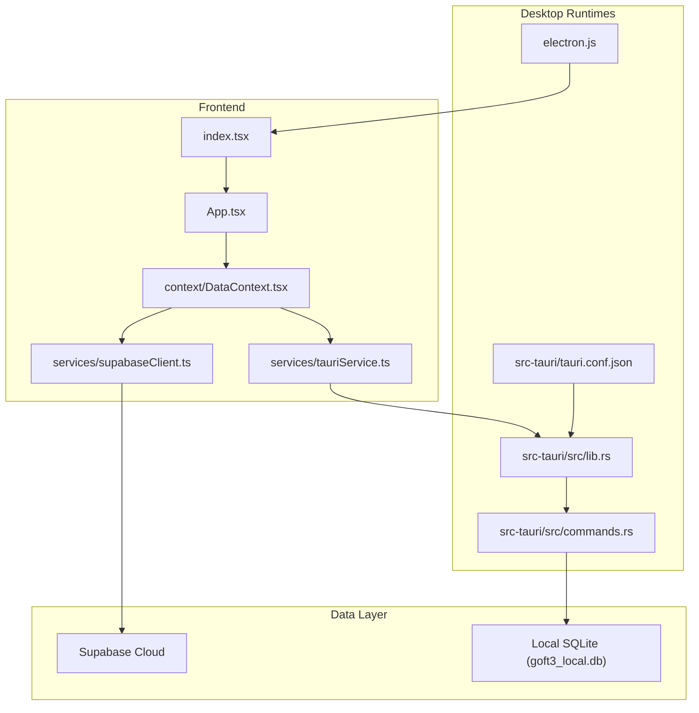
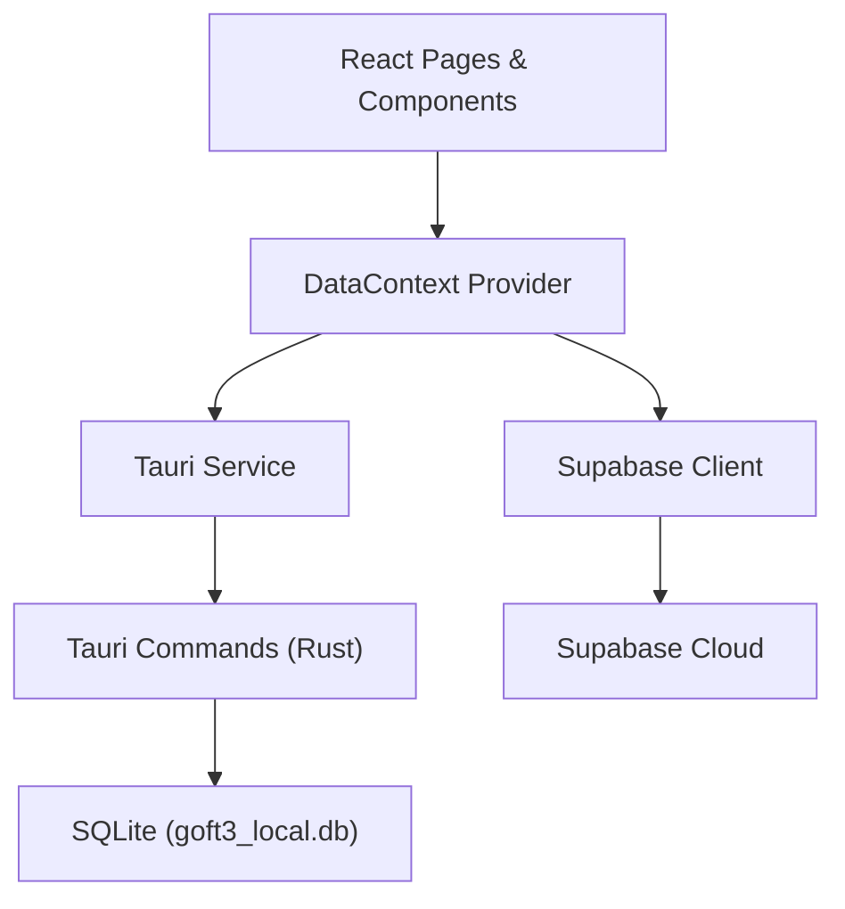
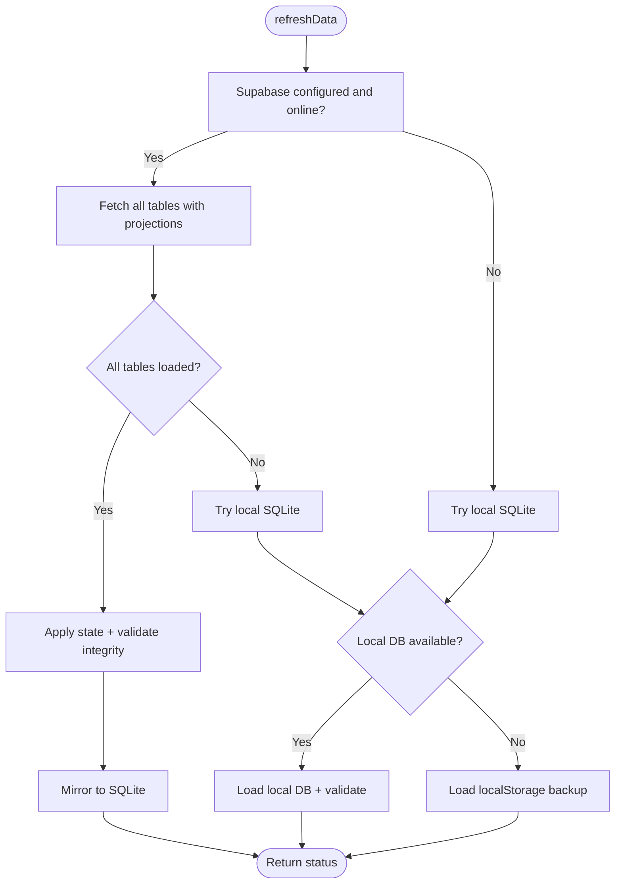
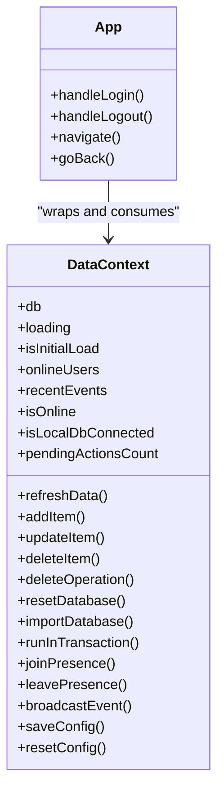
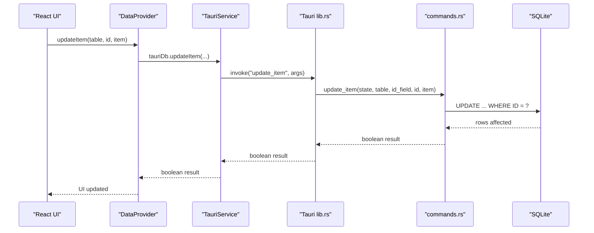
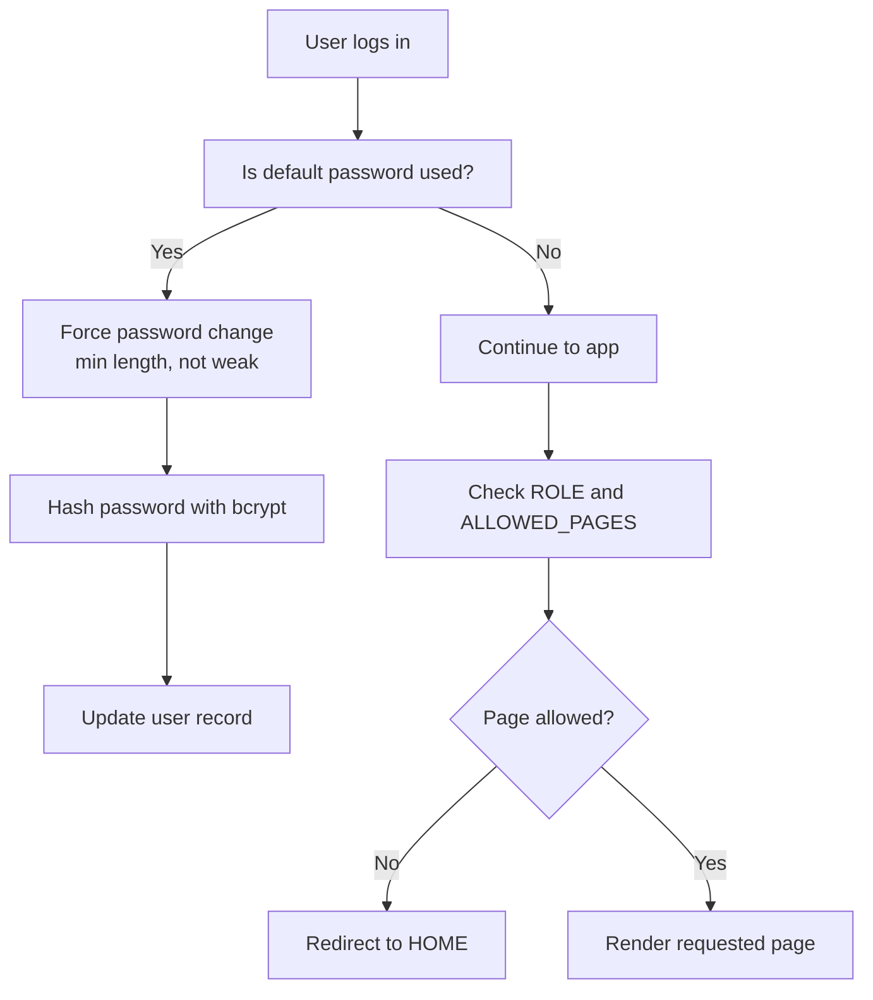
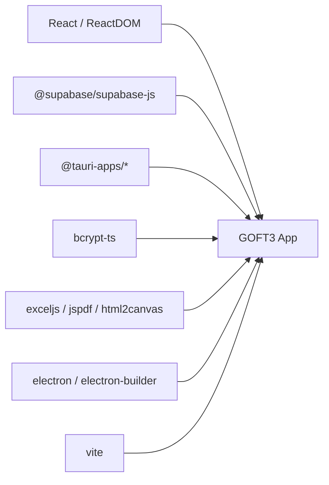

# System Architecture

<cite>
**Referenced Files in This Document**
- [package.json](file://package.json)
- [App.tsx](file://App.tsx)
- [index.tsx](file://index.tsx)
- [electron.js](file://electron.js)
- [src-tauri/Cargo.toml](file://src-tauri/Cargo.toml)
- [src-tauri/tauri.conf.json](file://src-tauri/tauri.conf.json)
- [context/DataContext.tsx](file://context/DataContext.tsx)
- [services/supabaseClient.ts](file://services/supabaseClient.ts)
- [services/tauriService.ts](file://services/tauriService.ts)
- [src-tauri/src/lib.rs](file://src-tauri/src/lib.rs)
- [src-tauri/src/commands.rs](file://src-tauri/src/commands.rs)
</cite>

## Table of Contents
1. [Introduction](#introduction)
2. [Project Structure](#project-structure)
3. [Core Components](#core-components)
4. [Architecture Overview](#architecture-overview)
5. [Detailed Component Analysis](#detailed-component-analysis)
6. [Dependency Analysis](#dependency-analysis)
7. [Performance Considerations](#performance-considerations)
8. [Troubleshooting Guide](#troubleshooting-guide)
9. [Conclusion](#conclusion)

## Introduction
GOFT3 is a hybrid desktop application for financial operations management. It combines a React frontend with a dual runtime backend: Tauri for native performance and Electron for compatibility. The system implements an offline-first data strategy, provider-based state management, and a service-layer abstraction over Supabase cloud storage and a local SQLite database. Cross-cutting concerns include password hashing, role-based permissions, real-time presence monitoring, and disaster recovery through encrypted backups and local caching.

## Project Structure
The repository follows a feature-oriented layout:
- `pages` contains route-level screens such as login, operations, documents, reports, and print views.
- `components` provides reusable UI primitives like modals, forms, rows, and global search.
- `context` holds React context providers for data, language, and toast notifications.
- `services` abstracts external integrations: Supabase client configuration and Tauri command invocation.
- `src-tauri` contains the Rust backend, including commands, database initialization, and security utilities.
- `utils` includes authentication helpers, currency/date utilities, export tools, and update logic.
- Root files configure Vite, TypeScript, Tailwind, ESLint, and both Tauri and Electron packaging.

**Diagram sources**
- [index.tsx:92-102](file://index.tsx#L92-L102)
- [App.tsx:547-783](file://App.tsx#L547-L783)
- [context/DataContext.tsx:133-800](file://context/DataContext.tsx#L133-L800)
- [services/supabaseClient.ts:1-37](file://services/supabaseClient.ts#L1-L37)
- [services/tauriService.ts:1-102](file://services/tauriService.ts#L1-L102)
- [electron.js:1-73](file://electron.js#L1-L73)
- [src-tauri/tauri.conf.json:1-56](file://src-tauri/tauri.conf.json#L1-L56)
- [src-tauri/src/lib.rs:1-48](file://src-tauri/src/lib.rs#L1-L48)
- [src-tauri/src/commands.rs:1-791](file://src-tauri/src/commands.rs#L1-L791)

**Section sources**
- [package.json:1-137](file://package.json#L1-L137)
- [index.tsx:1-102](file://index.tsx#L1-L102)
- [App.tsx:1-783](file://App.tsx#L1-L783)
- [electron.js:1-73](file://electron.js#L1-L73)
- [src-tauri/tauri.conf.json:1-56](file://src-tauri/tauri.conf.json#L1-L56)

## Core Components
- Application shell and routing: `App.tsx` manages authentication state, page navigation, idle lock, update prompts, and wraps providers.
- Data provider: `context/DataContext.tsx` centralizes database state, online/offline sync, pending actions, presence, integrity checks, and backup strategies.
- Service abstractions:
  - `services/supabaseClient.ts` configures the Supabase client based on stored credentials.
  - `services/tauriService.ts` exposes safe wrappers to invoke Tauri commands for local SQLite operations.
- Desktop runtimes:
  - `electron.js` creates the Electron window, loads the built app, and applies security settings.
  - `src-tauri/src/lib.rs` initializes plugins, database state, and registers Tauri commands.
  - `src-tauri/src/commands.rs` implements secure CRUD, import/export, backup encryption, and window control commands.

Key responsibilities:
- Offline-first synchronization prioritizes local SQLite when cloud is unavailable.
- Provider-based state ensures consistent UI updates across pages.
- Service layer isolates platform-specific calls from business logic.

**Section sources**
- [App.tsx:547-783](file://App.tsx#L547-L783)
- [context/DataContext.tsx:133-800](file://context/DataContext.tsx#L133-L800)
- [services/supabaseClient.ts:1-37](file://services/supabaseClient.ts#L1-L37)
- [services/tauriService.ts:1-102](file://services/tauriService.ts#L1-L102)
- [electron.js:1-73](file://electron.js#L1-L73)
- [src-tauri/src/lib.rs:1-48](file://src-tauri/src/lib.rs#L1-L48)
- [src-tauri/src/commands.rs:1-791](file://src-tauri/src/commands.rs#L1-L791)

## Architecture Overview
GOFT3 uses a layered architecture:
- Presentation layer: React components and pages render financial data and user workflows.
- State layer: Context providers manage application state, presence, and event broadcasting.
- Service layer: Supabase client handles cloud operations; Tauri service invokes native commands.
- Persistence layer: Local SQLite stores operational data for offline use; Supabase is the source of truth for collaboration.
- Native layer: Tauri/Rust commands perform secure file I/O, database operations, and window control.

**Diagram sources**
- [App.tsx:547-783](file://App.tsx#L547-L783)
- [context/DataContext.tsx:133-800](file://context/DataContext.tsx#L133-L800)
- [services/supabaseClient.ts:1-37](file://services/supabaseClient.ts#L1-L37)
- [services/tauriService.ts:1-102](file://services/tauriService.ts#L1-L102)
- [src-tauri/src/lib.rs:1-48](file://src-tauri/src/lib.rs#L1-L48)
- [src-tauri/src/commands.rs:1-791](file://src-tauri/src/commands.rs#L1-L791)

## Detailed Component Analysis

### Hybrid Runtime Design: Tauri vs Electron
GOFT3 supports two desktop runtimes:
- Tauri: Preferred for native performance, smaller footprint, and secure command execution.
- Electron: Maintained for compatibility and broader ecosystem support.

Runtime detection and behavior:
- `services/tauriService.ts` detects Tauri environment and conditionally invokes native commands.
- `App.tsx` disables the native close button via Tauri to avoid WebView hang issues and closes the app explicitly.
- `electron.js` sets up a secure BrowserWindow with context isolation and no Node integration in the renderer.

Trade-offs:
- Tauri offers better startup time and memory usage but requires Rust toolchain and platform-specific builds.
- Electron simplifies distribution and debugging but increases bundle size and resource consumption.
- Dual-runtime maintenance introduces complexity in command availability and error handling.

Constraints:
- Some features depend on Tauri plugins (dialog, updater, process). When running under Electron, those paths are skipped or stubbed.
- Window control and file I/O must be handled carefully to avoid blocking the renderer.

**Section sources**
- [services/tauriService.ts:1-102](file://services/tauriService.ts#L1-L102)
- [App.tsx:640-652](file://App.tsx#L640-L652)
- [electron.js:11-36](file://electron.js#L11-L36)
- [src-tauri/Cargo.toml:15-34](file://src-tauri/Cargo.toml#L15-L34)

### Offline-First Data Synchronization
The data provider implements a multi-tier fallback:
1. Try Supabase if configured and online.
2. Fall back to local SQLite via Tauri commands.
3. Load localStorage backup if neither cloud nor local DB is available.

Synchronization flow:
- On initial load, hydrate from local cache to make the app responsive immediately.
- Background refresh pulls fresh data from Supabase and mirrors it into SQLite.
- Pending actions queue ADD/UPDATE/DELETE operations and replay them when connectivity returns.
- Integrity validation detects broken foreign keys among operations, pieces, engagements, and payments.

**Diagram sources**
- [context/DataContext.tsx:490-690](file://context/DataContext.tsx#L490-L690)

Security and resilience:
- Column projections reduce payload size and improve fetch reliability.
- Unknown columns from cloud payloads are ignored during SQLite writes to prevent schema mismatches.
- Backup files can be AES-256-GCM encrypted with PBKDF2-derived keys; legacy plain JSON backups remain supported.

**Section sources**
- [context/DataContext.tsx:490-800](file://context/DataContext.tsx#L490-L800)
- [src-tauri/src/commands.rs:226-254](file://src-tauri/src/commands.rs#L226-L254)

### Provider-Based State Management
`context/DataContext.tsx` exposes:
- Database state split into light metadata and heavy lists (operations, engagements, payments).
- Methods to add, update, delete items, reset/import databases, and run transactions.
- Presence and event channels for real-time collaboration.
- Pending action queue for offline writes.

Provider composition:
- `App.tsx` wraps the application with QueryClientProvider, LanguageProvider, DataProvider, and ToastProvider.
- Pages consume data via `useData`, ensuring consistent access to the current database snapshot.

**Diagram sources**
- [context/DataContext.tsx:28-57](file://context/DataContext.tsx#L28-L57)
- [App.tsx:725-783](file://App.tsx#L725-L783)

**Section sources**
- [context/DataContext.tsx:1-800](file://context/DataContext.tsx#L1-L800)
- [App.tsx:725-783](file://App.tsx#L725-L783)

### Service Layer Abstraction
Two primary services abstract external dependencies:
- Supabase client:
  - Reads URL and key from localStorage.
  - Exposes a null-safe client instance and configuration helpers.
- Tauri service:
  - Detects Tauri runtime.
  - Wraps `@tauri-apps/api/core/invoke` with error logging.
  - Provides typed methods for database operations, backup I/O, and file exports.

This separation allows the data provider to call `supabase` or `tauriDb` without coupling to platform specifics.

**Section sources**
- [services/supabaseClient.ts:1-37](file://services/supabaseClient.ts#L1-L37)
- [services/tauriService.ts:1-102](file://services/tauriService.ts#L1-L102)

### Backend Services and Native Commands
Tauri backend:
- `src-tauri/src/lib.rs` initializes plugins (opener, dialog, updater, process), sets up the database connection, and registers commands.
- `src-tauri/src/commands.rs` implements:
  - Allowed table validation and identifier sanitization.
  - Read/write operations with column whitelisting.
  - Import/export of full datasets and Supabase-to-SQLite conversion.
  - Encrypted backup save/read using AES-256-GCM and PBKDF2.
  - Window controls to disable X button and close programmatically.
  - Binary file saving to bypass WebView download restrictions.

**Diagram sources**
- [context/DataContext.tsx:412-429](file://context/DataContext.tsx#L412-L429)
- [services/tauriService.ts:45-52](file://services/tauriService.ts#L45-L52)
- [src-tauri/src/lib.rs:26-44](file://src-tauri/src/lib.rs#L26-L44)
- [src-tauri/src/commands.rs:494-548](file://src-tauri/src/commands.rs#L494-L548)

**Section sources**
- [src-tauri/src/lib.rs:1-48](file://src-tauri/src/lib.rs#L1-L48)
- [src-tauri/src/commands.rs:1-791](file://src-tauri/src/commands.rs#L1-L791)

### Security: Password Hashing and Role-Based Permissions
Security measures:
- Default admin password enforcement forces users to set a strong password before continuing.
- Passwords are hashed locally using bcrypt before being persisted.
- Role-based access control restricts pages and operations based on user roles and allowed lists.

Implementation highlights:
- `App.tsx` validates default passwords and enforces minimum length and non-trivial values.
- `App.tsx` filters visible pages by role (`admin`, `viewer`) and per-user `ALLOWED_PAGES`.
- Record-level checks limit access to specific operations for non-admin users.

**Diagram sources**
- [App.tsx:99-140](file://App.tsx#L99-L140)
- [App.tsx:238-301](file://App.tsx#L238-L301)

**Section sources**
- [App.tsx:99-140](file://App.tsx#L99-L140)
- [App.tsx:238-301](file://App.tsx#L238-L301)

### Monitoring via Real-Time Presence
Presence and events:
- The data provider maintains online users and recent events.
- Users join presence on login and leave on logout.
- Event broadcasting enables cross-tab or cross-instance awareness.

Operational impact:
- Presence helps detect concurrent edits and coordinate synchronization.
- Recent events provide audit-like visibility into user actions.

**Section sources**
- [context/DataContext.tsx:324-343](file://context/DataContext.tsx#L324-L343)
- [App.tsx:183-236](file://App.tsx#L183-L236)

### Disaster Recovery Through Local Caching and Backups
Disaster recovery mechanisms:
- Local SQLite mirror keeps a copy of cloud data for offline use.
- localStorage backup stores a JSON snapshot of the database.
- Encrypted backups allow secure export/import with passphrase protection.
- Export utilities support SQLite snapshots and Supabase dataset conversion.

Recovery flow:
- If cloud fails, load local SQLite; if that fails, load localStorage backup.
- Administrators can export encrypted backups for archival and restore via import commands.

**Section sources**
- [context/DataContext.tsx:453-488](file://context/DataContext.tsx#L453-L488)
- [context/DataContext.tsx:653-690](file://context/DataContext.tsx#L653-L690)
- [src-tauri/src/commands.rs:226-254](file://src-tauri/src/commands.rs#L226-L254)
- [src-tauri/src/commands.rs:256-405](file://src-tauri/src/commands.rs#L256-L405)

## Dependency Analysis
External dependencies and their roles:
- React and React DOM power the UI.
- Supabase JS client connects to the cloud database.
- Tauri API and plugins enable native capabilities.
- bcrypt-ts hashes passwords locally.
- ExcelJS, jspdf, html2canvas support export and printing.
- Electron and electron-builder package the web app for Windows/Linux.

Build and distribution:
- Vite builds the frontend; Tauri CLI integrates with npm scripts.
- Electron builder targets NSIS for Windows and DEB for Linux.
- Tauri bundler creates installers and updater artifacts.

**Diagram sources**
- [package.json:33-99](file://package.json#L33-L99)
- [package.json:100-135](file://package.json#L100-L135)

**Section sources**
- [package.json:1-137](file://package.json#L1-L137)

## Performance Considerations
- Code splitting: Pages are lazy-loaded to minimize initial bundle size.
- Query caching: React Query client configures stale and garbage collection times to reduce refetches.
- Column projections: Only necessary columns are fetched from Supabase to reduce network payload.
- Split state: Heavy lists (operations, engagements, payments) are separated from metadata to improve reactivity.
- Batched imports: SQLite import disables foreign key checks during bulk load and re-enables afterward.
- Idle lock: Auto-lock after inactivity reduces risk of unattended sessions.

Recommendations:
- Monitor large table sizes and consider pagination or incremental sync for very large datasets.
- Profile Tauri command latency for frequent operations and batch where possible.
- Use presence sparingly in high-concurrency environments to avoid excessive channel traffic.

[No sources needed since this section provides general guidance]

## Troubleshooting Guide
Common issues and resolutions:
- Supabase configuration missing:
  - Ensure URL and key are stored in localStorage; the client will be null otherwise.
  - Reset configuration to clear invalid entries.
- Network errors during sync:
  - The data provider detects network errors and falls back to local cache.
  - Pending actions pause on connection errors and resume when connectivity returns.
- Local SQLite unavailable:
  - Verify Tauri runtime and database initialization.
  - Check connection error messages from the data provider.
- Backup decryption failures:
  - Confirm passphrase meets minimum length and matches the encrypted backup.
  - Legacy plain JSON backups do not require a passphrase.
- Window close hangs:
  - Disable the native close button via Tauri and use explicit in-app close.
  - Avoid synchronous native dialogs that may freeze the renderer.

**Section sources**
- [services/supabaseClient.ts:14-37](file://services/supabaseClient.ts#L14-L37)
- [context/DataContext.tsx:113-131](file://context/DataContext.tsx#L113-L131)
- [context/DataContext.tsx:627-690](file://context/DataContext.tsx#L627-L690)
- [src-tauri/src/commands.rs:238-254](file://src-tauri/src/commands.rs#L238-L254)
- [App.tsx:640-652](file://App.tsx#L640-L652)

## Conclusion
GOFT3’s architecture balances performance, reliability, and security through a hybrid desktop design. The React frontend benefits from provider-based state management and service-layer abstractions, while Tauri delivers native performance and Electron ensures broad compatibility. Offline-first synchronization guarantees continuity, and robust security controls protect sensitive financial data. Infrastructure requirements center on Supabase integration, with scalable considerations for multi-user collaboration and deployment topology supporting both Tauri and Electron distributions.

[No sources needed since this section summarizes without analyzing specific files]