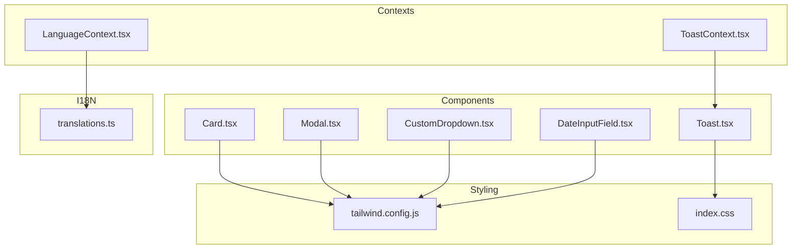
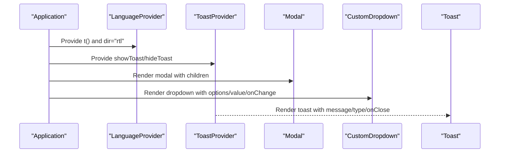
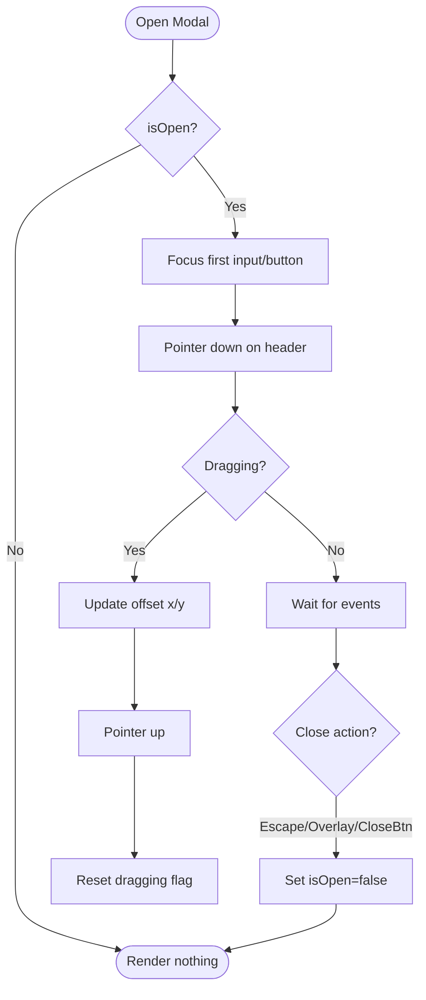
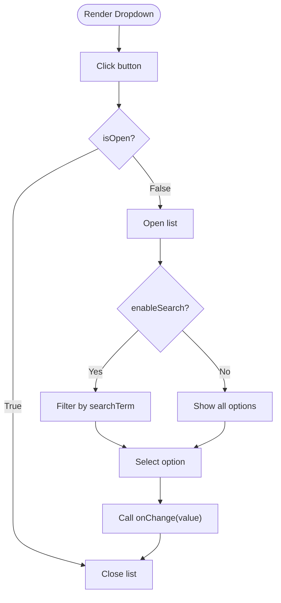
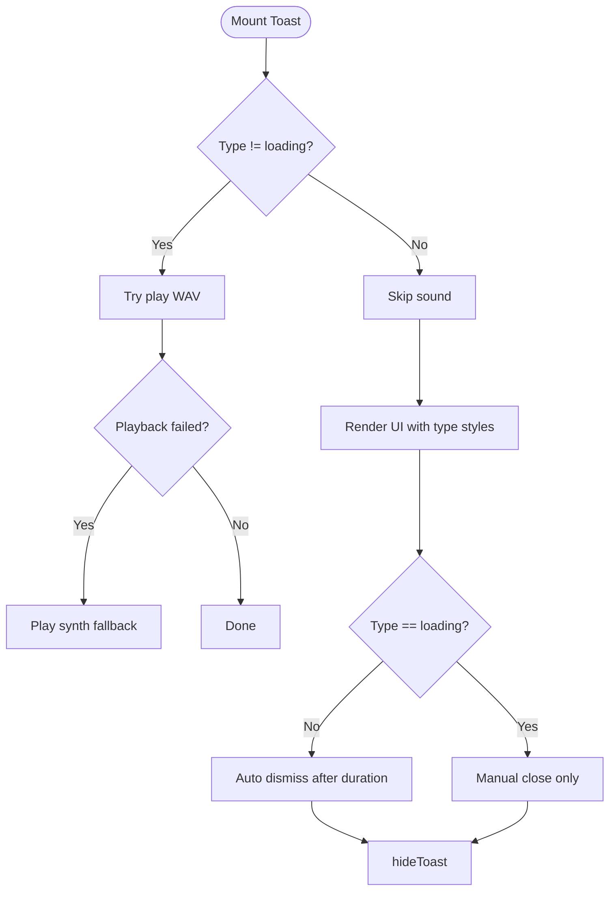
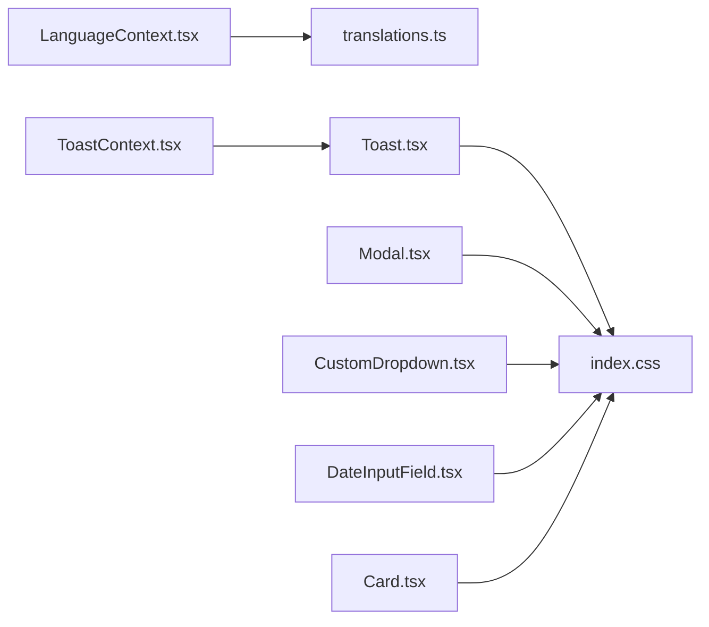

# UI Components Library

<cite>
**Referenced Files in This Document**
- [Card.tsx](file://components/Card.tsx)
- [Modal.tsx](file://components/Modal.tsx)
- [CustomDropdown.tsx](file://components/CustomDropdown.tsx)
- [DateInputField.tsx](file://components/DateInputField.tsx)
- [Toast.tsx](file://components/Toast.tsx)
- [LoadingToast.tsx](file://components/LoadingToast.tsx)
- [LanguageContext.tsx](file://context/LanguageContext.tsx)
- [translations.ts](file://i18n/translations.ts)
- [ToastContext.tsx](file://context/ToastContext.tsx)
- [tailwind.config.js](file://tailwind.config.js)
- [index.css](file://index.css)
</cite>

## Table of Contents
1. [Introduction](#introduction)
2. [Project Structure](#project-structure)
3. [Core Components](#core-components)
4. [Architecture Overview](#architecture-overview)
5. [Detailed Component Analysis](#detailed-component-analysis)
6. [Dependency Analysis](#dependency-analysis)
7. [Performance Considerations](#performance-considerations)
8. [Troubleshooting Guide](#troubleshooting-guide)
9. [Conclusion](#conclusion)

## Introduction
This document describes GOFT3’s UI components library focused on reusable interface elements. It covers visual appearance, behavior, user interaction patterns, props and attributes, events, slots (children), customization options via Tailwind CSS, accessibility considerations, internationalization for Arabic RTL, component states (loading, error, success), animations, cross-browser compatibility, performance optimization for large lists and complex forms, composition patterns, and integration with React Context for global state management.

## Project Structure
The UI components live under the components directory and are styled using Tailwind CSS classes defined in index.css and extended via tailwind.config.js. Internationalization is provided through a Language context and translation dictionary. Toast notifications are managed via a dedicated context that renders the Toast component.

**Diagram sources**
- [Card.tsx:1-28](file://components/Card.tsx#L1-L28)
- [Modal.tsx:1-158](file://components/Modal.tsx#L1-L158)
- [CustomDropdown.tsx:1-121](file://components/CustomDropdown.tsx#L1-L121)
- [DateInputField.tsx:1-47](file://components/DateInputField.tsx#L1-L47)
- [Toast.tsx:1-196](file://components/Toast.tsx#L1-L196)
- [LanguageContext.tsx:1-58](file://context/LanguageContext.tsx#L1-L58)
- [translations.ts:1-323](file://i18n/translations.ts#L1-L323)
- [ToastContext.tsx:1-97](file://context/ToastContext.tsx#L1-L97)
- [tailwind.config.js:1-21](file://tailwind.config.js#L1-L21)
- [index.css:1-166](file://index.css#L1-L166)

**Section sources**
- [tailwind.config.js:1-21](file://tailwind.config.js#L1-L21)
- [index.css:1-166](file://index.css#L1-L166)

## Core Components
GOFT3 provides a small set of focused UI primitives designed for financial administration workflows in Arabic RTL environments:

- Card: Compact or standard metric card with icon, title, value, and color accent. Supports compact mode and large-value typography.
- Modal: Draggable dialog with keyboard support, focus management, overlay click-to-close, and configurable width.
- CustomDropdown: Searchable select with placeholder, disabled state, and custom className injection.
- DateInputField: Text-based date input with auto-slash formatting, min/max constraints, and LTR direction enforcement for numeric dates.
- Toast: Animated notification with multiple types (success, error, info, event, loading), sound feedback, and progress bar for loading.

These components are styled with Tailwind utility classes and integrate with global styles and animations defined in index.css.

**Section sources**
- [Card.tsx:1-28](file://components/Card.tsx#L1-L28)
- [Modal.tsx:1-158](file://components/Modal.tsx#L1-L158)
- [CustomDropdown.tsx:1-121](file://components/CustomDropdown.tsx#L1-L121)
- [DateInputField.tsx:1-47](file://components/DateInputField.tsx#L1-L47)
- [Toast.tsx:1-196](file://components/Toast.tsx#L1-L196)

## Architecture Overview
The UI layer composes components that consume global contexts for language and toast notifications. The Language provider enforces Arabic RTL and supplies a translation function. The Toast provider manages toasts and emits real-time event toasts based on recent activity.

**Diagram sources**
- [LanguageContext.tsx:1-58](file://context/LanguageContext.tsx#L1-L58)
- [ToastContext.tsx:1-97](file://context/ToastContext.tsx#L1-L97)
- [Modal.tsx:1-158](file://components/Modal.tsx#L1-L158)
- [CustomDropdown.tsx:1-121](file://components/CustomDropdown.tsx#L1-L121)
- [Toast.tsx:1-196](file://components/Toast.tsx#L1-L196)

## Detailed Component Analysis

### Card
Visual appearance:
- White background with subtle border and shadow.
- Icon container with colored background; icon size adapts to compact mode.
- Title in uppercase small text; value in bold, responsive font size.

Behavior:
- Displays static metrics; no interactive state.
- Supports compact layout and large-value display.

Props:
- Required: title, value, icon, color
- Optional: compact (boolean), isLargeValue (boolean)

Usage example path:
- See usage in pages where cards render metrics (e.g., dashboard).

Accessibility:
- Semantic structure uses headings and paragraphs; ensure meaningful titles.

Internationalization:
- Use t() from LanguageContext for labels if needed.

Tailwind customization:
- Modify colors, spacing, and typography via Tailwind classes in the component.

**Section sources**
- [Card.tsx:1-28](file://components/Card.tsx#L1-L28)

### Modal
Visual appearance:
- Fullscreen overlay with centered content box.
- Header with title and optional close button.
- Scrollable body area.

Behavior:
- Draggable by pointer events on header.
- Closes on Escape key and optionally on overlay click.
- Focus management: focuses first editable element or primary button when opened.
- Width controlled via maxWidth prop mapped to Tailwind max-width utilities.

Props:
- Required: isOpen, onClose, title, children
- Optional: maxWidth ('sm' | 'md' | 'lg' | 'xl' | '2xl' | '3xl' | '4xl' | '5xl' | '6xl' | '7xl' | 'full'), closeOnOverlay (boolean), hideCloseButton (boolean)

Events:
- onClose triggered by close button, overlay click (if enabled), or Escape key.

Slots:
- children: any ReactNode rendered inside the modal body.

Accessibility:
- aria-modal="true", role="dialog", focus trapping logic, and accessible close label.

Animations:
- Smooth transform transitions when dragging; no external animation library used.

Tailwind customization:
- Adjust width classes via maxWidth mapping; customize header/body styles as needed.

**Diagram sources**
- [Modal.tsx:20-58](file://components/Modal.tsx#L20-L58)
- [Modal.tsx:60-94](file://components/Modal.tsx#L60-L94)
- [Modal.tsx:113-153](file://components/Modal.tsx#L113-L153)

**Section sources**
- [Modal.tsx:1-158](file://components/Modal.tsx#L1-L158)

### CustomDropdown
Visual appearance:
- Pill-shaped button with chevron indicator.
- Dropdown panel with search input and scrollable list.
- Selected item highlighted with checkmark.

Behavior:
- Toggle open/close on button click.
- Click outside closes dropdown and clears search.
- Optional search filtering by label.
- Placeholder option allows clearing selection.

Props:
- Required: options (array of {value, label}), value (string | number), onChange(value: string)
- Optional: placeholder (string), disabled (boolean), className (string), enableSearch (boolean)

Events:
- onChange invoked with selected value string.

Slots:
- None; content composed via options array.

Accessibility:
- Uses native button and list items; ensure keyboard navigation and screen reader labels if extended.

Internationalization:
- Use t() for placeholder and empty results messages if needed.

Tailwind customization:
- className prop allows overriding wrapper styles; internal styles use Tailwind utilities.

**Diagram sources**
- [CustomDropdown.tsx:18-41](file://components/CustomDropdown.tsx#L18-L41)
- [CustomDropdown.tsx:43-49](file://components/CustomDropdown.tsx#L43-L49)
- [CustomDropdown.tsx:51-117](file://components/CustomDropdown.tsx#L51-L117)

**Section sources**
- [CustomDropdown.tsx:1-121](file://components/CustomDropdown.tsx#L1-L121)

### DateInputField
Visual appearance:
- Centered input with rounded pill shape and subtle border.
- Label above input.

Behavior:
- Accepts digits and slashes; auto-inserts slashes at positions 2 and 5.
- Limits length to 10 characters.
- Enforces LTR direction internally to prevent date scrambling in RTL contexts.

Props:
- Required: value (string), onChange(value: string), label (string)
- Optional: required (boolean), id (string), className (string), min (string), max (string)

Events:
- onChange invoked with formatted date string.

Accessibility:
- Associates label with input via htmlFor/id.

Internationalization:
- Placeholder remains numeric format; consider localizing label via t().

Tailwind customization:
- className prop allows overriding default styles.

**Section sources**
- [DateInputField.tsx:1-47](file://components/DateInputField.tsx#L1-L47)

### Toast
Visual appearance:
- Top-centered notification with left/right alignment centering.
- Colored accent bar and icon badge per type.
- Progress bar for loading state.

Behavior:
- Plays notification sounds for non-loading types; fallback synth audio if files unavailable.
- Auto-dismiss after duration (event: 5s, others: 3s); loading stays until closed.
- Renders different styles per type: success, error, info, event, loading.

Props:
- Required: message (string), type ('success' | 'error' | 'info' | 'loading' | 'event'), onClose () => void

Events:
- onClose triggered by close button.

States:
- Success, Error, Info, Event, Loading with distinct visuals and behaviors.

Internationalization:
- Titles and labels are localized within the component; can be extended via t().

Animations:
- Slide-down entrance; bounce-in-right for event type; spinning icon for loading; animated progress bar.

Sound handling:
- Prefers WAV files with WebAudio fallback.

Tailwind customization:
- Styles rely on Tailwind utilities; extend via index.css animations.

**Diagram sources**
- [Toast.tsx:87-107](file://components/Toast.tsx#L87-L107)
- [Toast.tsx:142-196](file://components/Toast.tsx#L142-L196)

**Section sources**
- [Toast.tsx:1-196](file://components/Toast.tsx#L1-L196)

### Toast Provider Integration
The ToastProvider manages toast state and integrates with real-time events to show event-type toasts automatically.

Key responsibilities:
- Expose showToast(message, type) and hideToast().
- Auto-dismiss non-loading toasts after configured durations.
- Sync with recentEvents to emit event toasts with user action summaries.

Integration pattern:
- Wrap application with ToastProvider.
- Consume useToast() hook to trigger toasts from components.

**Section sources**
- [ToastContext.tsx:1-97](file://context/ToastContext.tsx#L1-L97)

### Language Provider and Internationalization
The LanguageProvider sets document direction to RTL, applies Cairo font, and exposes a translation function t(key, params).

Responsibilities:
- Force Arabic locale and RTL direction.
- Provide t() with parameter substitution.
- Ensure consistent font styling across the app.

Usage:
- Wrap application with LanguageProvider.
- Use useLanguage() to access t() and dir.

**Section sources**
- [LanguageContext.tsx:1-58](file://context/LanguageContext.tsx#L1-L58)
- [translations.ts:1-323](file://i18n/translations.ts#L1-L323)

## Dependency Analysis
Component-level dependencies:
- Toast depends on index.css for animations and Tailwind utilities.
- Modal relies on pointer events and DOM APIs for drag and focus management.
- CustomDropdown uses refs and event listeners for outside clicks and search focus.
- DateInputField uses HTML input attributes and inline style for direction control.
- LanguageContext depends on translations dictionary.
- ToastContext depends on Toast component and DataContext for recent events.

**Diagram sources**
- [LanguageContext.tsx:1-58](file://context/LanguageContext.tsx#L1-L58)
- [translations.ts:1-323](file://i18n/translations.ts#L1-L323)
- [ToastContext.tsx:1-97](file://context/ToastContext.tsx#L1-L97)
- [Toast.tsx:1-196](file://components/Toast.tsx#L1-L196)
- [index.css:1-166](file://index.css#L1-L166)
- [Modal.tsx:1-158](file://components/Modal.tsx#L1-L158)
- [CustomDropdown.tsx:1-121](file://components/CustomDropdown.tsx#L1-L121)
- [DateInputField.tsx:1-47](file://components/DateInputField.tsx#L1-L47)
- [Card.tsx:1-28](file://components/Card.tsx#L1-L28)

**Section sources**
- [tailwind.config.js:1-21](file://tailwind.config.js#L1-L21)
- [index.css:1-166](file://index.css#L1-L166)

## Performance Considerations
- Large lists: Prefer virtualization libraries (e.g., react-window) for long option lists in CustomDropdown or table rows. Current implementation filters options client-side; consider memoization and debounced search for large datasets.
- Complex forms: Use form libraries (e.g., react-hook-form) to manage validation and reduce re-renders. Avoid heavy computations in render paths; move to useMemo/useCallback.
- Animations: Prefer CSS animations over JS-driven ones; index.css defines efficient keyframes. Avoid excessive transforms during drag; Modal already disables transition while dragging.
- Audio: Toast uses cached Audio instances and WebAudio fallback; keep volume low and avoid frequent instantiation.
- Accessibility: Ensure focus management and keyboard navigation remain performant; Modal’s focus trap is lightweight.

[No sources needed since this section provides general guidance]

## Troubleshooting Guide
Common issues and resolutions:
- Modal not closing on overlay click: Verify closeOnOverlay prop is true and onClick handler is attached to overlay.
- Dropdown not closing on outside click: Ensure wrapperRef is present and mousedown listener is active.
- Date input formatting incorrect: Confirm onChange updates value correctly and direction is enforced via inline style.
- Toast not playing sound: Check browser autoplay policies; fallback synth will attempt playback.
- RTL misalignment: Ensure LanguageProvider sets document.dir='rtl' and body class font-cairo applied.

**Section sources**
- [Modal.tsx:20-58](file://components/Modal.tsx#L20-L58)
- [CustomDropdown.tsx:24-41](file://components/CustomDropdown.tsx#L24-L41)
- [DateInputField.tsx:14-46](file://components/DateInputField.tsx#L14-L46)
- [Toast.tsx:87-107](file://components/Toast.tsx#L87-L107)
- [LanguageContext.tsx:13-24](file://context/LanguageContext.tsx#L13-L24)

## Conclusion
GOFT3’s UI components provide a cohesive, accessible, and RTL-first design system tailored for Arabic-language financial applications. They leverage Tailwind CSS for styling, global CSS for animations, and React Context for language and toast management. By following the guidelines here—props usage, accessibility practices, internationalization, and performance tips—you can compose robust interfaces that scale to complex forms and large datasets while maintaining a consistent user experience.

[No sources needed since this section summarizes without analyzing specific files]